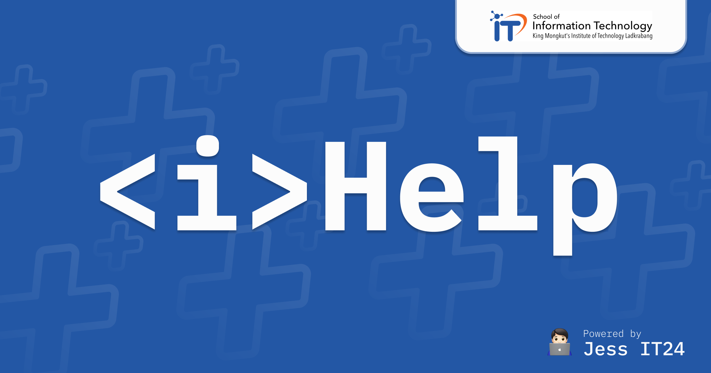

# \<i\>Help

> **ศูนย์รวมสื่อการเรียนรู้ สรุปบทเรียน คลังข้อสอบ และเครื่องมือช่วยเรียนสำหรับนักศึกษาคณะเทคโนโลยีสารสนเทศ สจล. (IT KMITL)**
>
> 🌐 เว็บไซต์จริง: **[ihelp.chatan.in.th](https://ihelp.chatan.in.th)**

<p align="center">
  
</p>

<p align="left">
  
  
  
  
  
  
</p>

---

## เกี่ยวกับ iHelp

**\<i\>Help** ถูกสร้างขึ้นโดยนักศึกษาไอทีลาดกระบัง เพื่อเป็นพื้นที่กลางในการรวบรวมและแบ่งปันสื่อการเรียนการสอน สไลด์บรรยาย ใบงานแล็บ ชีทสรุปเตรียมสอบ ตารางสอบรายบุคคล ตลอดจนเครื่องมือช่วยคำนวณคะแนนตามเกณฑ์วิชาจริง เพื่อให้เพื่อน ๆ และรุ่นน้องทุกคนสามารถเข้าถึงแหล่งเรียนรู้ที่มีคุณภาพได้อย่างสะดวกรวดเร็ว

ดีไซน์ของเว็บไซต์ได้รับแรงบันดาลใจจากธีมมืดระดับโปรสไตล์ **Figma Neutral Charcoal** อ่านสบายตา คมชัด และเป็นระเบียบ

---

## 📊 สถิติคลังสื่อการเรียนรู้ (Platform Statistics)

<!-- stats:start -->
| 📚 รายวิชาในระบบ | 🗂️ วิชามีคลังสื่อ | 📄 การ์ดสื่อการเรียน | 💾 ไฟล์เอกสารจริง | 📖 จำนวนหน้าเอกสาร | 🗓️ อัปเดตล่าสุด |
|:---:|:---:|:---:|:---:|:---:|:---:|
| **15** วิชา | **14** วิชา | **741** รายการ | **724** ไฟล์ | **13,593** หน้า | พฤศจิกายน 2569 |
<!-- stats:end -->

---

## ไฮไลต์ฟีเจอร์เด่น (Key Features)

| หมวดหมู่ฟีเจอร์ | รายละเอียดความสามารถ | ทางลัด / เข้าชม |
|:---|:---|:---:|
| 📚 **คลังสื่อการเรียนรู้และฮับรายวิชา**<br>*(Course Hubs & Library)* | รวบรวมสไลด์ เอกสารแล็บ และสรุปรายสัปดาห์ของ 15 รายวิชา จัดเรียงตามคาบเรียนและสัปดาห์ พร้อมฟิลเตอร์แยกเนื้อหากลางภาค/ปลายภาค | [`/courses`](https://ihelp.chatan.in.th/courses) |
| 📅 **ตารางสอบและผังที่นั่งสอบรายบุคคล**<br>*(Exam Schedule & Seating Map)* | ค้นหากำหนดการสอบ ห้องสอบ และเลขที่นั่งสอบรายวิชาด้วยรหัสนักศึกษา 8 หลัก พร้อมแสดงผลบน Interactive Seating Map เสมือนจริงในห้องเรียน และส่งออกปฏิทิน (.ics) ได้ทันที | [`/exam-schedule`](https://ihelp.chatan.in.th/exam-schedule) |
| 🧮 **ระบบคำนวณคะแนนและตัดเกรด**<br>*(Grade & Exam Score Calculator)* | แม่แบบสัดส่วนคะแนน 7 รายวิชาหลัก ปี 1 เทอม 1 พร้อมคำนวณนิพจน์เลขสดในช่อง (`10+5+8.5`), วางคะแนนจาก Excel/TSV, ตัดเกรดคงที่ A–F และ S/U, และจำลองคะแนนสอบ Final ขั้นต่ำที่ต้องทำเพื่อคว้าเกรดเป้าหมาย | [`/grade-calculator`](https://ihelp.chatan.in.th/grade-calculator) |
| 🤖 **Help Desk Chat Widget**<br>*(Instant AI Assistant)* | ปุ่มแชตผู้ช่วยมุมขวาล่างของทุกหน้า ตอบคำถามการใช้งานทันใจด้วยคลัง FAQ คัดสรรกว่า 75 ข้อ ค้นหาไฟล์ในคลังรายวิชาแบบเรียลไทม์ และระบบตอบคำถามด้วย AI | *มีในทุกหน้าเว็บ* |
| ⏱️ **พื้นที่อ่านหนังสือโฟกัส**<br>*(Focus Study Space)* | หน้าจอโฟกัสพร้อมตัวจับเวลาอ่านหนังสือ/พักผ่อนขนาดใหญ่ โหมด Standby/Fullscreen และระบบติดตามโควตาอ่านสอบปลายภาค 22 วัน (112 ชั่วโมง) | [`/profile`](https://ihelp.chatan.in.th) |

---

## 🤝 ร่วมเป็นส่วนหนึ่งของ iHelp (Welcome Contributors!)

ไม่ว่าคุณจะเป็นนักศึกษาชั้นปีไหน มีชีทสรุปที่เคยจดไว้ อยากแบ่งปันบันทึกเลกเชอร์ หรืออยากฝึกฝนทักษะการพัฒนาเว็บด้วย Next.js 16 + React 19 **เรายินดีต้อนรับทุกคนครับ!**

- 📖 **[อ่านคู่มือการร่วมพัฒนา (Contributing Guide)](./CONTRIBUTING.md)** — กติกาง่าย ๆ 3 ข้อในการส่งโค้ดหรือเนื้อหา
- 📝 **[วิธีส่งชีทสรุปและเอกสารเข้าคลัง (Dropzone SOP)](./docs/DROPZONE_SOP.md)** — สำหรับเพื่อน ๆ ที่ต้องการแชร์ชีทสรุป
- 👥 **[ดูทีมผู้พัฒนาบนเว็บไซต์](https://ihelp.chatan.in.th/version)** — ร่วมส่งผลงานและรับเครดิตบนหน้าประวัติของเว็บ

---

## 🚀 เริ่มต้นใช้งานในเครื่อง (Quickstart)

```bash
git clone https://github.com/Jesselpetry/ihelp.git
cd ihelp
git checkout staging         # กิ่งหลักในการพัฒนา
bun install                  # ติดตั้ง dependencies
bun run dev                  # เปิดเว็บที่ http://localhost:3000
```

> **ข้อแนะนำ:** สำหรับการตั้งค่าตัวแปรสภาพแวดล้อม (`.env.local`) และการเชื่อมต่อ Supabase / Database สามารถอ่านเพิ่มเติมได้ที่ [คู่มือเทคนิคฉบับเต็ม](./docs/FULL_README.md)

---

## 📚 ศูนย์รวมเอกสารฉบับเต็ม (Documentation Hub)

เอกสารสเปกเชิงลึกและคู่มือสำหรับนักพัฒนา/AI Agent ถูกจัดเก็บไว้อย่างเป็นระเบียบในโฟลเดอร์ [`docs/`](./docs/):

| เอกสาร | รายละเอียด |
|---|---|
| 📖 **[FULL_README.md](./docs/FULL_README.md)** | คู่มือทางเทคนิคฉบับเต็ม, ตาราง `.env.local`, สถาปัตยกรรม Tech Stack, และคำสั่งตรวจความถูกต้อง |
| 🤝 **[FULL_CONTRIBUTING.md](./docs/FULL_CONTRIBUTING.md)** | ข้อกำหนดการส่ง PR อย่างละเอียด, การจัดหมวดหมู่สื่อ, กฎสิทธิ์การเข้าถึง, และ Commit Convention |
| 🗂️ **[docs/FILE_STRUCTURE.md](./docs/FILE_STRUCTURE.md)** | แผนผังไดเรกทอรี, แหล่งความจริง (Source of truth) ของแต่ละโมดูล และกติกาการตั้งชื่อ |
| 🏛️ **[LIBRARY_ARCHITECTURE.md](./docs/LIBRARY_ARCHITECTURE_AND_WORKFLOW.md)** | วงจรชีวิตของคลังสื่อ, การทำงานของ Resource Index Dictionary, และคู่มือ Public API |
| 🛡️ **[QUARANTINE_AND_EXAMS.md](./docs/QUARANTINE_AND_EXAMS_AUDIT.md)** | รายงานตรวจสอบความปลอดภัย, ไฟล์ในระบบกักกัน (Quarantine), และแนวทางให้เครดิตรุ่นพี่ |
| 👥 **[CONTRIBUTOR_SYSTEM.md](./docs/CONTRIBUTOR_SYSTEM.md)** | ระบบ Contributor Credit, สถาปัตยกรรมโปรไฟล์นักศึกษา, และระบบเลื่อนชั้นปีอัตโนมัติ |
| 🏷️ **[VERSION_CONTROL_GUIDE.md](./docs/VERSION_CONTROL_GUIDE.md)** | ระเบียบการกำหนดเลขเวอร์ชัน (SemVer), การบันทึก CHANGELOG, และการผูกข้อมูลหน้า `/version` |
| 🤖 **[AGENTS.md](./AGENTS.md)** | กฎระเบียบและแนวทางปฏิบัติสำคัญสำหรับ AI Coding Agents (Claude Code, Antigravity) |

---

## 👥 ทีมผู้พัฒนาและผู้มีส่วนร่วม (Core Team & Contributors)

แพลตฟอร์ม iHelp พัฒนาและดูแลโดยนักศึกษาคณะเทคโนโลยีสารสนเทศ สจล. ร่วมกับเพื่อน ๆ และรุ่นพี่ผู้ร่วมแบ่งปันเนื้อหา โดยมีรายละเอียดบทบาทและข้อมูลติดต่อดังนี้:

| โปรไฟล์ | ชื่อ-นามสกุล | รหัสนักศึกษา | อีเมลนักศึกษา (KMITL) | บทบาทและความรับผิดชอบหลัก | ช่องทางติดต่อ |
|:---:|:---|:---:|:---|:---|:---:|
| <a href="https://github.com/Jesselpetry"></a> | **Chatan Petry**<br>`@Jesselpetry` | `69070027` | `69070027@kmitl.ac.th` | **ผู้ก่อตั้งและผู้ดูแลหลัก (Lead Maintainer)**<br>สถาปัตยกรรมหลักของ iHelp, ระบบตัดเกรด, ธีมมืด Figma, คลังเอกสาร และเครื่องมือเตรียมสอบ | [GitHub](https://github.com/Jesselpetry)<br>[IG: @chatann_](https://instagram.com/chatann_) |
| <a href="https://github.com/PhuPunnavit"></a> | **Punnavit Tangkolchan**<br>`@PhuPunnavit` | `69070119` | `69070119@kmitl.ac.th` | **ผู้ร่วมพัฒนาหลัก (Core Contributor)**<br>ระบบ Help Desk Chat Widget และสรุปสไลด์บรรยาย ITF ฉบับแปลไทย Week 08–15 | [GitHub](https://github.com/PhuPunnavit)<br>[IG: @priiu_i](https://instagram.com/priiu_i) |
| <a href="https://github.com/PGTHEGOD"></a> | **Akarapach Yootsukprasert**<br>`@PGTHEGOD` | `69070225` | `69070225@kmitl.ac.th` | **ผู้ร่วมพัฒนา (Contributor)**<br>หน้า Landing Page และระบบเชื่อมต่อ PG IJUDGE Extension (`/pro`) | [GitHub](https://github.com/PGTHEGOD)<br>[IG: @pgthegod_x](https://instagram.com/pgthegod_x) |
| <a href="https://github.com/Meaookung144"></a> | **Kittinan Atthasiri**<br>`@Meaookung144` | `6907xxxx` | `6907xxxx@kmitl.ac.th` | **ผู้ร่วมพัฒนา (Contributor)**<br>ระบบฟอร์มแก้ไขไฟล์ส่งงาน PSCP และการเชื่อมต่อ GitHub | [GitHub](https://github.com/Meaookung144)<br>[IG: @meaookung144](https://instagram.com/meaookung144) |
|  | **Tammadon Suksa** | `69070082` | `69070082@kmitl.ac.th` | **ผู้ร่วมแบ่งปันเนื้อหา (Content Contributor)**<br>บันทึกสรุปการเรียน Notion วิชา ITF สัปดาห์ที่ 08–15 พร้อมภาพประกอบคำอธิบาย | [Notion Notes](https://app.notion.com/p/ITF-407363d85cea806abdc6c9ec2254f668) |

> 💡 **สำหรับผู้ร่วมพัฒนารายใหม่:** สามารถส่ง Pull Request เพื่อเพิ่มหรือปรับปรุงข้อมูลโปรไฟล์ รหัสนักศึกษา และอีเมลสถาบันของตนเองในตารางนี้ได้เมื่อมีส่วนร่วมในโครงการ

---

## License

เผยแพร่ภายใต้สัญญาอนุญาต [MIT License](./LICENSE)
