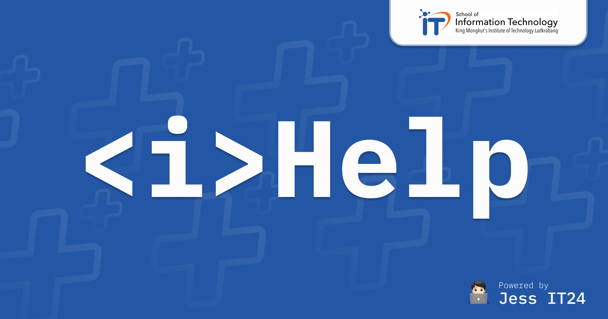

# \<i\>Help — คลังการเรียนรู้ IT KMITL



ศูนย์รวมสื่อการเรียนของนักศึกษา IT สจล. ปี 1 — สรุปเนื้อหา สไลด์บรรยาย ข้อสอบเก่า
แบบฝึกหัด และเครื่องมือสร้าง Learning Log ของวิชา PSCP รวมอยู่ในเว็บเดียว
ดีไซน์ตามสไตล์ [iJudge](https://ijudge.it.kmitl.ac.th) · เว็บจริง: <https://ihelp.chatan.in.th>

**15 รายวิชา (14 วิชามีคลังสื่อ) · 722 การ์ดสื่อการเรียน · 705 ไฟล์** — ณ 15 ต.ค. 2569
(ค่าปัจจุบัน: `jq .totals lib/library/resource-index.json`)

<p>
  
  
  
  
  
  
  
  
  
</p>

> เว็บนี้ไม่เขียนเนื้อหาแทนคุณ — เครื่องมือสร้างไฟล์ทุกตัวเก็บคำตอบที่คุณเขียนเอง
> แล้วจัดลง template ทางการของรายวิชา ไม่มีการส่งอะไรไปที่ OJ

> **AI agent:** เริ่มที่ [AGENTS.md](./AGENTS.md) — กฎที่พลาดง่าย ตาราง "แก้ที่ไหน" และวิธีค้นหาในคลัง

## วิธีรัน

ใช้ [Bun](https://bun.sh) เป็น package manager / script runner โดย Next.js รันบน Node (ต้องการ Node ≥ 20.9)

```bash
cd ihelp
bun install                  # ครั้งแรกครั้งเดียว
cp .env.example .env.local   # แล้วกรอกค่า — ดูตารางด้านล่าง
bun run dev                  # http://localhost:3000
```

หมายเหตุ: ห้ามใช้ `bun --bun next ...` — Next 16 build จะ crash บน Bun 1.2.x (SIGTRAP)

| ตัวแปรใน `.env.local` | ใช้กับ | ถ้าไม่ตั้ง |
| --- | --- | --- |
| `NEXT_PUBLIC_SUPABASE_URL` · `NEXT_PUBLIC_SUPABASE_ANON_KEY` | login, session (`proxy.ts` รันแทบทุก request), URL ของไฟล์ใน bucket | `proxy.ts` สร้าง Supabase client ไม่ได้ — แทบทุกหน้า error |
| `DATABASE_URL` | Drizzle (`db/index.ts`) — โปรไฟล์ บทบาท insider ข้อสอบ ไฟล์ที่แชร์ | `@/db` throw ตอน import — route ที่ใช้ DB error |
| `SUPABASE_SERVICE_ROLE_KEY` | signed URL ข้อสอบเก่า · `assets:sync` | ข้อสอบเก่าและการอัปโหลดใช้ไม่ได้ |
| `ANALYTICS_SALT` | ตัวนับผู้เข้าชมที่ footer (`/api/views`) | `lib/analytics.ts` throw |
| `GITHUB_OAUTH_CLIENT_ID` · `GITHUB_OAUTH_CLIENT_SECRET` · `NEXT_PUBLIC_APP_URL` | Push ขึ้น GitHub (ดูหัวข้อด้านล่าง) | ฟีเจอร์ GitHub ใช้ไม่ได้ |
| `NEXT_PUBLIC_UPLOADS_ENABLED` | เปิดการแชร์ไฟล์ (`/upload`) | ค่าเริ่มต้นคือปิด (`0`) |

ตัวแปร `*_PATH` ที่ override ที่เก็บข้อมูล (`OJ_PROBLEMS_PATH`, `PSCP_REGISTRY_PATH`,
`AI_GUIDELINES_PATH` ฯลฯ) ใช้ได้เฉพาะตอน dev — production ไม่อ่านค่าพวกนี้

## ภาพรวม

เนื้อหาแบ่งเป็น **โมดูล** ต่อรายวิชา — ทุกวิชาประกาศครบ 11 โมดูลเหมือนกัน (`STANDARD_SPINE`
ใน `lib/courses/spine.ts`) เรียงตามสิ่งที่สมองต้องทำ: เข้าใจ → ย่อ → ฝึก → พิสูจน์
นักศึกษาไล่จากบนลงล่างได้เลย

| เฟส | โมดูล (`/courses/<วิชา>/…`) | คืออะไร |
| --- | --- | --- |
| เข้าใจ | `overview` · `map` · `summary` | ภาพรวมรายวิชา (ขอบเขตสอบ สัดส่วนคะแนน) · แผนที่เนื้อหา — ITF และ ICS มีหนึ่งหน้าต่อสัปดาห์ (เอกสาร สรุปอ่านสอบ ทดสอบตัวเอง ใบงานแล็บ) · สรุปเนื้อหาพร้อมสารบัญด้านข้าง |
| ย่อ | `cram` · `cards` | สรุปเร่งด่วน · บัตรคำ |
| ฝึก | `quiz` · `speed` · `labs` | แบบทดสอบรายบทพร้อมคำอธิบายว่าทำไมตัวเลือกอื่นผิด · ชุดจับเวลา · คลังโจทย์/ห้องแลป (PSCP ไปที่ `/pscp`) |
| พิสูจน์ | `mock` · `weak-spots` · `library` | ข้อสอบจำลองพร้อมเฉลยแสดงวิธีทำ · ห้องซ่อมจุดอ่อน · คลังทรัพยากร (สไลด์ PDF ข้อสอบเก่า ภาพสมุดจด) |

โมดูลที่วิชานั้นยังไม่มีเนื้อหาจะโชว์เป็นช่อง "เร็วๆ นี้" เพื่อให้เห็น roadmap ทั้งหมด และแยกออกว่า
"ยังไม่ทำ" กับ "ไม่มี" — `bun run readiness` พิมพ์ว่าแต่ละวิชาเติมได้กี่ช่องจาก 11
สัญญาของโมดูลอยู่ใน [docs/LEARNING_BLUEPRINT.md](./docs/LEARNING_BLUEPRINT.md)

ภาพรวมรายวิชาทุกวิชาใช้โครงเดียวกันหกหัวข้อตาม
**[docs/COURSE_OVERVIEW_STANDARD.md](./docs/COURSE_OVERVIEW_STANDARD.md)** —
`bun run content:check` ตรวจให้ก่อน build ทุกครั้ง

### รายวิชาที่มีอยู่

**ปี 1 เทอม 1** — ITF · ICS · MFIT · PSCP · CHARM · FE · SPORT
**ปี 1 เทอม 2** — BFIT · DSA · OOP · PSTAT · FE2 · DL
**EN-KMITL** (ลงข้ามคณะ) — ComPro · General Chemistry

รายชื่อและรหัสวิชาอยู่ใน `lib/courses/catalog.ts`

### คลังทรัพยากร (Media Library)

สื่อทุกชิ้นจัดกลุ่มตาม **ขอบเขตสอบ** — ก่อนมิดเทอม / หลังมิดเทอม — โดยเส้นแบ่งของ
แต่ละวิชาอ่านจาก `summary.md` ของวิชานั้น ไม่ได้เดาจากเลขสัปดาห์ในชื่อไฟล์
(ITF/ICS/MFIT/PSCP แบ่งที่สัปดาห์ 7, DSA/PSTAT/OOP ที่บทที่ 7, BFIT ที่สัปดาห์ 8)
สื่อที่คร่อมทั้งเทอม เช่นแผนการสอนหรือตารางค่าวิกฤต จะโชว์ใต้ทั้งสองหมุด

ITF และ ICS เปิดคลังมาเป็น**มุมมองรายสัปดาห์** — ตารางเดียวแบ่งหัวแถวตามสัปดาห์
พร้อมแถบกระโดดไปสัปดาห์ และซ่อนฉบับปีก่อนไว้หลังปุ่ม "ฉบับเก่า" ตารางสัปดาห์อยู่ใน
`lib/library/course-weeks.ts` ไฟล์ที่มาจาก OnLearn มีปุ่ม **ต้นทาง** (`sourceUrl`)
เปิดหน้าไฟล์ต้นฉบับ

การ์ดมาจากสองชั้น: entry ที่เขียนมือใน `lib/library/subject-library.ts` (มีชื่อสองภาษา
คำอธิบาย ขอบเขตสอบ สัปดาห์) ซ้อนบน manifest ที่ scan จากไฟล์จริง — ไฟล์ที่วางลง
`public/assets/` ตามกติกาจะได้การ์ดของตัวเองโดยไม่ต้องรอใครมาเขียน entry
(การ์ดอัตโนมัติไม่มีขอบเขตสอบและมีชื่อจากชื่อไฟล์เท่านั้น)

**ตัวไฟล์ไม่ได้อยู่ใน repo** — `public/assets/` ถูก gitignore ไว้ ไฟล์จริงอยู่บน
Supabase Storage และเว็บเสิร์ฟจากที่นั่น (`lib/library/asset-url.ts` แปลง path
`/assets/…` เป็น URL ของ bucket) เก็บไฟล์ไว้ในเครื่องต่อได้เพื่อให้
`library:build` scan ได้ แต่ต้องรัน `assets:sync` เพื่ออัปโหลดขึ้น bucket
ไม่งั้นไฟล์จะ 404 บน production ทั้งที่เปิดได้ในเครื่อง

เหตุผล: ตอนที่ PDF (~908 MB) ยังอยู่ใน repo git pack โตถึง 881 MB และ build output
ทะลุ 1 GB จน build container ของ Vercel เนื้อที่หมด (ENOSPC)

**เพิ่ม/เปลี่ยนชื่อไฟล์:** วางตามกติกาใน `public/assets/` → `bun run library:build` →
`bun run library:audit` (แก้ error ที่คุณทำให้เกิด) → `bun run assets:sync` → commit JSON ที่ถูก regenerate

**ค้นหาในคลัง:** `bun run library:find -- <คำค้น> [--course ITF] [--week 13]` หรือ `jq` บน
`lib/library/resource-index.json` — ไฟล์ที่ generate ขึ้นมารวมรายวิชา โมดูล สัปดาห์ เอกสาร
และการ์ดทุกใบไว้ที่เดียว (ห้ามแก้มือ ห้าม import จากโค้ดของแอป)

### สิทธิ์การเข้าถึงคลัง — อะไรเปิด อะไรปิด

| ส่วน | ใครเข้าถึงได้ | อยู่ที่ไหน |
| --- | --- | --- |
| **รายการสื่อบนหน้า** `/courses/<วิชา>/library` | นักศึกษา IT ที่เข้าสู่ระบบแล้ว — อีเมล `@kmitl.ac.th` ที่รหัสนักศึกษามีรหัสคณะ `07` (`lib/auth/verify.ts`) | หน้านี้ prerender เป็น static ไม่มีข้อมูลไฟล์ในหน้า รายการมาจาก `/api/library/assets` ซึ่งตอบ 401 ถ้าไม่มี session ที่ผ่านการยืนยัน (ตอน dev ไม่บังคับล็อกอิน) |
| **ตัวไฟล์ทั่วไป** — สไลด์ ใบงาน ชีท ภาพสมุดจด | ใครก็ได้ที่มี URL | bucket **สาธารณะ** `ihelp-library` และ path ของไฟล์อยู่ใน repo สาธารณะ (`library-manifest.json`, `subject-library.ts`) |
| **ข้อสอบเก่า** (`category: "exam"`) | เฉพาะ insider — ผู้ใช้ที่มี role `insider` หรือ `admin` (`isInsider()`) | bucket **ปิด** `ihelp-library-exams` เสิร์ฟด้วย signed URL อายุ 10 นาที (`lib/library/library-exams.ts` ส่งมากับ `/api/library/assets`) |

การล็อกอินจึง**ซ่อนรายการบนหน้าคลัง ไม่ได้ทำให้ไฟล์เป็นส่วนตัว** — ก่อนอัปโหลด
ให้ถือว่าไฟล์ทุกชิ้นนอกจากข้อสอบเก่าเป็นสาธารณะ

การจัดว่าอะไรเป็นข้อสอบดูจาก `category === "exam"` **ไม่ใช่ path** — หน้าข้อสอบ
ที่ถ่ายมาเก็บไว้ที่ `/assets/it-kmitl/ics/pages/pg-*.jpg` อยู่นอกโฟลเดอร์
`exams/` ถ้าใช้ path ตัดสินจะหลุดสาธารณะทันที ดู `isRestrictedAsset()` ใน
`lib/library/subject-library-ui.ts`

รายละเอียดโครงสร้าง กติกาตั้งชื่อ และ taxonomy กลางภาค/ปลายภาค อยู่ใน
**[FILE_STRUCTURE.md](./FILE_STRUCTURE.md)**

มีไฟล์กองใหญ่ที่ยังไม่ได้จัดหมวด — วางลง `_dropzone/` แล้วชี้ AI agent ไปที่
**[docs/DROPZONE_SOP.md](./docs/DROPZONE_SOP.md)** เดี๋ยวจัดให้ทั้งชุด

## ฟีเจอร์เครื่องมือ PSCP

- **รายการโจทย์** (`/pscp`) — จาก registry `data/pscp/problems.json` พร้อมระดับความยาก
  วันหมดเขต ป้าย Learning Log / แนะนำ และแท็บกรองรายสัปดาห์ กดโจทย์เพื่อเปิด workspace
  (drawer บนหน้ารายการ หรือหน้า `/pscp/<slug>`) ที่ตรวจโค้ดในเบราว์เซอร์ได้
- **registry ไม่ได้แก้มือ** — `bun run pscp:build` สร้างจาก branch `OP` ของ repo archive
  (`pscp-69070027`: รายการโจทย์ รายละเอียด และเฉลยอ้างอิง `solutions/oj<id>/main.py`)
  ดูขั้นตอนใน [CONTRIBUTING.md](./CONTRIBUTING.md) ข้อ 4)
- **โจทย์แนะนำ** (`/recommended`) — อ่านโจทย์พร้อมอธิบายเทคนิค เทสเคส เฉลย และควิซ
  (ข้อมูลอยู่ใน `data/recommended/`)
- **Wizard ทีละขั้นตอน** (`/make/submission`, `/make/reflection`) ตาม template ทางการ
  พร้อมคำแนะนำและตัวอย่างจากรายวิชา
- **Preview + ดาวน์โหลด** ไฟล์ `submission.md` / `ai_reflection.md`
- **แบบร่างบันทึกอัตโนมัติ** ใน browser (localStorage) แยกตามโจทย์
- **ประวัติไฟล์ที่สร้าง** (`/history`) — เก็บในเครื่อง ดูย้อนหลัง โหลดซ้ำ ลบได้
  ไม่มีข้อมูลออกจาก browser
- **ห้องสมุด** (`/library`) — อ่านเอกสาร AI-Guidelines-PSCP ทั้งชุดแบบหนังสือ
  (bundle อยู่ใน `data/ai-guidelines/`, override ด้วย env `AI_GUIDELINES_PATH` เฉพาะตอน dev)
  คนละอย่างกับหน้าคลังของแต่ละวิชา (`/courses/<วิชา>/library`)
- **ทางลัดประจำสัปดาห์** บนหัวหน้า `/pscp` — แก้ลิงก์ได้ที่ `lib/courses/shortcuts.ts`
- **สลับ TH / EN** ทั้ง UI และภาษาของ template ที่ใช้สร้างไฟล์
- **Push ขึ้น GitHub** (ไม่บังคับ) — push ไฟล์เข้า repo ของคุณที่
  `oj<id>/submission.md` และ `oj<id>/ai_reflection.md` ได้โดยตรง ทั้งจากหน้า wizard
  และหน้า `/history` หน้า `/pscp` จะแสดงป้ายว่าโจทย์ไหน upload แล้ว
- **หน้าแก้ไฟล์ใน repo** (`/repo`) — ดูไฟล์ทั้งหมดใน repo, แก้ `submission.md` /
  `ai_reflection.md` ได้ทั้งแบบ **Raw** และ **ทีละขั้นตอน** (ถอดกลับจากไฟล์เป็น
  ฟอร์มคำถามอัตโนมัติ), สร้างไฟล์ใหม่ และ commit ขึ้น repo ได้จากหน้าเดียว

## ตั้งค่า Push ขึ้น GitHub (ไม่บังคับ)

ฟีเจอร์นี้ใช้ GitHub OAuth App — access token เก็บใน httpOnly cookie เท่านั้น
(ไม่อยู่ใน localStorage) ทุก request ไป GitHub ผ่าน route ฝั่ง server ที่
`app/api/github/*`

1. สร้าง OAuth App ที่ <https://github.com/settings/developers> → **New OAuth App**
   - Authorization callback URL: `<app-url>/api/github/callback`
     (เพิ่ม `http://localhost:3000/api/github/callback` สำหรับ dev)
2. ใส่ `GITHUB_OAUTH_CLIENT_ID`, `GITHUB_OAUTH_CLIENT_SECRET` และ `NEXT_PUBLIC_APP_URL`
   ใน `.env.local` (ดูตัวแปรทั้งหมดในตาราง "วิธีรัน")
3. รันแอป กด **เชื่อมต่อ GitHub** ที่แถบด้านบนของ `/pscp` (หรือในหน้า wizard) แล้วเลือก repository ปลายทาง

> scope ที่ขอคือ `public_repo` (เขียน public repo ได้) หากต้องการ push เข้า
> private repo เปลี่ยนเป็น `repo` ที่ `OAUTH_SCOPE` ใน `lib/github/github-server.ts`

## Tech stack

ทุกตัวในนี้ใช้งานจริง — คืออะไร และทำอะไรใน codebase นี้

### Framework & ภาษา

<table>
  <tr>
    <td align="center" width="96">
      <br>
      <sub><b>Next.js 16</b></sub>
    </td>
    <td><strong>App Router</strong> รันบน Node (ห้าม <code>bun --bun next</code> — build crash SIGTRAP บน Bun 1.2.x) หลาย route เป็น <code>force-static</code> เพื่ออยู่ในโควตา 12 serverless function ของ Vercel Hobby (ตามบันทึกใน CHANGELOG) · <a href="proxy.ts">proxy.ts</a> refresh session Supabase และกัน <code>/onboarding</code> <code>/upload</code> <code>/exams</code> · redirect ของ route เก่าอยู่ใน <a href="next.config.ts">next.config.ts</a> · dev รันบน Turbopack</td>
  </tr>
  <tr>
    <td align="center" width="96">
      <br>
      <sub><b>React 19</b></sub>
    </td>
    <td>เรนเดอร์ทั้งหมด ส่วนใหญ่เป็น Server Component — หน้า <code>/pscp</code> โหลด registry ตอน build, ฝั่ง client มีแค่ตัวกรอง/มุมมองตาราง-การ์ดและ workspace drawer</td>
  </tr>
  <tr>
    <td align="center" width="96">
      <br>
      <sub><b>TypeScript 5</b></sub>
    </td>
    <td>ทั้ง codebase · <code>lib/schemas/content.ts</code> + <code>bun run content:check</code> ตรวจคลังข้อสอบตอน build — ทุกข้อต้องมีแหล่งอ้างอิง (<code>sourceRef</code>) ตัวเลือกห้าม id ซ้ำ progress key (<code>quizId</code>) ห้ามชน</td>
  </tr>
</table>

### UI & Styling

<table>
  <tr>
    <td align="center" width="96">
      <br>
      <sub><b>Tailwind 4</b></sub>
    </td>
    <td>Styling ทั้งเว็บ ผ่าน <code>@tailwindcss/postcss</code> ไม่มี <code>tailwind.config</code> · token อยู่ใน <a href="app/globals.css">globals.css</a> · <code>--primary</code> หลักเป็นสีฟ้า <code>#2357A5</code> — <code>.pscp-theme</code> rebind เป็น PSCP Pink (<code>#db2777</code> / dark <code>#ec4899</code>) และ <code>app/courses/[dir]/layout.tsx</code> rebind ต่อวิชา (<code>COURSE_COLORS</code>) · <code>tw-animate-css</code> สำหรับ animation utility</td>
  </tr>
  <tr>
    <td align="center" width="96">
      <br>
      <sub><b>Radix UI</b></sub>
    </td>
    <td>Primitive ที่เข้าถึงได้ใน <a href="components/ui/">components/ui/</a> — dialog, select, dropdown-menu, tooltip ฯลฯ ใช้ที่ที่ focus trap และคีย์บอร์ดสำคัญกว่าสไตล์ เช่น workspace drawer ของโจทย์</td>
  </tr>
  <tr>
    <td align="center" width="96">
      <br>
      <sub><b>shadcn/ui</b></sub>
    </td>
    <td>วิธีที่ primitive พวกนั้นมาถึง — generate ลง repo (<a href="components.json">components.json</a>, base neutral, CSS variable) ไม่ได้ลงเป็น dependency แต่ละตัวจึงเป็น source ที่แก้ได้ ใช้ convention <code>cn()</code> + <code>cva</code></td>
  </tr>
  <tr>
    <td align="center" width="96">
      <br>
      <sub><b>Lucide</b></sub>
    </td>
    <td>ไอคอนชุดเดียวทั้งเว็บ (<code>lucide-react</code>) มากับ shadcn/ui</td>
  </tr>
</table>

### เนื้อหา & Markdown

<table>
  <tr>
    <td align="center" width="96">
      <br>
      <sub><b>react-markdown</b></sub>
    </td>
    <td>เรนเดอร์สรุปเนื้อหา ชีท หน้ารายสัปดาห์ และเอกสาร AI-Guidelines ทุกหน้า pipeline: <code>remark-frontmatter</code> + <code>remark-gfm</code> + <code>remark-math</code> + <code>remarkNotebook</code> (<code>lib/docs/remark-notebook.ts</code>: <code>{==ไฮไลต์==}</code> <code>{++ขีดเส้นใต้++}</code> <code>&lt;sub&gt;</code> <code>&lt;sup&gt;</code>) → <code>rehype-katex</code> · fence <code>youtube</code> เล่นคลิปในหน้า · สารบัญด้านข้างแบบ scroll-spy สร้างจาก heading ที่ parse ได้</td>
  </tr>
  <tr>
    <td align="center" width="96">
      <br>
      <sub><b>KaTeX</b></sub>
    </td>
    <td>สูตรคณิตศาสตร์ใน markdown (MFIT, PSTAT, DL) รองรับ inline <code>$…$</code> และ block <code>$$…$$</code> หลายบรรทัด · CSS โหลดผ่าน <code>app/globals.css</code></td>
  </tr>
  <tr>
    <td align="center" width="96">
      <br>
      <sub><b>Pyodide</b></sub>
    </td>
    <td>รัน Python ตรวจโจทย์ในเบราว์เซอร์ (WebAssembly) ใน Web Worker — client-side grader ของ <code>/pscp/[slug]</code> และ <code>/recommended/[slug]</code> ไม่ส่งโค้ดขึ้น server และไม่ยิงอะไรไป OJ · runtime อยู่ใน <code>public/pyodide/</code> (<code>scripts/copy-pyodide-assets.mjs</code> คัดลอกจาก <code>node_modules</code>)</td>
  </tr>
</table>

### ข้อมูล & แพลตฟอร์ม

<table>
  <tr>
    <td align="center" width="96">
      <br>
      <sub><b>Supabase</b></sub>
    </td>
    <td>Auth (Google OAuth จำกัด <code>@kmitl.ac.th</code> รหัสคณะ <code>07</code> ผ่าน <code>@supabase/ssr</code>) + Storage ห้า bucket: <code>ihelp-library</code> (สื่อการเรียน สาธารณะ) · <code>ihelp-library-exams</code> (ข้อสอบเก่าของคลัง ปิด signed URL อายุ 10 นาที) · <code>ihelp-exams</code> (คลัง <code>/exams</code> ปิด) · <code>ihelp-resources</code> (ไฟล์ที่ผู้ใช้แชร์) · <code>ihelp-avatars</code> (รูปโปรไฟล์) — สื่อการเรียนอยู่บน bucket ไม่ได้อยู่ใน git (จำนวนและขนาดดู <code>totals</code> ใน <code>resource-index.json</code>)</td>
  </tr>
  <tr>
    <td align="center" width="96">
      <br>
      <sub><b>Drizzle ORM</b></sub>
    </td>
    <td>Schema ใน <a href="db/">db/</a> ต่อ Postgres ผ่านไดรเวอร์ <code>postgres</code> · <code>drizzle-kit</code> สำหรับ generate / push / studio (<a href="drizzle.config.ts">drizzle.config.ts</a>) เก็บโปรไฟล์ผู้ใช้ ข้อมูลข้อสอบเก่า (<code>ihelp.exams</code>) ทรัพยากรที่แชร์ ตัวนับผู้เข้าชม · ฐานข้อมูลใช้ร่วมกับแอป itgg-2026 — iHelp เป็นเจ้าของเฉพาะ schema <code>ihelp</code> (<code>schemaFilter</code>)</td>
  </tr>
  <tr>
    <td align="center" width="96">
      <br>
      <sub><b>Zod</b></sub>
    </td>
    <td>Schema ของ content contract และ payload ฟอร์ม — ตรวจฝั่ง client เป็นชั้น UX ส่วน API ตรวจแยกอิสระ</td>
  </tr>
  <tr>
    <td align="center" width="96">
      <br>
      <sub><b>Vercel</b></sub>
    </td>
    <td>Deploy target (Hobby) · <code>@vercel/analytics</code> + <code>@vercel/speed-insights</code> mount ใน root layout · <code>prebuild</code> รัน <code>content:check</code> ก่อนทุก build</td>
  </tr>
  <tr>
    <td align="center" width="96">
      <br>
      <sub><b>Bun</b></sub>
    </td>
    <td>Package manager / script runner — <code>bun.lock</code> เป็น lockfile ที่ commit ไว้ Next.js เองยังรันบน Node · สคริปต์ TypeScript ใน <code>scripts/</code> รันผ่าน <code>tsx</code> ส่วนสคริปต์ PSCP เป็น Python 3</td>
  </tr>
  <tr>
    <td align="center" width="96">
      <br>
      <sub><b>ESLint</b></sub>
    </td>
    <td>Flat config (<a href="eslint.config.mjs">eslint.config.mjs</a>) บน <code>eslint-config-next</code> · ยังไม่มี test runner — gate ตอนนี้คือ <code>tsc --noEmit</code> + <code>lint</code> (ห้ามเพิ่ม error — ยังมี error เดิมค้างอยู่) + <code>content:check</code> + build ที่ผ่าน</td>
  </tr>
</table>

**ไลบรารีเสริม:** <code>react-easy-crop</code> (ครอบรูปโปรไฟล์ในเบราว์เซอร์ ย่อเป็น WebP 512px) · <code>class-variance-authority</code> + <code>tailwind-merge</code> + <code>clsx</code> (ตัวช่วย <code>cn()</code>) · <code>katex</code> (CSS โหลดผ่าน <code>app/globals.css</code>)

## Scripts

| คำสั่ง | ทำอะไร |
| --- | --- |
| `bun run dev` · `build` · `start` | dev server · production build · รัน build ที่ build แล้ว |
| `bun run lint` | eslint |
| `bun run content:check` | ตรวจ spine/binding, คลังข้อสอบ, registry ของ `/recommended` และ `summary.md` ตามมาตรฐาน — รันก่อน build อัตโนมัติ (`prebuild`) |
| `bun run readiness` | แต่ละวิชาเติมได้กี่โมดูลจาก 11 และโมดูลไหนยังไม่มีวิชาไหนเติม |
| `bun run library:build` | = `library:manifest` + `library:stats` + `library:index` — ต้องรันทุกครั้งที่เพิ่ม/ลบ/เปลี่ยนชื่อไฟล์ใน `public/assets/` หรือแก้การ์ด/binding/ตารางสัปดาห์/เอกสาร |
| `bun run library:manifest` · `library:stats` · `library:index` | สร้างทีละตัว → `library-manifest.json` (การ์ดจากไฟล์จริง) · `library-stats.json` (ขนาด/จำนวนหน้า) · `resource-index.json` (ดัชนีรวมวิชา โมดูล สัปดาห์ เอกสาร การ์ด — โครงสร้างอธิบายใน `resource-index.schema.json`) |
| `bun run library:audit` | รายงานความสอดคล้องของคลัง (error / warning / info — รายการกฎใน [FILE_STRUCTURE.md](./FILE_STRUCTURE.md) §4) · exit 1 ถ้ามี error (2 = รันไม่ได้) · `-- --remote` เทียบกับ bucket แบบอ่านอย่างเดียว · `-- --json` · `-- --course ITF` |
| `bun run library:find -- <คำค้น> [--course ITF] [--week 13] [--kind exercise] [--docs] [--json]` | ค้นการ์ด (หรือเอกสารด้วย `--docs`) จากดัชนี |
| `bun run assets:sync` | อัปโหลดไฟล์ใน `public/assets/` ที่ bucket ยังไม่มีขึ้น Supabase Storage (`-- --force` = ทั้งหมด) และแยกข้อสอบเก่าเข้า bucket แบบปิดตามกติกาเดียวกับ `isRestrictedAsset()` — ไม่ลบ object ใน bucket · ต้องใช้ `SUPABASE_SERVICE_ROLE_KEY` |
| `bun run assets:compress` | บีบ PDF ทุกไฟล์ใน `public/assets/` ด้วย Ghostscript (ต้องมี `gs` กับ `magick`; เขียนทับไฟล์เดิมเมื่อผ่านเกณฑ์) — อ่านเกณฑ์และคำเตือน "ห้ามบีบซ้ำ" ใน [docs/DROPZONE_SOP.md](./docs/DROPZONE_SOP.md) ก่อนใช้ |
| `bun run pscp:build` | = `pscp:registry` + `pscp:edges` + `pscp:verify` — สร้าง `data/pscp/problems.json` จาก branch `OP` ของ repo archive (ต้องมี Python 3 และ worktree `.op`) |
| `bun run compro:labs` | สร้าง `data/en-kmitl/compro/labs.json` จากข้อมูลที่ scrape ของ ComPro |
| `bun run db:generate` · `db:push` · `db:studio` | drizzle-kit (ดูคำเตือนเรื่อง schema ที่ใช้ร่วมกับ itgg-2026 ใน `drizzle.config.ts`) |

ไฟล์ที่ generate ขึ้นมา (`library-manifest.json`, `library-stats.json`, `resource-index.json`,
`data/pscp/problems.json`, `data/en-kmitl/compro/labs.json`) ห้ามแก้มือ — แก้ที่ต้นทางแล้วรันคำสั่งข้างบน

## ร่วมพัฒนา

Open source — อยากเพิ่มวิชาใหม่ เขียนสรุป อัปเดตโจทย์ แก้บั๊ก หรือเพิ่มฟีเจอร์
อ่าน [CONTRIBUTING.md](./CONTRIBUTING.md) และ [FILE_STRUCTURE.md](./FILE_STRUCTURE.md)

| เอกสาร | ไว้ทำอะไร |
| --- | --- |
| [AGENTS.md](./AGENTS.md) | จุดเริ่มต้นของ AI agent — กฎที่พลาดง่าย ตาราง "แก้ที่ไหน" วิธีค้นหาในคลัง (`CLAUDE.md` แค่ include ไฟล์นี้) |
| [CONTRIBUTING.md](./CONTRIBUTING.md) | ขั้นตอนทีละงาน: เพิ่มวิชา เขียนสรุป เพิ่มไฟล์ โจทย์ PSCP CHANGELOG และ PR |
| [FILE_STRUCTURE.md](./FILE_STRUCTURE.md) | แหล่งความจริงของแต่ละอย่าง path กติกาตั้งชื่อ taxonomy กลางภาค/ปลายภาค ไฟล์ที่ generate |
| [docs/DROPZONE_SOP.md](./docs/DROPZONE_SOP.md) | จัดไฟล์กองใหญ่ใน `_dropzone/` เข้าคลัง |
| [docs/COURSE_OVERVIEW_STANDARD.md](./docs/COURSE_OVERVIEW_STANDARD.md) · [docs/LEARNING_BLUEPRINT.md](./docs/LEARNING_BLUEPRINT.md) | มาตรฐาน `summary.md` · สัญญาของ 11 โมดูล |
| [lib/README.md](./lib/README.md) · [content/courses/README.md](./content/courses/README.md) | โครง `lib/` และขอบเขตการนำเข้า · สถานะเนื้อหาแต่ละวิชา |

## ที่มาของสื่อการเรียน และข้อควรระวัง

ไฟล์สื่อการเรียนคัดมาจากคลัง `kmitl-archive` ซึ่งเป็นที่เก็บสื่อการเรียน
ของหลักสูตรตั้งแต่ปี 1 ถึงปี 4 — โปรเจกต์นี้ใช้เฉพาะส่วนปี 1 — และไฟล์ภาค 1/2569
ส่วนหนึ่งดาวน์โหลดจาก OnLearn (ต้องล็อกอิน) ตัวไฟล์อยู่บน Supabase Storage ไม่ได้อยู่ใน repo

- **ลิขสิทธิ์สื่อการสอน (ยังไม่ได้ตัดสินใจ)** — `summary.md` ของ Foundation English ระบุว่า workbook
  เป็นของ Edusoft Ltd. และให้ *เก็บไว้หลังระบบล็อกอินเท่านั้น* ส่วน IT-Fundamentals ระบุว่าสไลด์บรรยาย
  เป็นเอกสารของผู้สอน *ห้ามเผยแพร่สาธารณะ* — ตอนนี้ล็อกอินกั้นแค่รายการบนหน้าคลัง ตัวไฟล์ยังอยู่ใน
  bucket สาธารณะ (ดูตารางสิทธิ์ข้างบน) ถ้าจะให้ตรงตามที่ `summary.md` ระบุ ต้องย้ายไฟล์กลุ่มนี้ไป
  bucket แบบปิด หรือแก้หมายเหตุใน `summary.md`
- **ข้อมูลส่วนบุคคล** — เอกสารที่ผู้สอนแจกทั้งชั้นเรียนใน OnLearn (สไลด์ ใบงานแล็บ) เพิ่มได้ แม้ภาพหน้าจอ
  จะมีชื่อ/รหัสของ TA หรือนักศึกษาตัวอย่าง ส่วนงานของนักศึกษาคนอื่น งานกลุ่มที่มีชื่อเพื่อน ไฟล์ที่ตรวจ
  ให้คะแนนแล้ว และหน้าเว็บที่บันทึกจากบัญชีส่วนตัวห้ามเพิ่ม — เช็คลิสต์เต็มใน
  [CONTRIBUTING.md](./CONTRIBUTING.md) ข้อ 3)

## เครดิต

สร้างและดูแลโดย **Chatan Petry** — GitHub: [@Jesselpetry](https://github.com/Jesselpetry) ·
Instagram: [@chatann\_](https://instagram.com/chatann_)

## License

[MIT License](./LICENSE) — © 2026 Chatan Petry

MIT ครอบเฉพาะ **โค้ด** สื่อการเรียน (สไลด์ ชีท ข้อสอบเก่า workbook) เป็นลิขสิทธิ์
ของผู้สอนและผู้จัดพิมพ์ตามเดิม **ไม่ได้อยู่ภายใต้ MIT** และไม่ได้อยู่ใน repo นี้ —
การ clone repo จึงไม่ได้สิทธิ์ในสื่อเหล่านั้นมาด้วย

ตราสัญลักษณ์ KMITL (`public/kmitl-seal.svg`, `public/kmitl-emblem.svg`,
`public/it-kmitl-logo.*`) เป็นเครื่องหมายของสถาบัน อยู่นอกขอบเขต MIT เช่นกัน
