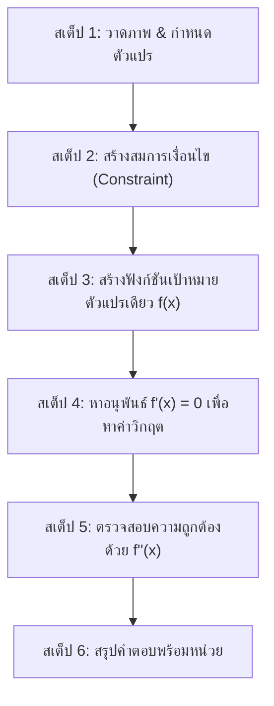
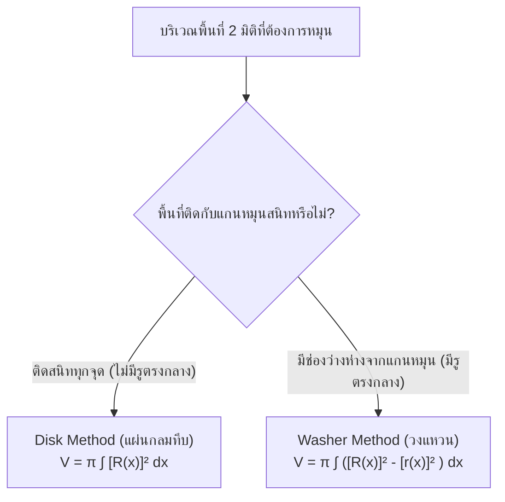

# ⚔️ MFIT Final Exam War Room — ศูนย์รวมข้อสอบเก่า & ยุทธศาสตร์พิชิตปลายภาค (35 คะแนน)
## 06016401 Mathematics for Information Technology · Final Examination Study Guide & Vault

> **สรุปยุทธศาสตร์การรบปลายภาค 1/2569:**  
> การสอบปลายภาควิชา MFIT เป็น **ข้อเขียนแสดงวิธีทำล้วน 100% (Constructed-Response)** รวม **35 คะแนนเต็ม** (คิดเป็น 35% ของคะแนนรวมทั้งรายวิชา)  
> ขอบเขตเนื้อหา: **แคลคูลัสล้วน (สัปดาห์ที่ 8 ถึง 15)** ตามชุดสไลด์บรรยาย `Calculus-01` ถึง `Calculus-08`  
> **ไม่อนุญาตให้ใช้เครื่องคิดเลข** — คำนวณด้วยมือล้วน และเกณฑ์การตรวจให้คะแนนเป็นแบบ **Step-by-Step** เขียนแต่คำตอบโดยไม่แสดงวิธีทำจะได้ **0 คะแนนทันที**

---

## 🧭 ยุทธศาสตร์และภาพรวมการรบ (Final Exam Briefing)

คะแนนปลายภาค 35% คือ **"สมรภูมิตัดเกรด"** ของวิชา MFIT อย่างแท้จริง จากสถิติรุ่นพี่ทุกปีการศึกษา นักศึกษาที่คะแนนกลางภาคสูสีกัน มักจะถูกแยกเกรด A, B+, B, C หลุดลอยหรือคว้าชัยชนะได้จากข้อสอบแคลคูลัสชุดนี้

> [!IMPORTANT]
> **ปรัชญาแคลคูลัสของอาจารย์ (จากสไลด์ Calculus-01):**  
> *"Calculus is a **limit machine**. DO NOT learn calculus as if it were simply a collection of new formulas."*  
> แคลคูลัสไม่ใช่แค่วิชาท่องจำสูตร แต่เป็นเครื่องจักรลิมิต ทุกสิ่งทุกอย่างตั้งแต่ อนุพันธ์, การอินทิเกรต, การหาพื้นที่, ไปจนถึงปริมาตรทรงตันหมุน ล้วนสร้างต่อยอดมาจาก **"แนวคิดของลิมิต"** ทั้งสิ้น การท่องสูตรได้แต่เขียนแสดงวิธีทำไม่เป็น จะทำให้เสียคะแนนวิธีทำในห้องสอบไปอย่างน่าเสียดาย

---

## 📚 คลังข้อสอบเก่าปลายภาคในระบบ

รวบรวมชุดข้อสอบเก่าฉบับจริงย้อนหลังทุกปีการศึกษาที่จัดเก็บในคลัง สามารถกดคลิกปุ่ม **"ดูตัวอย่าง"** เพื่อเปิดอ่านข้อสอบลายมืออาจารย์และเฉลยคำตอบได้ทันทีบนเว็บไซต์ หรือดาวน์โหลดไฟล์เก็บไว้ฝึกทำ:

| เอกสาร | ไฟล์ในคลัง | หน้า |
|---|---|:---:|
| ข้อสอบปลายภาค ปีการศึกษา 2561 (ฉบับจริง 50 คะแนน) | `mfit-final-final-mathit-2561.pdf` | 22 |
| ข้อสอบปลายภาค ปีการศึกษา 2560 (ฉบับจริง 40 คะแนน) | `mfit-final-2560.pdf` | 26 |
| ข้อสอบปลายภาค ปีการศึกษา 2559 (ฉบับจริง 40 คะแนน) | `mfit-final-final-mathit-2559.pdf` | 1 |
| บันทึกเฉลยข้อสอบ NoteLub (เฉลยวิธีทำข้อสอบปลายภาค) | `mfit-final-notelub.pdf` | 3 |
| รวมชุดข้อสอบเก่าคลังกลาง (รวมข้อสอบเก่าและแนวคิด) | `mfit-final-cdn-fbsbx-com.pdf` | 19 |
| ข้อสอบปลายภาคฉบับสำเนา 2559 (Copy of Final 2559) | `mfit-final-copy-of-final-mathit-2559.pdf` | 1 |
| ข้อสอบปลายภาค ชุดข้อสอบรวม Unidentified | `mfit-final-unidentified.pdf` | 6 |

---

## 📑 ชีทสรุปสูตร & เอกสารประกอบการติวเข้ม

หน้านี้รวบรวมชีทสรุปสูตรทางการและเอกสารติวเข้มที่ใช้ประกอบการเตรียมสอบ สามารถคลิกพรีวิวหรือดาวน์โหลดได้ทันที:

| เอกสาร | ไฟล์ในคลัง | หน้า |
|---|---|:---:|
| แผ่นสรุปข้อมูลและสูตรสำคัญ Calculus Useful Info (เทอม 2569) | `mfit-ref-calculus-useful-info-2569.pdf` | 1 |
| ชีตสรุปเข้มแคลคูลัสปลายภาค Holy Shit Final Part 1 (โดย Tammadon Suksa) | `mfit-sheet-holyshit-final-part1.pdf` | 21 |
| ชีทติวเข้มและสรุปเนื้อหาทบทวนปลายภาค สัปดาห์ 8–13 | `mfit-sheet-final-recap-week08-13.pdf` | 19 |
| ชีทสรุปสูตรแคลคูลัส อนุพันธ์ และปริพันธ์ (Diff & Int Recap) | `mfit-sheet-recap-calculus.pdf` | 6 |
| ชีทสรุปสูตรปลายภาค ฉบับปี 2023 | `mfit-sheet-cheat-sheet-2023.pdf` | 1 |
| ชีทสรุปสูตรปลายภาค ฉบับปี 2022 | `mfit-sheet-cheat-sheet-2022.pdf` | 3 |

> [!TIP]
> **แนวทางการฝึกด้วยข้อสอบเก่า:**
> 1. เปิดข้อสอบจริงปี 2561, 2560, 2559 จาก [คลังเรียนรู้](/courses/06016401-Math-for-IT/archive) แล้ว **ปิดเฉลย ฝึกจับเวลาทำบนกระดาษเปล่า**
> 2. เขียนแสดงวิธีทำทีละบรรทัด ห้ามกระโดดข้ามขั้นตอน
> 3. ตรวจเทียบกับบันทึกเฉลยลายมือ `mfit-final-notelub.pdf` เพื่อดูรูปแบบการให้คะแนนของอาจารย์
> 4. ตรวจสอบสูตรที่ได้รับอนุญาตในห้องสอบจาก `mfit-ref-calculus-useful-info-2569.pdf`

---

## 📊 การวิเคราะห์สัดส่วนคะแนน 35 คะแนน (1/2569 Blueprint Breakdown)

โครงสร้างข้อสอบปลายภาคแบ่งออกเป็น **5 เสาหลักแห่งแคลคูลัส** โดยน้ำหนักคะแนนจะกระจายตามสัดส่วนเนื้อหาและความเข้มข้นของสไลด์บรรยาย ดังนี้:

| เสาหลัก (Pillar) | สัปดาห์ & สไลด์ | คะแนนประเมิน | น้ำหนัก | ระดับความเสี่ยง | โจทย์แม่แบบที่การันตีออกสอบ |
|---|:---:|:---:|:---:|:---:|---|
| **เสาที่ 1: ลิมิตและความต่อเนื่อง** | Week 8 (`Calc-01`) | **~4 คะแนน** | ~11% | ปานกลาง | ลิมิตรูปแบบ $\frac{0}{0}$ (แยกตัวประกอบ / คูณสังยุค) + ตรวจสอบความต่อเนื่อง 3 เงื่อนไข |
| **เสาที่ 2: อนุพันธ์, กฎลูกโซ่ & ฟังก์ชันแฝง** | Week 9–10 (`Calc-02, 03`) | **~8 คะแนน** | ~23% | สูง | ดิฟจากนิยามลิมิต $f'(x) = \lim_{\Delta x\to 0}\frac{f(x+\Delta x)-f(x)}{\Delta x}$ + กฎผลคูณ/ผลหาร + **Implicit Differentiation** |
| **เสาที่ 3: การประยุกต์อนุพันธ์ & ค่าสุดขีด** | Week 11 (`Calc-04`) | **~6 คะแนน** | ~17% | สูงมาก | จุดวิกฤต (Critical Numbers) + ค่าสุดขีดสัมบูรณ์บนช่วงปิด + **โจทย์ปัญหา Optimization** |
| **เสาที่ 4: ปริพันธ์, FTC & u-Substitution** | Week 12–13 (`Calc-05, 06`) | **~9 คะแนน** | ~26% | สูงมาก | ทฤษฎีบทหลักของแคลคูลัส (FTC) + **$u$-Substitution** แบบเปลี่ยนขอบเขต + สมมาตรฟังก์ชันคู่/คี่ |
| **เสาที่ 5: By Parts, พื้นที่ & ปริมาตรหมุน** | Week 14–15 (`Calc-07, 08`) | **~8 คะแนน** | ~23% | สูงสุด | **Integration by Parts (LIATE / DI Table)** + พื้นที่ปิดล้อม + **ปริมาตรทรงตันหมุน (Disk vs Washer)** |
| **รวมทั้งสิ้น** | **Week 8–15** | **35 คะแนน** | **100%** | — | **ข้อเขียนแสดงวิธีทำเต็มรูปแบบทุกข้อ** |

---

### เจาะลึก 5 เสาหลักแห่งข้อสอบปลายภาค

#### เสาที่ 1 — ลิมิตและความต่อเนื่อง (Limit & Continuity — Week 8)
- **น้ำหนักคะแนน:** ~4 คะแนน
- **เนื้อหาแกน:**
  - การหาค่าลิมิต $\displaystyle\lim_{x\to c} f(x)$ โดยการแทนค่าโดยตรง (Direct Substitution)
  - การจัดการรูปแบบยังไม่กำหนด $\frac{0}{0}$ (Indeterminate Form) ด้วยการแยกตัวประกอบ (Factoring) หรือการคูณสังยุค (Conjugate)
  - ลิมิตอนันต์ $\displaystyle\lim_{x\to \pm\infty} \frac{P(x)}{Q(x)}$ โดยการพิจารณากำลังสูงสุด
  - การตรวจสอบความต่อเนื่องที่จุด $x=c$ ด้วย **3 เงื่อนไขเหล็ก:**
    1. $f(c)$ นิยาม (หาค่าได้)
    2. $\displaystyle\lim_{x\to c} f(x)$ มีค่า (นั่นคือ $\displaystyle\lim_{x\to c^-} f(x) = \lim_{x\to c^+} f(x)$)
    3. $\displaystyle\lim_{x\to c} f(x) = f(c)$
  - การหาค่าคงที่ $A, B$ ในฟังก์ชันแบบแบ่งช่วง (Piecewise Function) เพื่อให้ฟังก์ชันต่อเนื่อง

#### เสาที่ 2 — อนุพันธ์, กฎลูกโซ่ และฟังก์ชันแฝง (Differentiation Mechanics — Week 9–10)
- **น้ำหนักคะแนน:** ~8 คะแนน
- **เนื้อหาแกน:**
  - **การหาอนุพันธ์จากนิยามลิมิต (Limit Definition of Derivative):**  
    $$f'(x) = \lim_{\Delta x \to 0} \frac{f(x + \Delta x) - f(x)}{\Delta x}$$
    *(ออกสอบแทบทุกปี นศ. ต้องเขียนขั้นตอนการกระจายพจน์และตัดทอน $\Delta x$ ให้เห็นชัดเจน ห้ามใช้สูตรลัด)*
  - กฎการหาอนุพันธ์พื้นฐาน: Power Rule, Product Rule $(uv)' = u'v + uv'$, Quotient Rule $\left(\frac{u}{v}\right)' = \frac{u'v - uv'}{v^2}$
  - กฎลูกโซ่ (Chain Rule): General Power Rule $\frac{d}{dx}[u^n] = n u^{n-1} \frac{du}{dx}$, อนุพันธ์ของฟังก์ชันตรีโกณมิติ, ฟังก์ชันชี้กำลัง $e^u$ และลอการิทึม $\ln u$
  - **อนุพันธ์ของฟังก์ชันแฝง (Implicit Differentiation):** การหา $\frac{dy}{dx}$ จากสมการที่ $x$ และ $y$ ปะปนกันอยู่ เช่น $x^3 + y^3 = 6xy$ โดยใช้ Chain Rule กับตัวแปร $y$ เสมอ

#### เสาที่ 3 — การประยุกต์อนุพันธ์และปัญหาค่าสุดขีด (Applications & Optimization — Week 11)
- **น้ำหนักคะแนน:** ~6 คะแนน
- **เนื้อหาแกน:**
  - การหาค่าวิกฤต (Critical Numbers) จากสมการ $f'(x) = 0$ หรือ $f'(x)$ หาค่าไม่ได้
  - การหาค่าสูงสุดสัมบูรณ์และค่าต่ำสุดสัมบูรณ์ (Absolute Extrema) บนช่วงปิด $[a, b]$ (Extreme Value Theorem)
  - การทดสอบอนุพันธ์อันดับหนึ่ง (First Derivative Test) เพื่อระบุช่วงฟังก์ชันเพิ่ม/ฟังก์ชันลด และจุดขีดสุดสัมพัทธ์
  - การทดสอบอนุพันธ์อันดับสอง (Second Derivative Test) เพื่อตรวจสอบความเว้า (Concavity) และจุดเปลี่ยนเว้า (Inflection Points)
  - **โจทย์ปัญหาค่าสูงสุด-ต่ำสุด (Optimization Problems):** การสร้างฟังก์ชันเป้าหมายจากโจทย์ปัญหาจริง (เช่น การล้อมรั้วให้ได้พื้นที่มากที่สุด, การสร้างกล่องให้มีปริมาตรสูงสุด หรือการผลิตที่ต้นทุนต่ำสุด)

#### เสาที่ 4 — ปริพันธ์พื้นฐาน, FTC และ u-Substitution (Integration Mechanics — Week 12–13)
- **น้ำหนักคะแนน:** ~9 คะแนน
- **เนื้อหาแกน:**
  - ปริพันธ์ไม่จำกัดเขต (Indefinite Integrals) พร้อมการบวกค่าคงที่ของการอินทิเกรต $+ C$ ทุกครั้ง
  - ปริพันธ์จำกัดเขตและทฤษฎีบทหลักมูลของแคลคูลัส (Fundamental Theorem of Calculus: FTC):
    $$\int_a^b f(x)\,dx = F(b) - F(a)$$
  - **เทคนิคการแทนค่าด้วยตัวแปร $u$ ($u$-Substitution):**
    - การเลือกก้อนตัวแปร $u$ ที่เหมาะสม
    - การแปลง $dx = \frac{du}{u'}$
    - **การเปลี่ยนขอบเขตการอินทิเกรตทันที** สำหรับปริพันธ์จำกัดเขต $x \in [a, b] \to u \in [u(a), u(b)]$
  - สมบัติความสมมาตรของฟังก์ชันคู่และฟังก์ชันคี่บนช่วง $[-a, a]$:
    $$\int_{-a}^a f_{\text{odd}}(x)\,dx = 0, \qquad \int_{-a}^a f_{\text{even}}(x)\,dx = 2\int_0^a f_{\text{even}}(x)\,dx$$

#### เสาที่ 5 — By Parts, พื้นที่ และปริมาตรทรงตันหมุน (Advanced Integration & Applications — Week 14–15)
- **น้ำหนักคะแนน:** ~8 คะแนน
- **เนื้อหาแกน:**
  - **การอินทิเกรตทีละส่วน (Integration by Parts):**  
    $$\int u\,dv = uv - \int v\,du$$
    การเลือก $u$ ด้วยกฎ **LIATE** และการใช้ตารางคำนวณลัด (Tabular DI Method)
  - เคสวนซ้ำ (Cyclic / Recursive By Parts) เช่น $\int e^{ax}\cos(bx)\,dx$
  - การหาพื้นที่ระหว่างเส้นโค้งสองเส้น (Area Between Curves):  
    $$A = \int_a^b \big(y_{\text{บน}} - y_{\text{ล่าง}}\big)\,dx \quad \text{หรือ} \quad A = \int_c^d \big(x_{\text{ขวา}} - x_{\text{ซ้าย}}\big)\,dy$$
  - **ปริมาตรทรงตันที่เกิดจากการหมุน (Solids of Revolution):**
    - แผ่นกลมทึบ (**Disk Method**): พื้นที่ติดแกนหมุน
    - วงแหวนมีรูตรงกลาง (**Washer Method**): พื้นที่ไม่ติดแกนหมุน
  - ภาพรวมอนุพันธ์ย่อยพื้นฐาน (Partial Derivatives: $\frac{\partial f}{\partial x}, \frac{\partial f}{\partial y}$)

---

## 🎯 ยุทธวิธีพิชิตข้อสอบรายพาร์ต (Tactical Guide)

ในข้อสอบอัตนัยแสดงวิธีทำ อาจารย์จะตรวจตามลำดับตรรกะและขั้นตอนทางคณิตศาสตร์ นี่คือพิมพ์เขียวการเขียนวิธีทำแบบทีละสเต็ปที่ได้คะแนนเต็มแน่นอน:

---

### 1. ยุทธวิธีจัดการลิมิต $\frac{0}{0}$ (Indeterminate Form Strategy)

เมื่อเจอโจทย์ลิมิต ให้ทำตาม 3 ขั้นตอนนี้เสมอ:

#### ขั้นที่ 1: ตรวจสอบและแสดงรูป $\frac{0}{0}$
แทนค่า $x \to c$ ในเศษและส่วนเพื่อยืนยันว่าเป็นรูปแบบยังไม่กำหนด:
$$\lim_{x\to c}\frac{f(x)}{g(x)} \longrightarrow \frac{f(c)}{g(c)} = \frac{0}{0} \quad (\text{Indeterminate Form})$$
*(⚠️ ห้ามเขียนสรุปทันทีว่า "หาค่าไม่ได้" หรือ $= \frac{0}{0}$ โดยไม่ทำต่อ)*

#### ขั้นที่ 2: เลือกเครื่องมือขจัดตัวส่วนที่เป็นศูนย์
- **กรณีที่ 1: พหุนาม $\to$ แยกตัวประกอบ (Factoring):**
  $$\lim_{x\to -3}\frac{x^2-9}{x+3} = \lim_{x\to -3}\frac{(x-3)(x+3)}{x+3} = \lim_{x\to -3}(x-3) = -3 - 3 = -6$$
- **กรณีที่ 2: ติดกรณฑ์/รากที่สอง $\to$ คูณสังยุค (Conjugate Multiplication):**
  คูณทั้งเศษและส่วนด้วยคอนจูเกตของพจน์ที่ติดราก:
  $$\lim_{x\to 0}\frac{\sqrt{9+x}-3}{x} = \lim_{x\to 0}\frac{(\sqrt{9+x}-3)(\sqrt{9+x}+3)}{x(\sqrt{9+x}+3)}$$
  กระจายผลต่างกำลังสองที่เศษ $(a-b)(a+b) = a^2 - b^2$:
  $$= \lim_{x\to 0}\frac{(9+x) - 9}{x(\sqrt{9+x}+3)} = \lim_{x\to 0}\frac{x}{x(\sqrt{9+x}+3)}$$
  ตัดทอน $x$ ออกจากเศษและส่วน:
  $$= \lim_{x\to 0}\frac{1}{\sqrt{9+x}+3} = \frac{1}{\sqrt{9+0}+3} = \frac{1}{3+3} = \frac{1}{6}$$

> [!NOTE]
> **เครื่องหมายลิมิต:** ต้องเขียนสัญลักษณ์ $\displaystyle\lim_{x\to c}$ กำกับไว้หน้าสมการทุกบรรทัดจนกว่าจะถึงขั้นตอนการแทนค่าตัวเลขจริงลงไป หากละเลยอาจถูกตัดคะแนนสัญลักษณ์

---

### 2. ยุทธวิธีทำ Implicit Differentiation (อนุพันธ์ของฟังก์ชันแฝง)

เมื่อ $y$ ผูกอยู่กับ $x$ ในสมการจนไม่สามารถจัดรูป $y = f(x)$ ได้ง่าย ให้มองว่า **$y$ เป็นฟังก์ชันของ $x$ เสมอ ($y = y(x)$)**

#### กฎทองของ Implicit:
$$\frac{d}{dx}[x^n] = n x^{n-1} \qquad \text{แต่} \qquad \frac{d}{dx}[y^n] = n y^{n-1} \cdot \frac{dy}{dx}$$

#### ตัวอย่างแม่แบบ: จงหา $\dfrac{dy}{dx}$ ของสมการ $x^3 + y^3 = 6xy$
- **ขั้นที่ 1: ทำการดิฟทั้งสองข้างเทียบกับ $x$:**
  $$\frac{d}{dx}\big[x^3 + y^3\big] = \frac{d}{dx}\big[6xy\big]$$
- **ขั้นที่ 2: กระจายอนุพันธ์ทีละพจน์ (ระวัง Product Rule ที่พจน์ $6xy$):**
  $$3x^2 + 3y^2\frac{dy}{dx} = 6\left( \frac{d}{dx}[x]\cdot y + x\cdot \frac{d}{dx}[y] \right)$$
  $$3x^2 + 3y^2\frac{dy}{dx} = 6y + 6x\frac{dy}{dx}$$
- **ขั้นที่ 3: ย้ายพจน์ที่มี $\dfrac{dy}{dx}$ มาไว้ข้างเดียวกัน:**
  $$3y^2\frac{dy}{dx} - 6x\frac{dy}{dx} = 6y - 3x^2$$
- **ขั้นที่ 4: ดึงตัวร่วม $\dfrac{dy}{dx}$ ออกมา:**
  $$\big(3y^2 - 6x\big)\frac{dy}{dx} = 6y - 3x^2$$
- **ขั้นที่ 5: ย้ายข้างและจัดรูปให้เรียบร้อย:**
  $$\frac{dy}{dx} = \frac{6y - 3x^2}{3y^2 - 6x} = \frac{3(2y - x^2)}{3(y^2 - 2x)} = \frac{2y - x^2}{y^2 - 2x}$$

---

### 3. ยุทธวิธีแก้โจทย์ปัญหาค่าสุดขีด (Optimization Protocol)

โจทย์ Optimization มักเป็นโจทย์คำบรรยายความยาว 3–5 บรรทัด วิธีทำที่สมบูรณ์ต้องมี **5 สเต็ปมาตรฐาน**:

1. **สเต็ป 1: วาดภาพและตั้งตัวแปร (Diagram & Variables)**  
   วาดรูปประกอบคร่าว ๆ ระบุด้าน กว้าง ยาว สูง หรือตัวแปร $x, y$ ให้ชัดเจน
2. **สเต็ป 2: สร้างสมการเงื่อนไข (Constraint Equation)**  
   เขียนสมการข้อจำกัดจากสิ่งที่โจทย์กำหนดค่ามาให้คงที่ เช่น ความยาวเชือก หรือต้นทุนงบประมาณ:
   $$\text{เช่น } 2x + y = 100 \implies y = 100 - 2x$$
3. **สเต็ป 3: สร้างฟังก์ชันเป้าหมาย (Objective Function)**  
   เขียนสมการของสิ่งที่ต้องการทำให้มากที่สุด (Maximize) หรือน้อยที่สุด (Minimize) แล้วนำสมการเงื่อนไขมาแทนค่า เพื่อให้เหลือตัวแปรอิสระเพียงตัวเดียว:
   $$A = x \cdot y \implies A(x) = x(100 - 2x) = 100x - 2x^2$$
   พร้อมระบุโดเมนความเป็นจริง เช่น $x \in (0, 50)$
4. **สเต็ป 4: หาอนุพันธ์อันดับหนึ่งและตั้ง $f'(x) = 0$**  
   $$A'(x) = 100 - 4x$$
   ตั้ง $A'(x) = 0 \implies 100 - 4x = 0 \implies x = 25$ (ได้ค่าวิกฤต)
5. **สเต็ป 5: ตรวจสอบประเภทค่าสุดขีดด้วย Second Derivative Test**  
   *(ขั้นตอนนี้บังคับทำ ห้ามข้ามเด็ดขาด)*
   $$A''(x) = -4 < 0 \quad \text{ทุกค่า } x$$
   เนื่องจาก $A''(25) < 0$ แสดงว่ากราฟคว่ำ (Concave Down) ดังนั้นที่ $x = 25$ ให้ **ค่าสูงสุดสัมพัทธ์ (Relative Maximum)** อย่างแท้จริง
6. **สเต็ป 6: ตอบสิ่งที่โจทย์ถามพร้อมใส่หน่วย**  
   หา $y = 100 - 2(25) = 50$  
   สรุปคำตอบ: "พื้นที่มากที่สุดคือ $A = 25 \times 50 = 1,250 \text{ ตารางเมตร}$"

---

### 4. ยุทธวิธีทำ u-Substitution พร้อมการเปลี่ยนขอบเขต

การทำ $u$-Substitution ในปริพันธ์จำกัดเขต ($\int_a^b$) หัวใจสำคัญคือ **"ห้ามแปลงกลับไปเป็นตัวแปร $x$ อีกเด็ดขาด"**

#### ตัวอย่างแม่แบบ: จงหาค่าของ $\displaystyle\int_0^1 x(x^2 + 1)^3\,dx$
- **ขั้นที่ 1: เลือกตัวแปร $u$**  
  เลือกก้อนที่ซับซ้อนและมีอนุพันธ์คูณอยู่ด้านนอก:
  $$\text{ให้ } u = x^2 + 1$$
- **ขั้นที่ 2: หา $du$ และ $dx$**  
  $$du = 2x\,dx \implies dx = \frac{du}{2x}$$
- **ขั้นที่ 3: เปลี่ยนขอบเขตการอินทิเกรตทันที (Point of Grace!)**  
  - เมื่อ $x = 0 \implies u = 0^2 + 1 = 1$ (ขอบล่างใหม่)
  - เมื่อ $x = 1 \implies u = 1^2 + 1 = 2$ (ขอบบนใหม่)
- **ขั้นที่ 4: แทนค่าลงในอินทิกรัลทั้งหมด**  
  $$\int_{x=0}^{x=1} x(x^2 + 1)^3\,dx = \int_{u=1}^{u=2} x \cdot u^3 \cdot \frac{du}{2x} = \frac{1}{2}\int_1^2 u^3\,du$$
  *(สังเกต: ตัวแปร $x$ ถูกตัดหมดเกลี้ยง เหลือเพียงตัวแปร $u$ ล้วน)*
- **ขั้นที่ 5: อินทิเกรตเทียบกับ $u$ และแทนขอบเขตใหม่**  
  $$= \frac{1}{2}\left[\frac{u^4}{4}\right]_1^2 = \frac{1}{8}\Big[2^4 - 1^4\Big] = \frac{1}{8}\big(16 - 1\big) = \frac{15}{8}$$

> [!CAUTION]
> **ข้อผิดพลาดร้ายแรง:** การเขียน $\int_0^1 u^3 \frac{du}{2}$ ถือว่าผิดหลักคณิตศาสตร์ทันที เพราะขอบเขต 0 ถึง 1 เป็นของตัวแปร $x$ ไม่ใช่ของตัวแปร $u$ คุณต้องเปลี่ยนขอบเขตเป็น 1 ถึง 2 หรือระบุชัดเจนว่า $\left[\dots\right]_{x=0}^{x=1}$

---

### 5. ยุทธวิธีทำ Integration by Parts ด้วยกฎ LIATE และตาราง DI

สูตรหลัก:
$$\boxed{\;\int u\,dv = uv - \int v\,du\;}$$

#### 5.1 กฎการเลือก $u$ ด้วย LIATE
เรียงลำดับจากซ้ายไปขวา ตัวไหนมาก่อนในคำว่า **LIATE** ให้เลือกตัวนั้นเป็น $u$ ส่วนที่เหลือทั้งหมดคือ $dv$:

1. **L** — **L**ogarithmic ($\ln x, \log x$)
2. **I** — **I**nverse Trigonometric ($\arcsin x, \arctan x$)
3. **A** — **A**lgebraic / Polynomials ($x, x^2, x^3 + 5$)
4. **T** — **T**rigonometric ($\sin x, \cos x, \sec^2 x$)
5. **E** — **E**xponential ($e^x, 2^x$)

#### 5.2 ตาราง 4 ช่องมาตรฐาน (สำหรับการแสดงวิธีทำ)
เมื่อเจอ $\displaystyle\int x e^{2x}\,dx$:
- $x$ เป็น Algebraic (**A**), $e^{2x}$ เป็น Exponential (**E**) $\implies$ เลือก $u = x$

| คอลัมน์อนุพันธ์ ($u$) | คอลัมน์ปริพันธ์ ($dv$) |
|---|---|
| $u = x$ | $dv = e^{2x}\,dx$ |
| $du = dx$ | $v = \displaystyle\int e^{2x}\,dx = \frac{1}{2}e^{2x}$ |

แทนค่าลงในสูตร:
$$\int x e^{2x}\,dx = (x)\left(\frac{1}{2}e^{2x}\right) - \int \left(\frac{1}{2}e^{2x}\right)\,dx = \frac{1}{2}x e^{2x} - \frac{1}{4}e^{2x} + C$$

#### 5.3 ตารางลัด DI Method (Tabular Integration)
ใช้เมื่อพหุนามคูณกับฟังก์ชันที่อินทิเกรตซ้ำได้เรื่อย ๆ เช่น $P(x) \times \sin(ax)$ หรือ $P(x) \times e^{ax}$:

**ตัวอย่าง: จงหาค่าของ $\displaystyle\int x^2 \sin x\,dx$**

| เครื่องหมาย (+/-) | อนุพันธ์ $D$ (ดิฟจนเป็น 0) | ปริพันธ์ $I$ (อินทิเกรตตามจำนวนแถว) | ทิศทางการคูณ |
|:---:|:---|:---|:---:|
| $+$ | $x^2$ | $\sin x$ | $\searrow$ |
| $-$ | $2x$ | $-\cos x$ | $\searrow$ |
| $+$ | $2$ | $-\sin x$ | $\searrow$ |
| $-$ | $0$ | $\cos x$ | $\longrightarrow$ แนวนอนได้ 0 |

รวมพจน์ตามแนวทแยง:
$$\int x^2 \sin x\,dx = \big(+\big)(x^2)(-\cos x) + \big(-\big)(2x)(-\sin x) + \big(+\big)(2)(\cos x) + C$$
$$= -x^2\cos x + 2x\sin x + 2\cos x + C$$

---

### 6. เปรียบเทียบ Disk Method vs Washer Method (สมรภูมิปริมาตรทรงตันหมุน)

การหมุนพื้นที่ 2 มิติรอบแกนเพื่อเกิดรูปทรงเรขาคณิต 3 มิติ แบ่งออกเป็น 2 กรณีชัดเจน:

#### ตารางเปรียบเทียบเชิงวิเคราะห์:

| คุณลักษณะ | วิธีจานกลม (Disk Method) | วิธีวงแหวน (Washer Method) |
|---|---|---|
| **ลักษณะรูปทรงตัดขวาง** | แผ่นวงกลมทึบตัน (Solid Disk) | แผ่นวงแหวน มีรูกลวงตรงกลาง (Washer / Ring) |
| **ความสัมพันธ์กับแกนหมุน** | พื้นที่ขอบด้านหนึ่ง **ติดแนบสนิทกับแกนหมุน** ตลอดช่วง | พื้นที่ **มีช่องว่างคั่นระหว่างพื้นที่กับแกนหมุน** |
| **จำนวนรัศมี** | รัศมีเดี่ยว: $R(x)$ | สองรัศมี: รัศมีนอก $R(x)$ และ รัศมีใน $r(x)$ |
| **สูตรหมุนรอบแกน $x$** | $\displaystyle V = \pi \int_a^b \big[R(x)\big]^2\,dx$ | $\displaystyle V = \pi \int_a^b \Big(\big[R(x)\big]^2 - \big[r(x)\big]^2\Big)\,dx$ |
| **สูตรหมุนรอบแกน $y$** | $\displaystyle V = \pi \int_c^d \big[R(y)\big]^2\,dy$ | $\displaystyle V = \pi \int_c^d \Big(\big[R(y)\big]^2 - \big[r(y)\big]^2\Big)\,dy$ |

> [!WARNING]
> ### 🚨 กับดักมรณะสูงสุดของบทปริมาตร 🚨
> $$\big[R(x)\big]^2 - \big[r(x)\big]^2 \;\neq\; \big(R(x) - r(x)\big)^2$$
> **ต้องนำรัศมีแต่ละตัวมายกกำลังสองแยกกันก่อน แล้วจึงนำมาลบกัน!**  
> นักศึกษาที่เขียน $\pi \int (R - r)^2 dx$ จะได้คำตอบที่ผิดรูป และ **เสียคะแนนเต็มทั้งข้อทันที**

---

## ⚠️ ตารางกับดักจุดตาย All-or-Nothing Checklist

ก่อนก้าวเท้าออกจากห้องสอบ โปรดใช้ Checklist นี้ตรวจสอบกระดาษคำตอบของคุณเพื่อป้องกันการเสียแต้มโดยไม่จำเป็น:

| อันดับ | กับดักจุดตาย (Deadly Trap) | อาการที่พบในข้อสอบ (Symptom) | บทลงโทษคะแนน | วิธีแก้ไข & Defensive Check |
|:---:|---|---|:---:|---|
| **1** | **ลืมบวกค่าคงที่ $+ C$** | ทำปริพันธ์ไม่จำกัดเขต ($\int f(x)dx$) เสร็จแล้วตอบเลย | หัก $0.5 - 1$ คะแนนทันที | กวาดสายตาดูอินทิกรัลทุกข้อที่ไม่มีขอบเขตบน-ล่าง ต้องลงท้ายด้วย $+ C$ เสมอ |
| **2** | **ลืมเปลี่ยนขอบเขตใน $u$-sub** | แปลงตัวแปรเป็น $u$ แต่ยังคงขอบเขตเดิม $a, b$ ของ $x$ ไว้ | ได้ $0$ คะแนนในบรรทัดนั้น | เมื่อกำหนด $u = g(x)$ ให้เขียน $u(a)$ และ $u(b)$ กำกับขอบเขตใหม่ทันที |
| **3** | **อาการตัวแปรผสม (Hybrid Variables)** | มีทั้งตัวแปร $x$ และ $u$ ปะปนกันในเครื่องหมาย $\int$ เดียวกัน | เสียคะแนนวิธีทำทั้งตอน | ก่อนเริ่มอินทิเกรต ตรวจดูว่า $x$ และ $dx$ ถูกกำจัดกลายเป็น $u$ และ $du$ ครบ 100% หรือยัง |
| **4** | **กับดัก Washer $(R-r)^2$** | นำผลต่างรัศมีมายกกำลังสอง แทนที่จะยกกำลังสองก่อนลบ | คำตอบผิดทั้งข้อ ($0$ คะแนน) | ท่องให้ขึ้นใจ: "รัศมีนอกกำลังสอง ลบด้วย รัศมีในกำลังสอง" $\implies R^2 - r^2$ |
| **5** | **ลืมใส่ค่าคงที่ $\pi$ ในปริมาตร** | หาปริมาตรทรงตันหมุนเสร็จ ลืมคูณ $\pi$ ที่หน้าอินทิกรัล | เสียคะแนนคำตอบสุดท้าย | ท่องจำ: พื้นที่หน้าตัดวงกลมมี $\pi r^2$ เสมอ ดังนั้นปริมาตรต้องมี $\pi$ ติดมาด้วย |
| **6** | **ลืม $\dfrac{dy}{dx}$ ในฟังก์ชันแฝง** | ดิฟ $y^3$ ได้ $3y^2$ โดยลืมคูณ $\frac{dy}{dx}$ ตามกฎลูกโซ่ | สมการแก้ต่อไม่ได้ | ทุกครั้งที่จรดปากกาดิฟตัวแปร $y$ ต้องตบท้ายด้วย $\frac{dy}{dx}$ เสมอ |
| **7** | **ลืมดิฟไส้ใน (Chain Rule Blindness)** | ดิฟ $\cos(4x)$ แล้วตอบ $-\sin(4x)$ หรือดิฟ $(x^2+1)^5$ ลืม $2x$ | ผิดตั้งแต่ขั้นแรก | สูตรคือ "ดิฟนอก คงใน คูณดิฟใน" $\implies \frac{d}{dx}[\cos(4x)] = -\sin(4x) \cdot 4$ |
| **8** | **ด่วนสรุป $\frac{0}{0}$ ว่าหาค่าไม่ได้** | แทนค่าลิมิตได้ $\frac{0}{0}$ แล้วตอบว่า Undefined ทันที | ได้ $0$ คะแนน | $\frac{0}{0}$ คือ "ยังไม่รู้ค่า" ต้องจัดรูป แยกตัวประกอบ หรือคูณคอนจูเกตเพื่อหาค่าจริง |
| **9** | **Optimization ข้ามการเช็ค $f''(x)$** | หาค่า $x$ จาก $f'(x)=0$ ได้แล้วรีบสรุปเป็นคำตอบทันที | โดนหักคะแนนการพิสูจน์ | ต้องแสดงการทดสอบอนุพันธ์อันดับสอง $f''(x)$ เพื่อพิสูจน์ว่าเป็นค่าสูงสุด ($<0$) หรือต่ำสุด ($>0$) |
| **10** | **เครื่องหมายผิดใน By Parts** | จำสูตรสับสนเป็น $uv + \int v\,du$ | คำตอบผิดเพี้ยนทั้งหมด | ตรวจสอบสูตร: $\int u\,dv = uv \;\mathbf{-}\; \int v\,du$ (เครื่องหมายตรงกลางต้องเป็น **ลบ**) |

---

## 🏁 สรุปคำแนะนำส่งท้ายก่อนเข้าห้องสอบ

1. **บริหารเวลา 180 นาที:** ข้อสอบมี 35 คะแนน ควรเฉลี่ยเวลาข้อละประมาณ 4–5 นาทีต่อ 1 คะแนน หากข้อไหนติดขัดเกิน 10 นาที ให้เว้นที่ว่างไว้แล้วข้ามไปทำข้อที่มั่นใจก่อน
2. **ความสะอาดของกระดาษคำตอบ:** จัดบรรทัดให้เป็นระเบียบ เขียนเครื่องหมายเท่ากับ ($=$) ให้ตรงกันในแนวดิ่ง และขีดเส้นใต้สองเส้นหรือตีกรอบ $\boxed{\text{คำตอบสุดท้าย}}$ ให้ชัดเจน
3. **ตรวจสอบหน่วย:** หากเป็นโจทย์ปัญหาประยุกต์ เช่น พื้นที่ หรือ ปริมาตร อย่าลืมใส่หน่วย "ตารางหน่วย" หรือ "ลูกบาศก์หน่วย" กำกับเสมอ

ขอให้นักศึกษาทุกคนมีสมาธิ มั่นใจในทุกย่างก้าวของการคำนวณ และคว้าคะแนนเต็ม 35 คะแนนในศึกปลายภาค MFIT ครั้งนี้! ⚔️🔥
