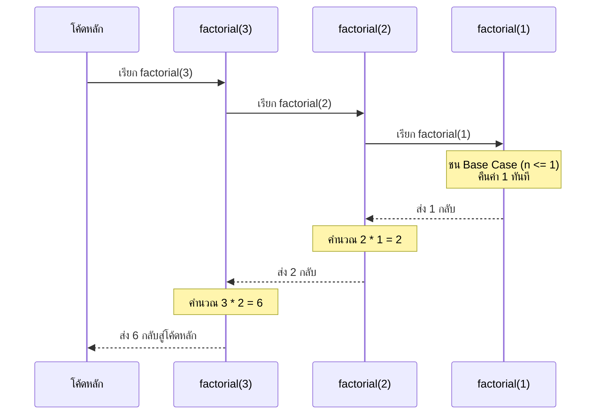

# สัปดาห์ที่ 13 · การเรียกซ้ำ การจัดการไฟล์ และข้อยกเว้น (Recursion, File I/O & Exception Handling)

> รศ.ดร. โชติพัชร์ ภรณวลัย · ผศ.ดร. สามารถ หมุดและ · ขอบเขตสอบปลายภาค (Final) · สรุปโจทย์ OJ ประจำสัปดาห์

## อ่านจบแล้วต้องตอบได้

- อธิบายองค์ประกอบสำคัญ 2 ส่วนของฟังก์ชันเรียกซ้ำ (**Base Case** และ **Recursive Case**) พร้อมทั้งแกะรอยการทำงานของ **Call Stack** ได้
- แปลงปัญหายอดนิยมให้อยู่ในรูปของการเรียกซ้ำได้ เช่น Factorial, Fibonacci, Euclidean GCD, การแบ่งแยกสายอักขระ และการคลี่โครงสร้างข้อมูลซ้อนหลายชั้น (Flatten List)
- ใช้คำสั่งจัดการไฟล์พื้นฐาน (`open`, `read`, `readline`, `readlines`, `write`) พร้อมบอกความแตกต่างของโหมด `'r'`, `'w'`, `'a'`
- อธิบายประโยชน์ของ Context Manager (`with open(...) as f:`) ในการรับประกันการปิดไฟล์อย่างปลอดภัย
- ควบคุมข้อผิดพลาดในโปรแกรมด้วยโครงสร้าง `try ... except ... else ... finally` และแยกแยะ Exception ชนิดสำคัญ (`ValueError`, `IndexError`, `KeyError`, `FileNotFoundError`, `ZeroDivisionError`, `RecursionError`)

---

## เอกสารประจำสัปดาห์

| เอกสาร | หน้า | ไฟล์ในคลัง |
|---|:---:|---|
| สไลด์บรรยายอ้างอิง — Chapter 05 Recursion & File I/O | 26 | `pscp-lec-chapter05.pdf` |

> 🔒 **ควิซและข้อสอบเก่า:** ข้อสอบย่อยประจำสัปดาห์และแนวข้อสอบเก่าจัดเก็บในคลังข้อสอบเฉพาะนักศึกษา IT KMITL สามารถเข้าดูได้ที่ [คลังเรียนรู้รายวิชา PSCP](/courses/06066303-Problem-Solving-and-Computer-Programming/archive) หลังเข้าสู่ระบบ

---

## สรุปอ่านสอบ

### 1. การทำงานของฟังก์ชันเรียกซ้ำ (Recursion Mechanics)

**Recursion** คือกระบวนการที่ฟังก์ชันเรียกตัวเองซ้ำๆ เพื่อแบ่งปัญหาใหญ่ที่ซับซ้อนให้กลายเป็นปัญหาย่อย (Subproblem) ที่มีรูปแบบเดียวกันแต่มีขนาดเล็กลงเรื่อยๆ

#### โครงสร้างหลัก 2 ส่วนที่ขาดไม่ได้

1. **Base Case (กรณีหยุด / กรณีพื้นฐาน):**
   - เงื่อนไขที่แก้ปัญหาได้ทันทีโดยไม่ต้องเรียกตัวเองซ้ำ เป็นจุดตัดเพื่อยุติการเรียกซ้ำ
   - หากขาด Base Case หรือเขียนเงื่อนไขไม่ครอบคลุม จะเกิดการเรียกไม่รู้จบจน Stack เต็ม เกิดข้อผิดพลาด `RecursionError: maximum recursion depth exceeded`
2. **Recursive Step / Case (กรณีเรียกซ้ำ):**
   - การเรียกฟังก์ชันตัวเอง โดยส่งอาร์กิวเมนต์ที่ลดทอนขนาดของปัญหาลง และมุ่งหน้าเข้าสู่ Base Case เสมอ

```python
def factorial(n):
    # 1. Base Case: จุดหยุด
    if n <= 1:
        return 1
    # 2. Recursive Step: ปัญหาย่อยที่ขนาดเล็กลง (n - 1)
    return n * factorial(n - 1)
```

---

### 2. การทำงานของ Call Stack และ Stack Frame

เมื่อโปรแกรมมีการเรียกฟังก์ชัน ระบบปฏิบัติการจะจองพื้นที่หน่วยความจำที่เรียกว่า **Stack Frame** บน **Call Stack** เพื่อเก็บตัวแปรเฉพาะที่ (Local Variables) และตำแหน่งคำสั่งที่จะกระโดดกลับ (Return Address)

#### ตัวอย่างการแกะรอย (Tracing) `factorial(3)`

```
[ ขาลง (Call Phase): วางทับลงบน Stack ]
  เรียก factorial(3)  --> รอผลลัพธ์ของ 3 * factorial(2)
    เรียก factorial(2) --> รอผลลัพธ์ของ 2 * factorial(1)
      เรียก factorial(1) --> ชน Base Case คืนค่า 1!

[ ขาขึ้น (Unwind / Return Phase): ดึงออกจาก Stack แบบ LIFO ]
      factorial(1) ส่ง 1 คืนกลับมา
    factorial(2) คำนวณ 2 * 1 = 2 ส่ง 2 คืนกลับมา
  factorial(3) คำนวณ 3 * 2 = 6 ส่ง 6 คืนกลับมา
```



> **ข้อควรรู้สำหรับ Python:** Python กำหนดค่าขีดจำกัดความลึกของการเรียกซ้ำไว้เริ่มต้นที่ 1,000 ระดับ (ตรวจสอบได้ด้วย `sys.getrecursionlimit()`) หากโจทย์ต้องการการเรียกซ้ำมากกว่านี้ อาจต้องแปลงเป็นลูปแบบ Iteration หรือใช้เทคนิค Memoization

---

### 3. ตัวอย่างอัลกอริทึมเรียกซ้ำคลาสสิกที่มักออกสอบ

#### 3.1 ลำดับฟีโบนัชชี (Fibonacci Sequence)

นิยาม: $F(0) = 0, F(1) = 1$ และ $F(n) = F(n-1) + F(n-2)$ เมื่อ $n \ge 2$

```python
# แบบเรียกซ้ำตรงๆ (Naive Recursion) — มี Time Complexity O(2^n)
def fib_naive(n):
    if n <= 0:
        return 0
    if n == 1:
        return 1
    return fib_naive(n - 1) + fib_naive(n - 2)
```

> ⚠️ การเรียกแบบสองทาง (Binary Recursion) เช่น `fib(n)` จะคำนวณกิ่งซ้ำซ้อนมหาศาล ถ้า $n > 35$ โปรแกรมจะทำงานช้ามาก สำหรับ $n$ ขนาดใหญ่ ควรจำค่า (Memoization) ด้วย Dictionary หรือใช้ Dynamic Programming / Matrix Exponentiation

#### 3.2 การหา ห.ร.ม. แบบยุคลิด (Euclidean GCD)

นิยาม: $\gcd(a, b) = \gcd(b, a \pmod b)$ โดยมี Base Case คือเมื่อ $b = 0$ จะได้ผลลัพธ์คือ $a$

```python
def gcd(a, b):
    if b == 0:
        return a
    return gcd(b, a % b)
```

#### 3.3 การคลี่ลิสต์ที่ซ้อนหลายชั้น (Flattening Nested Lists)

การแปลงลิสต์ที่มีโครงสร้างซ้อนกันไม่จำกัดชั้นให้กลายเป็นลิสต์ชั้นเดียว:

```python
def flatten(lst):
    result = []
    for item in lst:
        if isinstance(item, list):
            # เรียกซ้ำเพื่อคลี่ปัญหาย่อย แล้วนำผลมารวม
            result.extend(flatten(item))
        else:
            result.append(item)
    return result

# ตัวอย่าง: flatten([1, [2, [3, 4], 5], 6]) -> [1, 2, 3, 4, 5, 6]
```

---

### 4. การจัดการไฟล์ (File Input / Output: File I/O)

การอ่านและเขียนไฟล์ใน Python ใช้ฟังก์ชันในตัว `open(filepath, mode, encoding="utf-8")`

#### 4.1 ตารางโหมดการเปิดไฟล์หลัก

| โหมด | ความหมาย | พฤติกรรมเมื่อพบไฟล์เดิม | พฤติกรรมเมื่อไม่พบไฟล์ |
|:---:|---|---|---|
| `'r'` | **Read (อ่านอย่างเดียว)** — เป็นโหมดเริ่มต้น | เปิดอ่านตั้งแต่ต้นไฟล์ | **เกิด `FileNotFoundError`** |
| `'w'` | **Write (เขียนใหม่)** | **ลบข้อมูลเดิมทิ้งทั้งหมด (Truncate เหลือ 0 bytes)** | สร้างไฟล์ใหม่ขึ้นมา |
| `'a'` | **Append (เขียนต่อท้าย)** | เลื่อน指標ไปท้ายไฟล์ เขียนต่อข้อมูลเดิม | สร้างไฟล์ใหม่ขึ้นมา |
| `'r+'` | **Read & Write (อ่านและเขียนทับ)** | เปิดอ่านและเขียนทับตำแหน่งปัจจุบัน | เกิด `FileNotFoundError` |

#### 4.2 การใช้งาน Context Manager (`with open(...) as f:`)

**กฎเหล็ก:** ควรเปิดไฟล์ด้วยคำสั่ง `with` เสมอ เพื่อให้ Python ปิดไฟล์ (`f.close()`) โดยอัตโนมัติเมื่อออกจากบล็อก แม้จะเกิด Exception ระหว่างทำงานก็ตาม

```python
# ✅ วิธีที่ถูกต้อง ปลอดภัย และเป็นมาตรฐาน
with open("student_data.txt", "r", encoding="utf-8") as f:
    for line in f:
        print(line.rstrip("\n"))
# เมื่อหลุดจากบล็อก with ไฟล์จะถูกปิดทันที ป้องกัน Memory / Resource Leak
```

#### 4.3 เปรียบเทียบเมธอดการอ่านข้อมูลจากไฟล์

```python
# 1. f.read(): อ่านทั้งไฟล์มาเป็น String ก้อนเดียว
with open("data.txt") as f:
    content = f.read()

# 2. f.readline(): อ่านทีละ 1 บรรทัด (คืนค่า string เปล่า "" เมื่อถึง EOF)
with open("data.txt") as f:
    first_line = f.readline()

# 3. f.readlines(): อ่านทุกบรรทัดออกมาเป็น List ของ String
with open("data.txt") as f:
    lines = f.readlines()  # ['line 1\n', 'line 2\n', ...]

# 4. การวนลูปบน File Object โดยตรง (ดีที่สุดสำหรับไฟล์ขนาดใหญ่ — ประหยัดแรม)
with open("huge_data.txt") as f:
    for line in f:
        clean_text = line.rstrip("\n")  # ตัด \n ตัวท้ายออก
        process(clean_text)
```

#### 4.4 การเขียนข้อมูลลงไฟล์

```python
with open("output.txt", "w", encoding="utf-8") as f:
    f.write("Hello IT KMITL\n")   # f.write ไม่เติม \n ให้ ต้องใส่เอง!
    f.writelines(["Line 1\n", "Line 2\n", "Line 3\n"])
```

---

### 5. การจัดการข้อยกเว้น (Exception Handling)

Exception คือเหตุการณ์ผิดปกติที่เกิดขึ้นระหว่างที่โปรแกรมกำลังทำงาน (Runtime) ซึ่งหากไม่มีการดักจับ จะทำให้โปรแกรมหยุดทำงานกะทันหัน

#### 5.1 โครงสร้างสมบูรณ์: `try ... except ... else ... finally`

```python
try:
    # 1. โค้ดเสี่ยงที่อาจเกิด Exception
    val = int(input("กรอกตัวเลข: "))
    result = 100 / val

except ValueError as e:
    # 2. ทำงานเมื่อเกิดข้อผิดพลาดด้านชนิด/รูปแบบข้อมูล
    print("กรุณากรอกเฉพาะตัวเลขจำนวนเต็ม!")

except ZeroDivisionError:
    # 3. ทำงานเมื่อตัวหารเป็น 0
    print("ไม่สามารถหารด้วยศูนย์ได้!")

except Exception as e:
    # 4. ดักจับข้อผิดพลาดทั่วไปอื่นๆ ที่ไม่ได้ระบุเจาะจง
    print(f"เกิดข้อผิดพลาดที่ไม่คาดคิด: {e}")

else:
    # 5. ทำงานเมื่อในบล็อก try "ไม่เกิดข้อผิดพลาดใดๆ เลย"
    print(f"ผลลัพธ์คือ {result}")

finally:
    # 6. ทำงาน "เสมอ" ไม่ว่าจะเกิด Error หรือไม่ และจะดักจับได้หรือไม่ก็ตาม
    print("สิ้นสุดกระบวนการทำงาน")
```

#### 5.2 ตาราง Exception มาตรฐานที่ต้องจำ

| ชื่อ Exception | สาเหตุที่เกิดขึ้น | ตัวอย่างคำสั่งที่พัง |
|---|---|---|
| `ValueError` | ข้อมูลชนิดถูกต้องแต่ค่าไม่ถูกต้อง | `int("hello")` หรือ `math.sqrt(-1)` |
| `TypeError` | ส่งข้อมูลผิดชนิดให้ตัวดำเนินการหรือฟังก์ชัน | `"score: " + 10` หรือ `len(1234)` |
| `IndexError` | เรียกดัชนีเกินขอบเขตของ List หรือ Tuple | `lst = [1, 2]; x = lst[5]` |
| `KeyError` | อ้างอิง Key ที่ไม่มีอยู่ใน Dictionary | `d = {"a": 1}; x = d["z"]` |
| `ZeroDivisionError` | ตัวหารทางคณิตศาสตร์เป็น 0 | `10 / 0` หรือ `10 % 0` |
| `FileNotFoundError` | เปิดไฟล์ในโหมดอ่าน `'r'` แต่ไม่พบไฟล์ | `open("not_exist.txt", "r")` |
| `RecursionError` | ฟังก์ชันเรียกซ้ำลึกเกินขีดจำกัด (เกิน 1,000) | ฟังก์ชันที่ไม่มี Base Case |
| `EOFError` | คำสั่ง `input()` พยายามอ่านแต่ข้อมูลหมด (End of File) | รัน `input()` เกินจำนวนบรรทัดใน OJ |

---

## จุดที่มักพลาด

1. **การลืม Base Case ในการเขียนฟังก์ชันเรียกซ้ำ**:
   - ทำให้เกิด `RecursionError: maximum recursion depth exceeded`
   - ตรวจสอบเสมอว่าในทุกเงื่อนไข ต้องมีอย่างน้อย 1 ทางแยกที่ส่งค่ากลับโดยไม่เรียกฟังก์ชันซ้ำ
2. **การส่งอาร์กิวเมนต์ตัวเดิมเข้าไปในฟังก์ชันซ้ำ**:
   - เช่น เรียก `return count(n)` แทนที่จะเป็น `return count(n - 1)` ส่งผลให้ค่าไม่เคลื่อนเข้าหา Base Case
3. **การเปิดไฟล์ด้วยโหมด `'w'` โดยไม่ได้ตั้งใจ**:
   - โหมด `'w'` จะ**ลบข้อมูลเดิมในไฟล์ทิ้งจนว่างเปล่าทันที**ที่รันคำสั่ง หากต้องการเขียนต่อท้ายเนื้อหาเดิม ต้องใช้โหมด `'a'` (Append)
4. **ลืมตัดตัวขึ้นบรรทัดใหม่ `\n`**:
   - เมธอด `.readline()`, `.readlines()` หรือการวนลูปอ่านไฟล์ จะมีตัวอักษร `\n` ติดมาที่ท้ายประโยคเสมอ หากนำไปเปรียบเทียบข้อความตรงๆ เช่น `line == "PASS"` จะได้ `False` เพราะค่าจริงคือ `"PASS\n"`
   - แก้ไขด้วยการใช้ `line.rstrip("\n")` หรือ `line.strip()`
5. **การใช้ Bare Except (`except: pass`)**:
   - การเขียน `except:` โดยไม่ระบุชนิดข้อผิดพลาด จะดักจับสัญญาณควบคุมระบบด้วย เช่น `KeyboardInterrupt` (Ctrl+C) และ `SystemExit` ทำให้หยุดโปรแกรมไม่ได้ และบดบังจุดบั๊กที่แท้จริง
   - ควรระบุชนิดข้อผิดพลาดเจาะจงเสมอ เช่น `except ValueError:`
6. **การเขียนทับผลลัพธ์ในฟังก์ชันเรียกซ้ำด้วยตัวแปรภายนอก**:
   - การประกาศลิสต์ว่างไว้นอกฟังก์ชันแล้วให้ฟังก์ชันเรียกซ้ำเอาของไป `append` ลงลิสต์ตัวแปร Global มักทำให้เกิดข้อผิดพลาดข้อมูลค้างข้าม Test Case ใน OJ ทางที่ดีควรส่งสะสมผ่านพารามิเตอร์หรือ Return รวมผลขึ้นมา

---

## ทดสอบตัวเอง

1. กำหนดฟังก์ชันต่อไปนี้ หากเรียก `mystery(4)` จะได้ผลลัพธ์เป็นเท่าใด และมีการเรียกฟังก์ชัน `mystery` ทั้งหมดกี่ครั้ง?
   ```python
   def mystery(n):
       if n <= 1:
           return 1
       return n + mystery(n - 1)
   ```
2. อธิบายความแตกต่างระหว่างโหมด `'r+'` และ `'w+'` ในการเปิดไฟล์?
3. พิจารณาโค้ดด้านล่าง เมื่อผู้ใช้กรอกข้อความว่า `"zero"` คอนโซลจะพิมพ์ข้อความอะไรบ้าง เรียงตามลำดับ?
   ```python
   try:
       x = int(input())
       print("Step A")
   except ValueError:
       print("Step B")
   else:
       print("Step C")
   finally:
       print("Step D")
   ```
4. หากไฟล์ `grades.txt` มีขนาดใหญ่มากถึง 4 GB คำสั่ง `f.readlines()` กับคำสั่ง `for line in f:` จะส่งผลต่อการใช้ทรัพยากรหน่วยความจำ (RAM) ต่างกันอย่างไร?
5. จงเขียนฟังก์ชันเรียกซ้ำ `count_digits(n)` เพื่อหาจำนวนหลักของเลขจำนวนเต็มบวก $n$ (เช่น `count_digits(12345)` ได้ `5`) โดยห้ามใช้คำสั่งแปลงเป็นสตริง `str()`

---

## โจทย์ iJudge ประจำสัปดาห์

| รหัสโจทย์ | ชื่อโจทย์ | ระดับความยาก | Learning Log | แนวคิดสำคัญ / คำใบ้ในการแก้ปัญหา |
|---|---|:---:|:---:|---|
| **oj3586** | Kabata | 1 | — | ตรวจสอบว่าคำที่กำหนดสร้างขึ้นจากพยางค์ภาษา "Kabata" ที่ถูกต้องหรือไม่ ได้แก่ "bakka", "ka", "ba", "ta" โดยมีข้อควรระวังสำคัญคือคำว่า "bakka" ต้องไม่ถูกอ่านแยกเป็น "ba" + "kka" |
| **oj3587** | OneTwo | 2 | — | สร้างรูปแบบข้อความเรียกซ้ำตามความสัมพันธ์ $S(1) = "1"$, $S(2) = "2"$ และสำหรับ $n > 2$ นิยาม $S(n) = S(n-1) + S(n-2)$ หรือประยุกต์ตามกฎที่โจทย์ระบุ |
| **oj3588** | GCD_N | 1 | — | หา ห.ร.ม. ของตัวเลขจำนวน $N$ ตัว ใช้ฟังก์ชัน $\gcd(a, b)$ แบบยุคลิด หาแบบลูกโซ่สะสม: $\gcd(\dots\gcd(\gcd(x_1, x_2), x_3)\dots)$ |
| **oj3589** | FibonacciRecursionV1 | 2 | — | คำนวณลำดับฟีโบนัชชีด้วยฟังก์ชันเรียกซ้ำ (Recursion) โดยตรง เพื่อทดสอบความเข้าใจพื้นฐานเรื่อง Base Case ($n=0 \rightarrow 0, n=1 \rightarrow 1$) และเงื่อนไขการหยุด |
| **oj3590** | Flatten | 2 | — | คลี่โครงสร้างข้อมูล Nested List หลายมิติที่มีความลึกไม่จำกัดให้กลายเป็น List ระนาบเดียวชั้นเดียว ตรวจสอบสมาชิกด้วย `isinstance(x, list)` แล้วเรียกซ้ำ |
| **oj3591** | Olympic | 2 | — | จัดอันดับตารางเหรียญรางวัลโอลิมปิก (เหรียญทอง, เงิน, ทองแดง) จัดการกรณีคะแนนเท่ากัน (Ties) ให้อันดับเดียวกัน และเว้นข้ามอันดับถัดไปตามมาตรฐานสากล |
| **oj3592** | Align | 1 | — | จัดตำแหน่งข้อความให้อยู่ ชิดซ้าย (`left`), กึ่งกลาง (`center`), หรือ ชิดขวา (`right`) ภายในความกว้างที่กำหนด จัดการช่องว่างเศษคี่/คู่ให้ถูกต้องตามสเปก |
| **oj3593** | FibonacciRecursionV2 | 3 | — | คำนวณฟีโบนัชชีสำหรับค่า $N$ ขนาดใหญ่มาก ซึ่งการเรียกซ้ำแบบเดิมจะติด TLE หรือเกิด RecursionError ต้องใช้เทคนิค Divide & Conquer, Fast Doubling หรือ Dynamic Programming |
| **oj3594** | 1132-Median | 1 | — | คำนวณค่ามัธยฐาน (Median) ของชุดข้อมูลตัวเลข จัดเรียงลิสต์แล้วหาค่ากึ่งกลาง จัดการกรณีจำนวนข้อมูลเป็นเลขคู่และเลขคี่ |
| **oj3595** | Meteorite | 1 | — | จำลองการยิงทำลายอุกกาบาต อุกกาบาตลูกใหญ่จะแตกกระจายเป็นลูกเล็กจำนวน $k$ ชิ้น วนซ้ำหรือเรียกซ้ำจนกว่าขนาดของชิ้นส่วนจะน้อยกว่าเกณฑ์ที่กำหนด |
| **oj3596** | Ramen Bowl | 1 | — | จำลองการซ้อนชามราเมน ตรวจสอบขนาดของชามที่นำมาซ้อนกัน ใช้แนวคิดของ Stack ในการนับจำนวนชามที่ซ้อนได้สูงสุด |
| **oj3597** | Paper Cut | 1 | — | คำนวณจำนวนชิ้นกระดาษหรือขนาดหลังจากการพับและตัดซ้ำๆ ตามกฎที่โจทย์ระบุ |
| **oj3598** | สถิติคลื่นความร้อน | 3 | — | ประมวลผลและวิเคราะห์ข้อมูลอุณหภูมิ หาช่วงคลื่นความร้อนต่อเนื่อง (Heatwave periods) ค้นหาจุดสูงสุดและช่วงเวลาที่เกิด |
| **oj3599** | SumOfNumber | 0 | — | วนลูปอ่านค่าตัวเลขเข้ามาสะสมเรื่อยๆ จนกว่าจะพบเงื่อนไขหยุด (เช่น ผลรวมถึงค่าเป้าหมาย หรือรับค่า -1) |
| **oj3600** | แคลอรี่ | 0 | — | คำนวณผลรวมแคลอรี่จากรายการอาหารที่เลือก โดยจับคู่เมนูกับตารางข้อมูลสารอาหาร |
