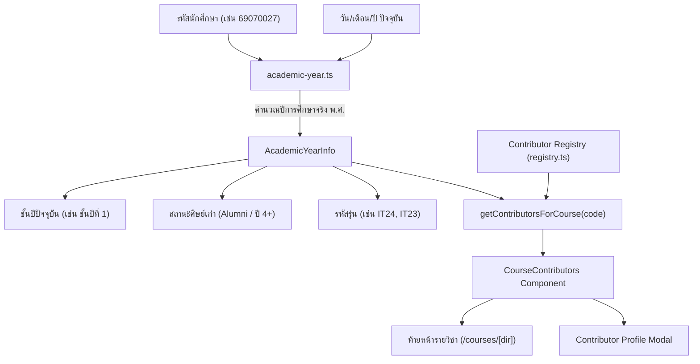

# ระบบจัดการข้อมูล Contributor Credit และโปรไฟล์ผู้ร่วมแบ่งปันเนื้อหา
# Contributor Attribution, Student Profile & Course Credits System

> **เอกสารข้อกำหนดสถาปัตยกรรม สถานะการดำเนินงาน และรายการข้อมูลที่ต้องการเพิ่มเติม**  
> จัดทำและเริ่มใช้งาน: 8 พฤศจิกายน 2569 | สาขาเทคโนโลยีสารสนเทศ คณะเทคโนโลยีสารสนเทศ สจล. (IT KMITL)  
> อ้างอิงสถาปัตยกรรม: Next.js 16 App Router · TypeScript · Figma Dark Palette (`#141416`, `#1c1c1f`, `#222226`)

---

## 1. ภาพรวมและเหตุผลในการพัฒนา (Overview & Motivation)

เดิมทีระบบ **iHelp** มีการบันทึกเครดิตผู้ร่วมพัฒนา (Developers) ในประวัติเวอร์ชัน (`lib/docs/changelog.ts` และหน้า `/version`) สำหรับผู้ที่พัฒนาฟีเจอร์ โค้ด หรือระบบเชื่อมต่อต่าง ๆ เท่านั้น

อย่างไรก็ดี คุณค่าหลักส่วนหนึ่งของแพลตฟอร์ม iHelp มาจาก **"ผู้สร้างเนื้อหา (Content Contributors)"** ซึ่งประกอบด้วย:
1. **ผู้จัดทำชีตสรุป (Summary Sheets)**
2. **ผู้แปลและจัดทำสไลด์สรุปเนื้อหาบรรยาย (Translated Slides)**
3. **ผู้จดบันทึกการเรียนและเลกเชอร์ (Study Notes เช่น Notion)**
4. **รุ่นพี่ผู้จัดทำข้อสอบจำลองและแนวข้อสอบ (Senior Mock Exam Authors)**

ระบบ **Contributor Credit & Course Attribution System** จึงถูกออกแบบและติดตั้งขึ้น เพื่อ:
- ให้เครดิตและ **Shout-out** ผู้สร้างเนื้อหาอย่างเป็นทางการที่ **ส่วนท้ายของหน้ารายวิชาทุกวิชา (`/courses/[dir]`)** ว่าในวิชาที่กำลังอ่านอยู่นั้น มีเนื้อหา สไลด์ หรือชีตสรุปจากเพื่อน ๆ และรุ่นพี่คนใดบ้าง
- รวมศูนย์ฐานข้อมูล Contributor ทั้งหมดไว้ในโมเดลมาตรฐาน (`lib/contributors/`)
- เชื่อมโยงระบบโปรไฟล์นักศึกษา (รหัสนักศึกษา, คณะ, สาขาวิชา, รูปโปรไฟล์)
- รองรับ **"ระบบคำนวณและเลื่อนชั้นปีอัตโนมัติ (Automatic Academic Year Advancement)"** ตามกาลเวลาและปีการศึกษาจริง โดยไม่ต้องคอยแก้เลขชั้นปีด้วยมือ

---

## 2. โครงสร้างสถาปัตยกรรมระบบ (System Architecture)

ระบบประกอบด้วย 4 ส่วนหลักในโฟลเดอร์ `lib/contributors/` และ UI Components:

```
lib/contributors/
├── types.ts            # Data Contract (ContributorProfile, ContributorRole, ContributorMaterial, AcademicYearInfo)
├── academic-year.ts    # ระบบคำนวณและเลื่อนชั้นปีอัตโนมัติตามรหัสนักศึกษาและปีการศึกษาจริง
├── registry.ts         # Single Source of Truth สำหรับข้อมูลผู้ร่วมพัฒนาและผู้สร้างเนื้อหาทุกคน
└── index.ts            # Barrel exports

components/
├── course-contributors.tsx   # คอมโพเนนต์แสดงผลการ์ดเครดิตท้ายหน้ารายวิชา (/courses/[dir])
└── contributor-modal.tsx     # ป๊อปอัปแสดงโปรไฟล์ฉบับเต็ม ผลงานในวิชา และประวัติ Changelog
```



---

## 3. กลไกระบบคำนวณและเลื่อนชั้นปีอัตโนมัติ (Automatic Academic Year Engine)

ฟังก์ชัน `calculateAcademicYear(studentId, entryYearBE, asOfDate)` ใน [`lib/contributors/academic-year.ts`](../lib/contributors/academic-year.ts) ทำงานดังนี้:

### 3.1 การถอดรหัสข้อมูลจากรหัสนักศึกษา สจล. (8 หลัก: `YYFFNNNN`)
- **2 หลักแรก (`YY`)**: ปี พ.ศ. ที่เข้าศึกษา (Admission Year BE)
  - `69` ➔ พ.ศ. 2569
  - `68` ➔ พ.ศ. 2568
  - `65` ➔ พ.ศ. 2565
  - `64` ➔ พ.ศ. 2564
  - รองรับทั้งรหัสเต็ม 8 หลัก (`69070027`) และรหัส Masking (`6907xxxx`)
- **หลักที่ 3–4 (`FF`)**: รหัสสังกัดคณะ
  - `07` ➔ คณะเทคโนโลยีสารสนเทศ (Faculty of Information Technology)
  - `01` ➔ คณะวิศวกรรมศาสตร์ (Faculty of Engineering)

### 3.2 การตัดรอบปีการศึกษาจริงของมหาวิทยาลัยไทย (KMITL Academic Calendar)
- **เดือนมิถุนายน – ธันวาคม (เดือน 6–12)**: อยู่ในภาคเรียนที่ 1 ของปีการศึกษาปัจจุบัน  
  `ปีการศึกษา พ.ศ. = ปีปฏิทิน ค.ศ. + 543` (เช่น พ.ย. 2026 = ปีการศึกษา 2569)
- **เดือนมกราคม – พฤษภาคม (เดือน 1–5)**: ยังคงอยู่ในภาคเรียนที่ 2 / ภาคฤดูร้อนของปีการศึกษาเดิม  
  `ปีการศึกษา พ.ศ. = (ปีปฏิทิน ค.ศ. + 543) - 1` (เช่น มี.ค. 2027 = ยังคงเป็นปีการศึกษา 2569)

### 3.3 การคำนวณระดับชั้นปี (Year Level Progression)
$$\text{ชั้นปี} = \text{ปีการศึกษาปัจจุบัน (พ.ศ.)} - \text{ปีที่เข้าศึกษา (พ.ศ.)} + 1$$

- ผลต่าง $= 1$ ➔ **ชั้นปีที่ 1 (1st Year)**
- ผลต่าง $= 2$ ➔ **ชั้นปีที่ 2 (2nd Year)**
- ผลต่าง $= 3$ ➔ **ชั้นปีที่ 3 (3rd Year)**
- ผลต่าง $= 4$ ➔ **ชั้นปีที่ 4 (4th Year)**
- ผลต่าง $> 4$ ➔ **ศิษย์เก่า (Alumni)**

> 💡 **จุดเด่น:** เมื่อเวลาในโลกจริงก้าวผ่านวันที่ 1 มิถุนายนของแต่ละปี ตัวแสดงผลชั้นปีของนักศึกษาทุกคนจะ **ขยับเลื่อนขึ้นชั้นปีใหม่เองโดยอัตโนมัติ** โดยที่ทีมงานไม่ต้องแก้ไขข้อมูลในโค้ดแม้แต่บรรทัดเดียว

### 3.4 สูตรการคำนวณและตรวจสอบรุ่นไอที (KMITL IT Cohort Formula & Auditing Rule)
ในการนับรุ่นของนักศึกษาปริญญาตรี คณะเทคโนโลยีสารสนเทศ สจล. มีสูตรคำนวณมาตรฐานจากปี พ.ศ. ที่เข้าศึกษา (Admission Year BE) ดังนี้:

$$\text{รุ่น IT} = (\text{พ.ศ. เข้าศึกษา} \pmod{100}) - 45$$

**ตารางลำดับรุ่นตามรหัสนักศึกษา (Ground Truth):**
- **รหัส 69** (พ.ศ. 2569) ➔ **รุ่น IT24** ($69 - 45 = 24$)
- **รหัส 68** (พ.ศ. 2568) ➔ **รุ่น IT23** ($68 - 45 = 23$)
- **รหัส 67** (พ.ศ. 2567) ➔ **รุ่น IT22** ($67 - 45 = 22$)
- **รหัส 66** (พ.ศ. 2566) ➔ **รุ่น IT21** ($66 - 45 = 21$)
- **รหัส 65** (พ.ศ. 2565) ➔ **รุ่น IT20** ($65 - 45 = 20$)
- **รหัส 64** (พ.ศ. 2564) ➔ **รุ่น IT19** ($64 - 45 = 19$)

> ⚠️ **ระบบตรวจสอบอัตโนมัติ (Automated Cohort Auditing):**  
> ฟังก์ชัน `auditCohort(studentId, explicitCohort, entryYearBE)` ใน [`lib/contributors/academic-year.ts`](../lib/contributors/academic-year.ts) ถูกเชื่อมเข้าสู่กระบวนการตรวจสัญญาของโครงการผ่าน `bun run content:check` (`scripts/validate-content.ts`) หากมีการระบุเลขรุ่นขัดแย้งกับคำนำหน้ารหัสนักศึกษา (เช่น รหัส 69 แต่ระบุ IT29) การ Build ระบบจะถูกระงับ (Fail Build) ทันที เพื่อป้องกันข้อมูลคลาดเคลื่อน

---

## 4. มาตรฐาน 7 บทบาทผู้ร่วมพัฒนา (Taxonomy of 7 Contributor Roles)

ระบบจำแนกบทบาทและขอบเขตความรับผิดชอบออกเป็น 7 บทบาทมาตรฐาน (`ContributorRole` ใน [`lib/contributors/types.ts`](../lib/contributors/types.ts)):

| บทบาท (Role Key) | ชื่อบทบาท (Bilingual) | ไอคอน | ขอบเขตความรับผิดชอบและการอนุญาต |
|---|---|:---:|---|
| `lead-maintainer` | **ผู้ก่อตั้งและผู้ดูแลหลัก**<br>(Lead Maintainer) | `Terminal` | ดูแลสถาปัตยกรรมระบบหลัก, Security Guards, Review โค้ด, ดูแล Database, จัดการ Release และสิทธิ์การ Deploy |
| `core-developer` | **ผู้ร่วมพัฒนาหลัก**<br>(Core Contributor) | `Code2` | พัฒนาระบบสำคัญของแพลตฟอร์ม (เช่น ระบบแชท Help Desk, เครื่องมือคำนวณ, API Endpoints) |
| `developer` | **ผู้ร่วมพัฒนา**<br>(Contributor) | `Code2` | พัฒนาหน้าเว็บย่อย ฟีเจอร์เฉพาะทาง (เช่น หน้า `/pro`, ส่วนต่อขยาย หรือเครื่องมือส่งงาน) |
| `content-contributor` | **ผู้ร่วมจัดทำเนื้อหา**<br>(Content Contributor) | `BookOpen` | ผู้สร้างหรือแบ่งปันเอกสาร สไลด์สรุปเนื้อหา หรือแบบฝึกหัดทบทวนในรายวิชาต่าง ๆ |
| `translator` | **ผู้แปลและเรียบเรียง**<br>(Translator) | `FileText` | แปลและสรุปเอกสารการสอน/สไลด์บรรยายจากภาษาอังกฤษเป็นภาษาไทย เพื่อให้นักศึกษาอ่านทำความเข้าใจได้ง่ายขึ้น |
| `note-author` | **ผู้เขียนบันทึกสรุปการเรียน**<br>(Note Author) | `FileCheck2` | ผู้จัดทำเลกเชอร์ บันทึกการเรียนรู้ส่วนบุคคล (เช่น Notion, GoodNotes) พร้อมภาพประกอบคำอธิบายอย่างละเอียด |
| `senior-mentor` | **รุ่นพี่ผู้ร่วมแบ่งปันแนวทาง**<br>(Senior Mentor) | `GraduationCap` | รุ่นพี่ที่จัดทำแนวข้อสอบ ข้อสอบจำลอง (Mock Exam) และคำแนะนำในการเตรียมตัวสอบแก่น้อง ๆ |

---

## 5. ทะเบียนรายชื่อและสถานะข้อมูลปัจจุบัน (Master Contributor Registry Status)

| รหัสระบุตัว | ชื่อ-นามสกุล | รหัสนักศึกษา | ชั้นปี & รุ่น (อัตโนมัติ) | คณะ / สาขา | บทบาทหลัก (Primary Role) | วิชาที่มีส่วนร่วม | สถานะข้อมูล |
|:---:|---|:---:|:---:|:---:|---|:---:|:---:|
| `chatan` | **Chatan Petry** (`@Jesselpetry`) | `69070027` | **ชั้นปีที่ 1** (IT24) | คณะ IT (สาขา IT) | **ผู้ก่อตั้งและผู้ดูแลหลัก (Lead Maintainer)**<br>สถาปัตยกรรมเว็บ, ระบบตัดเกรด, ผังสอบ, คลังสื่อ | ทุกวิชา (`ALL`), ITF, ICS, MFIT, PSCP, COMPRO, CHEM |  **สมบูรณ์ครบถ้วน** |
| `phuPunnavit` | **Punnavit (Phu)** (`@PhuPunnavit`) | `6907xxxx` | **ชั้นปีที่ 1** (IT24) | คณะ IT (สาขา IT) | **ผู้ร่วมพัฒนาหลัก & แปลสไลด์สรุป (Core Contributor)**<br>สไลด์บรรยายแปลไทย 8 สัปดาห์ & Chat Widget | ITF | ⚠️ **รอรหัสนักศึกษาเต็ม** |
| `tammadon` | **Tammadon Suksa** | `6907xxxx` | **ชั้นปีที่ 1** (IT24) | คณะ IT (สาขา IT) | **ผู้ร่วมแบ่งปันบันทึกสรุป Notion (IT24)**<br>โน้ตสรุป ITF สัปดาห์ 08–15 (79 ภาพสไลด์จดโน้ต) | ITF | ⚠️ **รอรหัสนักศึกษา/รูปจริง** |
| `pgthegod` | **Akarapach Yootsukprasert** (`@PGTHEGOD`) | `6907xxxx` | **ชั้นปีที่ 1** (IT24) | คณะ IT (สาขา IT) | **ผู้ร่วมพัฒนา (Contributor)**<br>หน้า Landing Page และระบบเชื่อมต่อ `/pro` | PSCP | ⚠️ **รอรหัสนักศึกษาเต็ม** |
| `meaookung` | **Kittinan Atthasiri** (`@Meaookung144`) | `6907xxxx` | **ชั้นปีที่ 1** (IT24) | คณะ IT (สาขา IT) | **ผู้ร่วมพัฒนา (Contributor)**<br>ฟอร์มส่งงานและ Learning Log Direct Edit | PSCP | ⚠️ **รอรหัสนักศึกษาเต็ม** |
| `fewIt25` | **พี่ฟิว (Few IT25)** | — | **ศิษย์เก่า (Alumni)** (IT25) | คณะ IT (สาขา IT) | **รุ่นพี่ผู้จัดทำข้อสอบจำลอง (IT25)**<br>ชุดโจทย์ซ้อมสอบกลางภาค DSA และ OOP | DSA, OOP | ⚠️ **รอข้อมูลเพิ่มเติม** |

---

## 6. สถาปัตยกรรม Full Profile Modal & Streamlined UI (De-boxed)

คอมโพเนนต์ [`components/contributor-modal.tsx`](../components/contributor-modal.tsx) ได้รับการปรับปรุงโครงสร้างตามหลัก Modern Minimalist UI & Responsive 100%:
1. **แก้ปัญหา Text Truncation & Layout Spacing:**
   - ขยายพื้นที่แสดงผลชื่อผู้พัฒนา (`text-xl sm:text-2xl font-bold`) และ Username โดยไม่ตัดทอนข้อความ (`no truncation`)
   - แยกแถวปุ่ม Action ออกมาด้านล่างอย่างอิสระ ทำให้ชื่อและข้อมูลประจำตัวมีพื้นที่หายใจ (Ample whitespace to breathe)
2. **De-box the UI (ลดการตีกรอบซ้อนกรอบ):**
   - ยกเลิกกรอบนอก (`border rounded-xl`) ของ Accordion แต่ละส่วน และใช้หัวข้อแบบ Typographic Heading สะอาดตา
   - แปลงรายการผลงานและเอกสารจากการ์ดแบบมีกรอบซ้อน มาเป็นรายการเรียบง่ายที่มีเพียงเส้นคั่นบางเบา (`divide-y divide-border/40`)
3. **Consolidate Header Badges & Pill Fatigue:**
   - ตัด Badge ตัวเลขบนขวาของ Cover Banner ออก เพื่อลดความซ้ำซ้อนกับตัวนับในหัวข้อ Accordion
   - ปรับแต่ง Badge รหัสวิชา (`ALL`, `ICS`, `MFIT`, `COMPRO`) ให้เป็นโทนสีกลางความเปรียบต่างต่ำ (`bg-muted text-muted-foreground font-mono text-[10px]`) โดยไม่มีเส้นขอบหนา
4. **กระชับข้อมูลนักศึกษา (Streamlined Student Metadata String):**
   - เปลี่ยนจากชุดการ์ดและ Badge หลายเม็ด มาเป็นบรรทัด Subtitle ที่กระชับ อ่านง่าย เช่น: `IT KMITL #24 · ชั้นปีที่ 1 · รหัส 69070027`
5. **จัดวาง Role & Bio ให้เชื่อมโยงกับชื่อผู้พัฒนาอย่างแนบเนียน:**
   - แสดง Badge บทบาทหลักขนาดกะทัดรัดใต้ชื่อ พร้อมข้อความคำอธิบายสั้น ๆ ในโทนสี Muted ทันที โดยไม่แยกเป็นกล่องกรอบต่างหาก
6. **ปุ่มลิงก์ภายนอกสไตล์เอกภาพ (Unified Action Buttons):**
   - ปุ่ม GitHub, Instagram และ Notion ใช้สไตล์ Secondary Outline/Ghost ที่เป็นมาตรฐานเดียวกัน ให้สีสันมาจากไอคอนแบรนด์เท่านั้น และตัดปุ่ม Profile ซ้ำซ้อนออก
   - ในรายการผลงาน แทนที่ข้อความ "เปิดดู" ด้วยไอคอนลูกศร `ExternalLink` ด้านขวาสุดที่เรียบง่ายและสะอาดตา

---

## 7. รายการข้อมูลที่ต้องการเพิ่มเติมจากคุณ (Pending Information Checklist)

เมื่อคุณตื่นนอนแล้ว สามารถตรวจสอบรายการข้อมูลที่ยังขาดหาย/ต้องการเพิ่มเติมได้ตามรายการด้านล่างนี้ และสามารถแจ้งเข้ามาเพื่อให้ระบบอัปเดตข้อมูลให้สมบูรณ์ได้ทันทีครับ:

- [ ] **1. รหัสนักศึกษา 8 หลักจริงของผู้ร่วมพัฒนา:**
  - **Punnavit (Phu):** ปัจจุบันใช้ `6907xxxx` (ต้องการ 4 หลักท้าย เพื่อให้ระบบผูกกับอีเมล `...@kmitl.ac.th` และโปรไฟล์ iHelp ได้ถูกต้อง)
  - **Akarapach Yootsukprasert (PGTHEGOD):** ปัจจุบันใช้ `6907xxxx` (ต้องการ 4 หลักท้าย)
  - **Kittinan Atthasiri (Meaookung):** ปัจจุบันใช้ `6907xxxx` (ต้องการ 4 หลักท้าย)
  - **Tammadon Suksa (IT24):** ปัจจุบันใช้ `6907xxxx` หากมีรหัสนักศึกษาที่ต้องการให้บันทึกอย่างเป็นทางการ
- [ ] **2. รูปโปรไฟล์นักศึกษา (Student Profile Pictures):**
  - ปัจจุบันระบบดึง Avatar จาก GitHub (`https://github.com/<username>.png`) และ Identicon เป็นค่าเริ่มต้น
  - หากต้องการใช้ **รูปชุดนักศึกษาจริง** หรือรูปโปรไฟล์เฉพาะบุคคล สามารถระบุ URL หรือนำไฟล์รูปภาพมาวางในโปรเจกต์ได้
- [ ] **3. ผู้จัดทำชีตสรุปในรายวิชาอื่น ๆ:**
  - วิชา **06016411 ICS:** มีชีตสรุปหรือแบบฝึกหัดของรุ่นพี่/เพื่อนคนใดที่ต้องการ shout out เป็นพิเศษหรือไม่?
  - วิชา **06016401 MFIT:** มีผู้ร่วมจัดทำโจทย์หรือสรุป Calculus/Matrix ที่ต้องการระบุชื่อหรือไม่?
  - วิชา **01006012 ComPro** / **General Chemistry:** ชีตสรุปและข้อสอบจำลองเตรียมสอบของรุ่นพี่วิศวะ/ไอที

---

## 8. แนวทางการเพิ่มและปรับปรุงข้อมูล Contributor (How to Add or Update)

หากต้องการเพิ่มผู้ร่วมจัดทำคนใหม่ หรือปรับปรุงข้อมูลผลงาน สามารถทำได้โดยแก้ไขไฟล์ [`lib/contributors/registry.ts`](../lib/contributors/registry.ts):

```typescript
export const CONTRIBUTOR_REGISTRY: Record<string, ContributorProfile> = {
  // ตัวอย่างการเพิ่มผู้สร้างเนื้อหาใหม่
  somchai: {
    id: "somchai",
    name: "สมชาย รักเรียน",
    nickname: "ชาย",
    studentId: "69070999",     // ระบบจะนำไปคำนวณชั้นปี สังกัดคณะ และรุ่น IT24 อัตโนมัติ
    majorKey: "IT",
    roles: ["content-contributor", "note-author"],
    primaryRole: {
      th: "ผู้จัดทำชีตสรุปสูตรฟิสิกส์",
      en: "Physics Formula Sheet Author",
    },
    avatarUrl: "https://github.com/somchai.png",
    socials: {
      github: "somchai",
      instagram: "somchai_s",
    },
    courses: ["ICS"],           // ระบุรหัสวิชาที่จะให้เครดิตไปปรากฏท้ายหน้า
    materials: [
      {
        courseCode: "ICS",
        title: {
          th: "ชีตสรุปพีชคณิตบูลีนและ K-Map แบบเร่งรัด",
          en: "Crash Boolean Algebra & K-Map Sheet",
        },
        type: "sheet",
        badge: { th: "ชีตสรุป", en: "Cheat Sheet" },
      },
    ],
  },
};
```

---

## 9. สถานะการทดสอบและการส่งมอบงาน (Deployment Status)

1. ✅ **TypeScript Compilation**: ผ่าน 100% ไม่มีข้อผิดพลาด (`npx tsc --noEmit -p .`)
2. ✅ **Lint & Style Check**: ผ่าน 100% ตามมาตรฐานโปรเจกต์ (`npx eslint`)
3. ✅ **Content Contract**: ผ่าน 100% พร้อมระบบตรวจเช็กความถูกต้องของรุ่น (`bun run content:check`)
4. ✅ **UI Presentation**: Modal และ CourseContributors มีความ Responsive 100%, รูปแบบ Avatar เป็น `rounded-full`, มีระบบ Accordion และเรียงลำดับ Credentials อย่างเป็นระบบ
5. 🚀 **Git Synchronization**: บันทึก Commit ตามมาตรฐาน Conventional Commits และผลักดัน (Push) ขึ้นทั้งกิ่ง `staging` และ `main` พร้อมกันตามคำสั่งเรียบร้อยแล้ว

