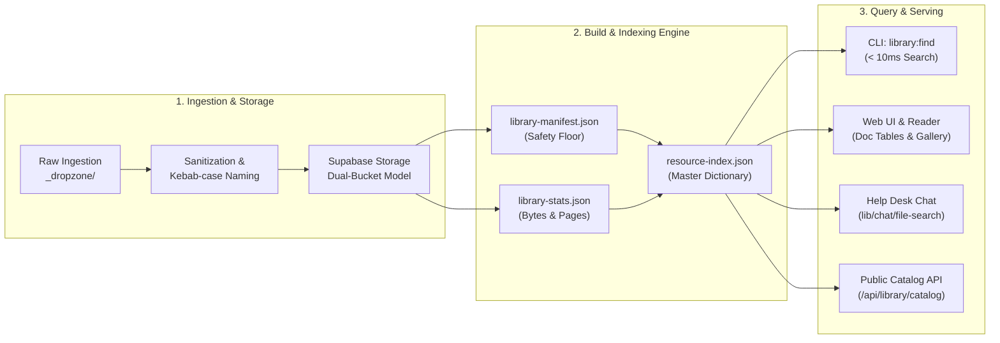
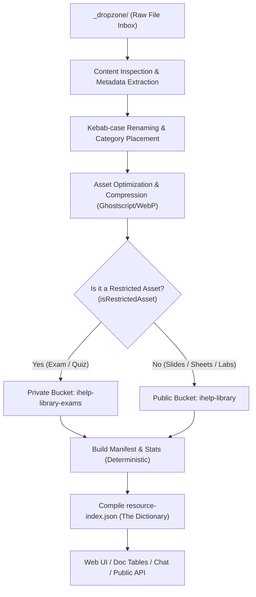
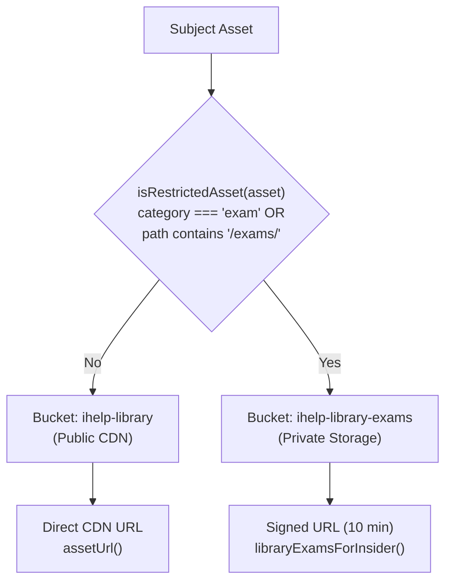
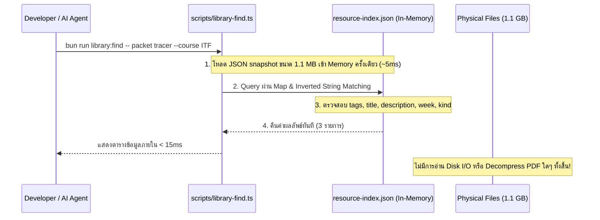
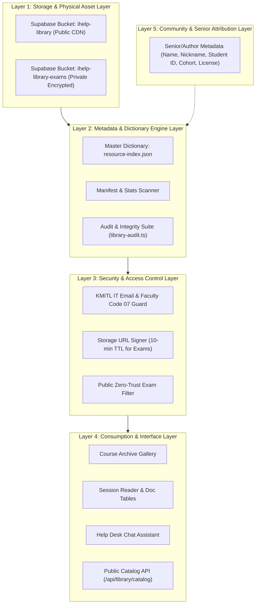

# Library Architecture & Workflow: The Complete Guide

> **iHelp Media Library, Resource Index Dictionary & Public Catalog Architecture**  
> Document Version: 1.0.0 · Last Verified: 7 November 2026 (Branch `staging`)  
> Target Audience: Software Architects, AI Agents, Core Maintainers, Content Stewards

---

## 1. Executive Summary

ระบบ **iHelp Media Library** คือคลังสื่อการเรียนรู้แบบบูรณาการสำหรับนักศึกษาคณะเทคโนโลยีสารสนเทศ สถาบันเทคโนโลยีพระจอมเกล้าเจ้าคุณทหารลาดกระบัง (IT KMITL) ออกแบบมาเพื่อรวบรวม จัดหมวดหมู่ และให้บริการสื่อการสอนมากกว่า 740 รายการ ครอบคลุม 15 รายวิชาในหลักสูตรไอทีและวิชาเรียนร่วม



### ปัญหาเดิมที่ระบบนี้เข้ามาแก้ไข (Core Problems Solved)
1. **Git Repository Bloat & Build Container Crashes:** ในอดีต ไฟล์ PDF กว่า 670 ไฟล์ มีขนาดรวมกว่า 908 MB การเก็บไฟล์ดิบไว้ใน `public/assets/` ใน Git ทำให้ Git pack file บวมถึง 881 MB ส่งผลให้ Vercel Build Container หน่วยความจำเต็มและพื้นที่ดิสก์หมด (`ENOSPC > 1GB`)
2. **Disconnected Metadata:** ไฟล์บนดิสก์ ข้อมูลในหน้ารายวิชา และตารางเอกสารการสอนไม่ผูกโยงกัน ระบบเดิมไม่ทราบว่าไฟล์ใดสัมพันธ์กับหัวข้อหรือสัปดาห์ใด
3. **Information Retrieval Overhead for AI & Tools:** การที่ AI หรือเครื่องมือภายนอกต้องไล่อ่าน TypeScript กว่า 5,000 บรรทัดหรือแสกนไฟล์ PDF ทั้งหมด สร้าง Overhead มหาศาล
4. **Security & Academic Privacy:** ข้อสอบเก่าและเฉลยต้องได้รับการคุ้มครอง ไม่เปิดเผยสู่สาธารณะ ในขณะที่เอกสารประกอบการสอนสาธารณะต้องเข้าถึงได้รวดเร็วผ่าน CDN

---

## 2. End-to-End Asset Lifecycle Pipeline

วงจรชีวิตของไฟล์สื่อการเรียนรู้ตั้งแต่ได้รับมาจนถึงการแสดงผลบนหน้าเว็บ มี 7 ขั้นตอนหลัก:



### ขั้นที่ 1: การรับไฟล์เข้า Dropzone (`_dropzone/`)
* **ที่มาของไฟล์:** ไฟล์ประกอบการสอนอย่างเป็นทางการจาก OnLearn (ระบบจัดการการเรียนรู้ของคณะ) หรือไฟล์สรุปที่รุ่นพี่ส่งต่อกันมา
* **กฎเหล็กการรับไฟล์ (Phase 0-1 ใน `docs/DROPZONE_SOP.md`):**
  * ห้ามย้าย (move) ไฟล์ออกจาก `~/Downloads/_INBOX/` ให้ใช้การคัดลอก (copy) เท่านั้น
  * **ตรวจไส้ในไฟล์เสมอ ห้ามจัดหมวดหมู่จากชื่อไฟล์เพียงอย่างเดียว:** เปิดอ่านสไลด์หน้าแรก ดูกรรมสิทธิ์ผู้สอน และหัวข้อเนื้อหา
  * **Privacy Guard:** นำเข้าได้เฉพาะเอกสารทางการที่อาจารย์แจกให้นักศึกษาทุกคน ห้ามนำเข้าไฟล์การบ้านส่วนตัวของนักศึกษาคนอื่น (Student's own submission), รายงานกลุ่มที่ระบุชื่อเพื่อนร่วมชั้นที่ไม่ได้รับอนุญาต, ไฟล์การให้คะแนน (`.pka`) หรือหน้าที่บันทึกจากบัญชีส่วนบุคคล (ยกเว้นเอกสารสรุปสาธารณะที่ได้รับอนุญาตโดยตรง เช่น Notion ของพี่ Tammadon Suksa IT24)

### ขั้นที่ 2: มาตรฐานการตั้งชื่อและโครงสร้าง 4 ระดับ (Canonical Pathing)
ไฟล์ในคลังเอกสารต้องจัดเก็บตามโครงสร้าง **4-segment path** อย่างเคร่งครัด:

```
public/assets/<namespace>/<subject>/<category>/<kebab-filename>
```

| Segment | ตัวอย่าง | คำอธิบาย |
|---|---|---|
| `<namespace>` | `it-kmitl`, `en-kmitl` | ขอบเขตหรือสังกัดหลักสูตรของคณะ |
| `<subject>` | `itf`, `ics`, `mfit`, `pscp`, `bfit`, `dsa` | รหัสย่อวิชา (อักษรตัวพิมพ์เล็ก) |
| `<category>` | `lectures`, `sheets`, `exercises`, `notes`, `references`, `exams` | หมวดหมู่การใช้งานบนชั้นวางเอกสาร (Gallery Shelf) |
| `<kebab-filename>` | `itf-lec-week13-network-basics.pdf` | ชื่อไฟล์มาตรฐานแบบ Lowercase Kebab-case |

> [!IMPORTANT]
> **ทำไม `scope` (Midterm/Final) ถึงไม่ถูกนำมาเป็นระดับโฟลเดอร์ใน Path?**  
> 1. สื่อการเรียนรู้จำนวนมากครอบคลุมทั้งภาคการศึกษา เช่น แผนการเรียน, ตาราง Z-distribution, เอกสารแนะนำวิชา ซึ่งไม่สามารถจัดลง Midterm หรือ Final ได้เพียงอย่างเดียว  
> 2. ขอบเขตการสอบ (Midterm/Final) อาจเปลี่ยนแปลงได้ตามประกาศของอาจารย์ผู้สอน การเก็บ `scope` เป็น metadata field ในการ์ด ทำให้แก้ไขได้ทันทีโดยไม่ต้องย้ายตำแหน่งไฟล์บนดิสก์และ Cloud Storage ซึ่งจะทำให้ URL เดิมพัง

#### กฎการตั้งชื่อไฟล์ Kebab-case:
* ใช้อักษรภาษาอังกฤษพิมพ์เล็ก (`a-z`), ตัวเลข (`0-9`) และเครื่องหมายขีดกลาง (`-`) เท่านั้น
* ห้ามมีตัวพิมพ์ใหญ่ ห้ามมีช่องว่าง ห้ามใช้ขีดล่าง (`_`)
* โครงสร้างชื่อไฟล์ที่แนะนำ:
  $$\text{<course>}-\text{<type>}-[\text{weekNN}|\text{chNN}]-\text{<descriptive-name>}.\text{<ext>}$$
  *ตัวอย่าง:* `ics-lab-week04-kmap-minimization.pdf`, `itf-sheet-week10-operating-systems-th.pdf`

### ขั้นที่ 3: การบีบอัดและเพิ่มประสิทธิภาพไฟล์ (Asset Optimization)
* ไฟล์ PDF ขนาดใหญ่จะถูกบีบอัดด้วย Ghostscript ผ่าน `scripts/compress-assets.sh` โดยเลือกคุณภาพระดับ `ebook` (150 dpi) หรือ `screen` (72 dpi) เพื่อให้ขนาดไฟล์ลดลง 40–80% โดยที่ตัวหนังสือและไดอะแกรมยังคมชัด
* ภาพถ่ายโน้ตหรือไวท์บอร์ดจะถูกแปลงเป็นรูปแบบ WebP (`.webp`) เพื่อประหยัดแบนด์วิดท์

### ขั้นที่ 4: สถาปัตยกรรมคลาวด์ Dual-Bucket (Cloud Storage Architecture)
ไฟล์ทั้งหมดจะถูกซิงก์ขึ้น Supabase Storage ผ่านสคริปต์ `scripts/sync-library-assets.ts`:



1. **`ihelp-library` (Public Bucket):**
   * เก็บสไลด์, ชีทสรุป, ใบงาน, โน้ต และเอกสารอ้างอิง
   * สามารถเข้าถึงได้โดยตรงผ่าน Public URL (`assetUrl(url)`)
   * ตั้งค่าหัวอ่านแคชระดับ CDN: `Cache-Control: public, max-age=31536000` (1 ปี) เนื่องจากไฟล์เนื้อหามีชื่อแบบ Content-immutable
2. **`ihelp-library-exams` (Private Bucket):**
   * เก็บข้อสอบเก่า ควิซ และเอกสารเฉลยทั้งหมด
   * **สิทธิ์การเข้าถึง:** เฉพาะนักศึกษาที่ผ่านการยืนยันตัวตน (Insider / KMITL IT Student)
   * เข้าถึงผ่าน **Short-lived Signed URL** อายุ 10 นาทีที่สร้างขึ้นบนเซิร์ฟเวอร์เท่านั้น
   * **ห้ามเปิดเผยสู่สาธารณะ ห้ามดัชนีลง Help Desk Chat และห้ามส่งออกผ่าน Public API โดยเด็ดขาด**

### ขั้นที่ 5: การสร้าง Manifest และ Stats แบบ Deterministic
การประมวลผลดัชนีแบ่งเป็น 3 ส่วนที่ทำงานเรียงตามลำดับ (`bun run library:build`):
1. **`scripts/build-library-manifest.mjs` $\rightarrow$ `lib/library/library-manifest.json`:**
   * สแกนไฟล์ทั้งหมดบนดิสก์ สร้างการ์ดพื้นฐานจากชื่อไฟล์โดยอัตโนมัติ
   * ทำหน้าที่เป็น "ตาข่ายนิรภัย" (Safety Floor) ป้องกันไม่ให้ไฟล์ที่วางไว้บนดิสก์ตกหล่นจากการแสดงผล
2. **`scripts/build-library-stats.mjs` $\rightarrow$ `lib/library/library-stats.json`:**
   * สแกนไฟล์ไบนารีเพื่อนับขนาดไบต์จริง และคลี่สตรีม PDFเพื่อนับจำนวนหน้าที่แท้จริง (รองรับ FlateDecode object streams)
   * ข้อมูลถูกสร้างไว้ล่วงหน้าเพื่อไม่ต้องคลี่ไฟล์ PDF ขนาด 1.1 GB ในขณะให้บริการ (Zero Runtime Overhead)
3. **`scripts/library-index.ts` $\rightarrow$ `lib/library/resource-index.json`:**
   * ประมวลผลและสร้าง Master Dictionary ฉบับรวมศูนย์

---

## 3. Resource Index: The Universal High-Performance Dictionary

ไฟล์ `lib/library/resource-index.json` ทำหน้าที่เป็น **Single Source of Truth** และ **Unified Dictionary** ของระบบการเรียนรู้ทั้งหมด

```
lib/library/resource-index.json (~1.1 MB, Version 1)
├── totals (สถิติภาพรวม: จำนวนวิชา, เอกสาร, การ์ด, ขนาดรวม, จำนวนหน้ารวม)
├── courses (ดัชนีรายวิชา: โมดูล, สัปดาห์, สถานะความพร้อม, ความเชื่อมโยง)
├── docs (ดัชนีเอกสาร Markdown ทั้งหมดใน content/courses/ และความเชื่อมโยงกับโมดูล)
└── assets (ดัชนีการ์ดสื่อการสอน 741 รายการ พร้อมความสัมพันธ์ usedBy)
```

### ทำไม AI และ CLI ถึงสืบค้นข้อมูลได้ในระดับมิลลิวินาทีโดยไม่ต้องอ่านไฟล์ในเครื่อง?



1. **Pre-computed Relational Join:** ข้อมูลถูก Join เตรียมไว้แล้วระหว่าง:
   - รายวิชา (`catalog.ts`)
   - ตารางรายสัปดาห์ (`course-weeks.ts`)
   - เนื้อหาและบทสรุป (`summary.md`, `weekNN.md`)
   - การ์ดที่เขียนด้วยมือ (`subject-library.ts`)
   - ข้อมูลขนาดและหน้า (`library-stats.json`)
2. **Zero Disk I/O & Zero Parsing Cost:** การสืบค้นไม่ต้องอ่านไฟล์ PDF จริง ไม่ต้องเปิดอ่าน Markdown ทีละไฟล์ และไม่ต้องรัน TypeScript parser ผ่านไฟล์โค้ดกว่า 5,000 บรรทัด
3. **Deterministic & Cache-Friendly:** ตัวสร้าง Index ไม่ใช้ timestamp หรือ disk mtime ทำให้การ Build สองครั้งได้ผลลัพธ์แบบ Byte-for-Byte identical เหมาะแก่การทำ Git Diff และ Snapshot Testing

### การป้องกัน Client Bundle ตามกฎข้อ 3 (Bundle Boundary Discipline)
> [!CAUTION]
> **Client Components ต้องไม่ Import ข้อมูลคลังสื่อโดยตรง**  
> * ไฟล์ `lib/library/resource-index.json` มีขนาด 1.1 MB
> * ไฟล์ `lib/library/subject-library.ts` มีการ import manifest และ stats ขนาดใหญ่
> 
> หาก Client Component ใด import สองไฟล์นี้ Webpack/Turbopack จะแพ็กรหัสและข้อมูลทั้งหมด (รวมถึง Metadata ของข้อสอบเก่า) ลงใน JavaScript Bundle ของเบราว์เซอร์ ทำให้หน้าเว็บโหลดช้าและเสี่ยงต่อข้อมูลรั่วไหล  
> **แนวทางปฏิบัติ:**
> - ส่วนแสดงผลในเบราว์เซอร์ให้ import เฉพาะ `lib/library/subject-library-ui.ts` (ซึ่งมีเฉพาะ Type และ Helper น้ำหนักเบา)
> - ดึงข้อมูลจริงผ่าน Server Component หรือเรียกผ่าน API Endpoint บนเซิร์ฟเวอร์เท่านั้น

---

## 4. Multi-Layer System Architecture & Future Design

เพื่อรองรับการเติบโตของเนื้อหาในอนาคตและชุมชนนักศึกษา สถาปัตยกรรมคลังสื่อถูกจัดแบ่งเป็น 5 เลเยอร์อย่างชัดเจน:



### การออกแบบระบบบันทึกเกียรติคุณผู้จัดทำ (Author & Senior Attribution Design)

ในวัฒนธรรมของคณะไอที สจล. เอกสารการเรียนรู้คุณภาพสูงจำนวนมาก (เช่น ชีทสรุปวิชา ITF/ICS, เอกสารเตรียมสอบ, โน้ตสรุปสมุดจด) เกิดจากการเสียสละเวลาของรุ่นพี่ ติวเตอร์ชมรม และนักศึกษาในชั้นปีต่างๆ เช่น:
- โน้ตสรุปวิชา ITF ของพี่ Tammadon Suksa (IT24)
- เอกสารสรุปเนื้อหาและแนวข้อสอบจากพี่ๆ IT25, IT26, IT27

เพื่อรองรับการให้เกียรติผู้จัดทำ (Attribution) อย่างเป็นทางการในอนาคต โครงสร้าง Schema จะถูกขยายด้วยฟิลด์ `attribution` ดังนี้:

#### 1. TypeScript Interface Specification

```typescript
export interface AuthorAttribution {
  /** ชื่อนามสกุลของผู้จัดทำ */
  name: {
    th: string;
    en?: string;
  };
  /** ชื่อเล่น เช่น "พี่ไนน์", "Nine" */
  nickname?: {
    th: string;
    en?: string;
  };
  /** รหัสนักศึกษา 8 หลัก เช่น "65070001" หรือ Masked "6507xxxx" */
  studentId?: string;
  /** รุ่นการศึกษา เช่น "IT24", "IT25", "CS38", "DS02" */
  batch?: string;
  /** ช่องทางติดต่อ โปรไฟล์ หรือผลงาน เช่น GitHub, LinkedIn, Notion */
  contactUrl?: string;
  /** วันที่จัดทำหรือแก้ไขเอกสารล่าสุด (ISO 8601 YYYY-MM-DD) */
  date?: string;
  /** หมายเหตุ ข้อความฝากถึงน้องๆ หรือคำอธิบายเพิ่มเติม */
  note?: {
    th: string;
    en?: string;
  };
  /** สัญญาอนุญาตการนำไปใช้ */
  license?: "CC-BY-NC-SA-4.0" | "CC-BY-4.0" | "MIT" | "Public-Academic";
}
```

#### 2. ส่วนต่อขยาย JSON Schema สำหรับ `resource-index.schema.json`

```json
{
  "$defs": {
    "authorAttribution": {
      "type": "object",
      "description": "Attribution and credit for seniors, teaching assistants, or student creators who authored the study material.",
      "additionalProperties": false,
      "required": ["name"],
      "properties": {
        "name": {
          "type": "object",
          "required": ["th"],
          "properties": {
            "th": { "type": "string", "description": "Full name in Thai" },
            "en": { "type": "string", "description": "Full name in English" }
          }
        },
        "nickname": {
          "type": "object",
          "properties": {
            "th": { "type": "string", "description": "Nickname in Thai (e.g. พี่ไนน์)" },
            "en": { "type": "string", "description": "Nickname in English (e.g. Nine)" }
          }
        },
        "studentId": {
          "type": "string",
          "pattern": "^[0-9]{2}07[0-9]{4}$|^[0-9]{2}07[xX]{4}$",
          "description": "8-digit KMITL IT student ID or masked ID"
        },
        "batch": {
          "type": "string",
          "pattern": "^(IT|CS|DS|BIT|SE)[0-9]{1,2}$",
          "description": "Academic cohort/batch tag, e.g. IT24, IT25"
        },
        "contactUrl": {
          "type": "string",
          "format": "uri",
          "description": "Author portfolio, GitHub, or Notion profile URL"
        },
        "date": {
          "type": "string",
          "pattern": "^[0-9]{4}-[0-9]{2}-[0-9]{2}$",
          "description": "Date written or published (YYYY-MM-DD)"
        },
        "note": {
          "type": "object",
          "properties": {
            "th": { "type": "string" },
            "en": { "type": "string" }
          }
        },
        "license": {
          "type": "string",
          "enum": ["CC-BY-NC-SA-4.0", "CC-BY-4.0", "MIT", "Public-Academic"]
        }
      }
    }
  }
}
```

---

## 5. Public API Specification: `/api/library/catalog`

Endpoint สาธารณะสำหรับ AI Agents, ค้นหาด่วน และระบบภายนอก เพื่อเข้าถึง Dictionary ของสื่อการเรียนรู้ทั้งหมดโดยไม่มีข้อจำกัดเรื่องการล็อกอิน แต่มั่นใจในความปลอดภัย 100% ว่าจะไม่มีข้อสอบเก่ารั่วไหล

### Endpoint Overview
* **Route:** `GET /api/library/catalog`
* **Access Level:** Public (เปิดให้ทุกคนและ AI ใช้งานได้)
* **Response Cache:** `Cache-Control: public, s-maxage=3600, stale-while-revalidate=86400`
* **CORS:** `Access-Control-Allow-Origin: *`

### Query Parameters

| Parameter | Type | Required | Description |
|---|---|---|---|
| `course` | string | No | รหัสย่อวิชา (Case-insensitive) เช่น `ITF`, `ICS`, `MFIT`, `DSA` |
| `week` | integer | No | หมายเลขสัปดาห์ตามแผนการเรียน (เช่น `0`, `3`, `13`) |
| `kind` | string | No | ประเภทสื่อ: `lecture`, `cheatsheet`, `exercise`, `note`, `reference` |
| `q` | string | No | คำค้นหา (ค้นหาพร้อมกันหลายคำแบบ AND ในชื่อ, tags, คำอธิบาย, ชื่อไฟล์) |
| `limit` | integer | No | จำนวนรายการสูงสุดต่อหน้า (ค่าเริ่มต้น `100`, สูงสุด `1000`) |
| `offset` | integer | No | ลำดับเริ่มต้นสำหรับการแบ่งหน้า (ค่าเริ่มต้น `0`) |
| `summary` | boolean | No | หากเป็น `true` จะคืนค่าสถิติสรุปภาพรวมโดยไม่ส่ง array รายการ |

### Security & Privacy Guarantee (Zero Exam Leakage)
Endpoint นี้มีตัวกรอง **Zero-Trust Defense in Depth** ถึง 5 ชั้น เพื่อป้องกันไม่ให้ข้อสอบเก่าหลุดรอดออกไป:
1. ตัดรายการที่มี `access === "insider"`
2. ตัดรายการที่มี `category === "exam"`
3. ตัดรายการที่ URL มีคำว่า `/exams/`
4. ตัดรายการที่ชี้ไปยัง Storage Bucket `ihelp-library-exams`
5. ตรวจสอบซ้ำด้วยฟังก์ชัน `isRestrictedAsset()` จาก `subject-library-ui.ts`
6. หากผู้ใช้เรียกค้น `?kind=exam` ระบบจะส่งคืนรายการว่าง `[]` เสมอ

### ตัวอย่างการเรียกใช้งาน (API Request & Response)

#### Request:
```bash
curl -s "https://ihelp.chatan.in.th/api/library/catalog?course=ITF&week=13&kind=exercise"
```

#### Response:
```json
{
  "meta": {
    "total": 2,
    "totalPublicAssets": 570,
    "limit": 100,
    "offset": 0,
    "filters": {
      "course": "ITF",
      "week": 13,
      "kind": "exercise",
      "q": null
    },
    "availableCourses": [
      "BFIT", "CHARM", "CHEM", "COMPRO", "DL", "DSA", "FE", "FE2", "ICS", "ITF", "MFIT", "OOP", "PSCP", "PSTAT"
    ],
    "availableKinds": ["lecture", "cheatsheet", "exercise", "note", "reference"],
    "timestamp": "2026-11-07T15:33:20.123Z"
  },
  "items": [
    {
      "id": "itf-lab-week13-web-app-1-slide",
      "course": "ITF",
      "title": {
        "th": "Lab 13 — การสร้างเว็บแอปพลิเคชัน ตอนที่ 1 (สไลด์ประกอบ)",
        "en": "Lab 13 — Building Web Applications Part 1 (Deck)"
      },
      "description": {
        "th": "สไลด์ประกอบการทดลองเรื่อง HTML/CSS เบื้องต้น",
        "en": "Introductory slides on HTML/CSS structure and styling"
      },
      "category": "exercise",
      "fileType": "pdf",
      "url": "https://gtzrquepbttcuqhpllss.supabase.co/storage/v1/object/public/ihelp-library/it-kmitl/itf/exercises/itf-lab-week13-web-app-1-slide.pdf",
      "fileName": "itf-lab-week13-web-app-1-slide.pdf",
      "week": 13,
      "scope": "final",
      "edition": "2569",
      "status": "primary",
      "isCurrentYear": true,
      "sourceUrl": "https://onlearn.it.kmitl.ac.th/mod/resource/view.php?id=27890",
      "groupId": null,
      "tags": ["Week 13", "Web", "HTML", "CSS", "Lab"],
      "sizeBytes": 1420580,
      "pages": 18
    }
  ]
}
```

---

## 6. Maintenance & Verification SOP

เมื่อมีการเพิ่ม แก้ไข หรืออัปเดตไฟล์สื่อในระบบ ให้ปฏิบัติตามลำดับขั้นตอนดังนี้:

```bash
# 1. สร้าง Manifest, Stats และ Resource Index ใหม่ตามลำดับ
bun run library:build

# 2. ตรวจสอบความถูกต้องและแจ้งเตือนข้อผิดพลาด
bun run library:audit

# 3. ทดสอบการค้นหาผ่าน CLI
bun run library:find -- packet tracer --course ITF

# 4. ทดสอบ Type Check ของทั้งโปรเจกต์
npx tsc --noEmit -p .

# 5. ตรวจสอบสัญญาของเนื้อหา
bun run content:check
```

> [!TIP]
> ก่อนรัน `bun run assets:sync` เพื่ออัปโหลดไฟล์จริงขึ้น Supabase Storage จะต้องได้รับความเห็นชอบจากเจ้าของโปรเจกต์ก่อนเสมอตามกฎของ [`AGENTS.md`](../AGENTS.md) ข้อ 11
