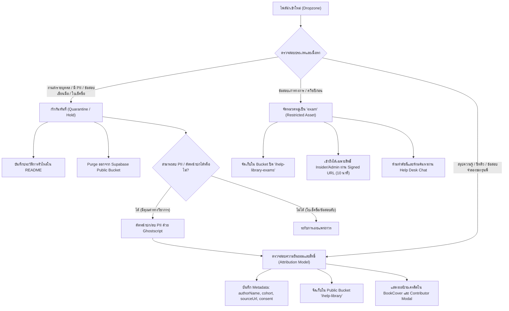
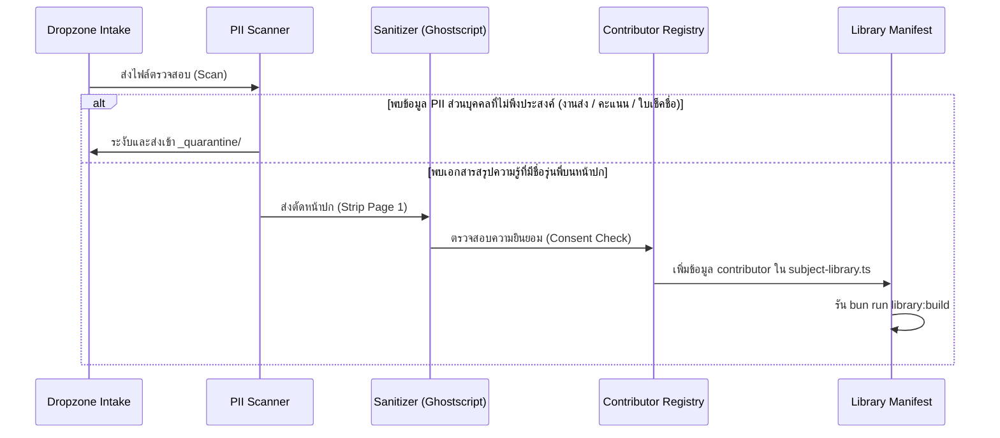

# Quarantine & Sensitive Assets Audit and Contributor Attribution Model
# รายงานการตรวจสอบไฟล์กักกัน คลังข้อสอบ และโมเดลการให้เครดิตผู้จัดทำเอกสาร

> **เอกสารกำกับความปลอดภัย ความเป็นส่วนตัว (PDPA) และสารบบการให้เครดิตผู้จัดทำเอกสาร**  
> ตรวจสอบและจัดทำ: 7 พฤศจิกายน 2569 | สาขาเทคโนโลยีสารสนเทศ คณะเทคโนโลยีสารสนเทศ สจล. (IT KMITL)  
> อ้างอิงสถาปัตยกรรม: Next.js 16 App Router · Supabase Storage · Drizzle ORM · TypeScript  

---

## 1. บทสรุปสำหรับผู้บริหาร (Executive Summary)

โครงการ **\<i\>Help** มุ่งเน้นการเป็นศูนย์กลางข้อมูลการเรียนการสอนและเครื่องมือสนับสนุนการศึกษาสำหรับนักศึกษาชั้นปีที่ 1 คณะเทคโนโลยีสารสนเทศ สถาบันเทคโนโลยีพระจอมเกล้าเจ้าคุณทหารลาดกระบัง (IT KMITL) โดยยึดหลักเกณฑ์ความโปร่งใส ความปลอดภัยของข้อมูลส่วนบุคคล (PDPA) และจริยธรรมทางวิชาการ (Academic Integrity) ตามข้อบังคับสถาบันและกฎหมายว่าด้วยการคุ้มครองข้อมูลส่วนบุคคล พ.ศ. 2562

เอกสารฉบับนี้จัดทำขึ้นโดย **Quarantine & Sensitive Asset Specialist** เพื่อรายงานผลการตรวจสอบอย่างละเอียดใน 3 ส่วนสำคัญ:
1. **การตรวจสอบและวิเคราะห์สินทรัพย์กักกัน (Quarantined Assets Audit)** ใน `_quarantine/` และ `_dropzone/_hold/mfit-privacy/` ที่ตรวจพบการรั่วไหลของข้อมูลระบุตัวบุคคล (Personally Identifiable Information: PII)
2. **การตรวจสอบคลังข้อสอบเก่าและระบบควบคุมสิทธิ์ (Past Exams & Restricted Assets Security Model)** ซึ่งจัดเก็บใน Bucket ส่วนบุคคลแบบปิด (`ihelp-library-exams`) และมีมาตรการป้องกันการเข้าถึงและการรั่วไหลผ่านระบบแชท Help Desk
3. **การออกแบบสถาปัตยกรรมโมเดลการให้เครดิตผู้จัดทำ (Senior & Student Contributor Attribution Model)** เพื่อยกระดับการจัดการสรุปความรู้ ชีทสรุป และข้อสอบจำลองที่จัดทำโดยรุ่นพี่หรือนักศึกษาให้เป็นระบบ ได้มาตรฐาน มีการขอความยินยอมอย่างถูกต้อง และให้เกียรติผู้จัดทำ

### ตารางสรุปสถานะความเสี่ยงและการดำเนินการ (Risk & Compliance Status Dashboard)

| ขอบเขตการตรวจสอบ | สถานะปัจจุบัน | ความเสี่ยงที่พบ | มาตรการที่บังคับใช้ | การดำเนินการที่ต้องทำต่อไป |
|---|---|---|---|---|
| **`_quarantine/` (ICS)** | กักกันนอก `public/assets/` แล้ว (9 ไฟล์) | รั่วไหลชื่อจริง นามสกุล และรหัสนักศึกษา (`64070106`, `65070021`, `65070027`) ในงานส่งและการสอบเขียนมือ | แยกไฟล์เข้าโฟลเดอร์กักกัน ถอดออกจาก manifest และ index | **Purge ออบเจกต์ทั้ง 9 คีย์ออกจาก Supabase Storage Public Bucket (`ihelp-library`) ก่อนขึ้น Production** |
| **`_dropzone/_hold/mfit-privacy/`** | กักกันใน Hold Zone (8 ไฟล์ + 1 โฟลเดอร์) | รั่วไหลรหัสนักศึกษาบนหน้าปกการบ้านและลายน้ำ (`65070021`, `69070134`), เอกสารเช็คชื่อทั้งชั้นปี (`plickers-roster`) | ระงับการนำเข้าสู่คลังเอกสารสาธารณะอย่างเด็ดขาด | ห้ามเผยแพร่ใบเช็คชื่อโดยเด็ดขาด; ไฟล์แบบฝึกหัดสามารถตัดหน้าปก (Strip Page 1) เพื่อกู้คืนเนื้อหาได้ |
| **คลังข้อสอบเก่า (`exams/`)** | จัดเก็บในระบบแยกส่วน (`isRestrictedAsset`) | ความเสี่ยงข้อสอบรั่วไหลสู่สาธารณะ หรือถูกบอท AI แชทนำไปตอบ | กรองออกจากการ prerender, แยกเข้า Bucket ปิด (`ihelp-library-exams`), ใช้ Signed URL 10 นาที, ปิดกั้นจากแชท | ตรวจสอบไฟล์สแกนที่อยู่นอกโฟลเดอร์ `exams/` (`ics/pages/pg-*.jpg`) ให้ครอบคลุมทุกวิชา |
| **เอกสารสรุปความรู้ของรุ่นพี่/เพื่อน** | ใช้งานแบบกระจายตัว (Ad-hoc naming เช่น `-by-few`, `-mai`) | ขาดมาตรฐานความยินยอม (Consent), ข้อมูลเครดิตไม่เป็นทางการ | ระบุเครดิตแบบ manual ใน Markdown (เช่น กรณี Tammadon Suksa IT24) | **นำโมเดล Contributor Attribution เข้าสู่ `SubjectAsset` และระบบ UI อย่างเป็นรูปธรรม** |



---

## 2. การตรวจสอบไฟล์กักกันและสินทรัพย์อ่อนไหว (Quarantine & Sensitive Assets Audit)

### 2.1 การตรวจสอบโฟลเดอร์ `_quarantine/` และประวัติการกักกัน (`_quarantine/README.md`)

จากการตรวจสอบโครงสร้างภายใน `_quarantine/` พบไฟล์ทั้งสิ้น 9 ไฟล์ สังกัดรายวิชา **06016411 Introduction to Computer Systems (ICS)** ซึ่งเดิมถูกนำเข้าไปยัง `public/assets/it-kmitl/ics/` แต่ถูกตรวจพบว่ามีข้อมูลส่วนบุคคล (PII) ที่รั่วไหล จึงได้ดำเนินการกักกันเมื่อวันที่ 21 กันยายน 2569

#### รายการไฟล์กักกันและ PII ที่ตรวจพบโดยละเอียด

| ลำดับ | ตำแหน่งเดิม (Original Path) | ขนาด | ข้อมูลส่วนบุคคลที่รั่วไหล (Leaked PII) | สาเหตุและลักษณะเอกสาร | มาตรการที่ดำเนินการแล้ว |
|:---:|---|:---:|---|---|---|
| 1 | `it-kmitl/ics/exams/ics-midterm-exam.pdf` | 768 KB | **ชื่อ-นามสกุล:** Sasithorn Srijun<br>**รหัสนักศึกษา:** `64070106` | กระดาษข้อสอบกลางภาคเขียนมือของนักศึกษาจริง (Handwritten Exam Paper) มีรอยตรวจคะแนนและคำตอบส่วนบุคคล | ย้ายออกจาก `public/assets/`, ลบออกจาก manifest/stats/index |
| 2 | `it-kmitl/ics/labs/ics-lab-01-completed.pdf` | 260 KB | **ชื่อ:** Kittikawin<br>**รหัสนักศึกษา:** `65070021` | ใบงานปฏิบัติการแล็บ 1 ที่กรอกคำตอบสมบูรณ์แล้วพร้อมชื่อและรหัส | ย้ายออกจาก `public/assets/`, ลบออกจาก manifest/stats/index |
| 3 | `it-kmitl/ics/labs/ics-lab-01-completed.circ` | 12 KB | *(ไฟล์วงจร Logisim)* | ไฟล์วงจรดิจิทัลที่ส่งคู่กับ `ics-lab-01-completed.pdf` แม้ไม่มีข้อความ PII ชัดเจนแต่เป็นงานส่งส่วนบุคคล | ย้ายออกจาก `public/assets/`, ลบออกจาก manifest/stats/index |
| 4 | `it-kmitl/ics/labs/ics-lab-02-completed.pdf` | 144 KB | **รหัสนักศึกษา:** `65070021` | ใบงานแล็บ 2 ที่ส่งแล้ว ปรากฏรหัสนักศึกษาบนหัวกระดาษ | ย้ายออกจาก `public/assets/`, ลบออกจาก manifest/stats/index |
| 5 | `it-kmitl/ics/labs/ics-lab-02-completed-v2.pdf` | 177 KB | **ชื่อ:** Kittikawin<br>**รหัสนักศึกษา:** `65070021` | ฉบับแก้ไขเพิ่มเติมของใบงานแล็บ 2 ปรากฏชื่อและรหัสชัดเจน | ย้ายออกจาก `public/assets/`, ลบออกจาก manifest/stats/index |
| 6 | `it-kmitl/ics/labs/ics-lab-03-completed.pdf` | 358 KB | **ชื่อ:** Kittikawin<br>**รหัสนักศึกษา:** `65070021` | ใบงานแล็บ 3 ที่ส่งแล้ว ปรากฏชื่อและรหัสนักศึกษา | ย้ายออกจาก `public/assets/`, ลบออกจาก manifest/stats/index |
| 7 | `it-kmitl/ics/labs/ics-lab-04-completed.pdf` | 1.3 MB | **ชื่อ-นามสกุล:** Sasithorn Srijun<br>**รหัสนักศึกษา:** `64070106` | ใบงานแล็บ 4 ที่ส่งแล้ว ปรากฏชื่อและรหัสนักศึกษาชัดเจน | ย้ายออกจาก `public/assets/`, ลบออกจาก manifest/stats/index |
| 8 | `it-kmitl/ics/labs/ics-lab-03-y1-s1.pdf` | 163 KB | **รหัสนักศึกษา:** `65070021`, `65070027` | ใบงานปฏิบัติการกลุ่ม ปรากฏรหัสนักศึกษา 2 คน | ย้ายออกจาก `public/assets/`, ลบออกจาก manifest/stats/index |
| 9 | `it-kmitl/ics/labs/ics-lab-lab04.pdf` | 150 KB | **ชื่อ:** Kittiron<br>**รหัสนักศึกษา:** `65070021`, `65070027` | ใบงานแล็บ 4 มีชื่อเพื่อนร่วมกลุ่มและรหัสนักศึกษา 2 คน | ย้ายออกจาก `public/assets/`, ลบออกจาก manifest/stats/index |

> [!CAUTION]
> **Supabase Storage Action Required:**  
> แม้ว่าไฟล์ทั้ง 9 ไฟล์จะถูกย้ายออกจากโฟลเดอร์ `public/assets/` ของ Git repository แล้ว แต่อาจมี Object ตกค้างอยู่ใน Storage Bucket สาธารณะ (`ihelp-library`) หากเคยมีการรันคำสั่ง `bun run assets:sync` ก่อนการกักกัน **จำเป็นต้องส่งคำสั่ง Purge คีย์ออบเจกต์ทั้ง 9 คีย์ออกจาก Supabase Storage โดยตรงก่อนขึ้น Production** (ดูรายละเอียดในหัวข้อที่ 7)

---

### 2.2 การตรวจสอบโฟลเดอร์กักกันเสริม `_dropzone/_hold/mfit-privacy/`

จากการสำรวจเชิงลึกในระบบ Dropzone พบโฟลเดอร์ระงับการนำเข้าเนื่องจากประเด็นความเป็นส่วนตัวเพิ่มเติมใน `_dropzone/_hold/mfit-privacy/` ซึ่งบันทึกเหตุผลไว้ใน `REASON.md` เมื่อวันที่ 8 ตุลาคม 2569:

#### รายละเอียดไฟล์ที่ถูกระงับใน MFIT
1. **`mfit-ex-week01-activity-completed-v2.pdf` (400 KB):**
   - เอกสารกิจกรรมประจำสัปดาห์ที่ 1 พร้อมเฉลยเขียนมือ
   - **PII ที่ตรวจพบ:** ปรากฏลายน้ำ (Watermark) รหัสนักศึกษา **`69070134`** ซึ่งเป็นรหัสนักศึกษารุ่นปัจจุบัน (IT28 / 2569) ปรากฏอยู่บน **ทุกหน้าของเอกสาร**
2. **`mfit-ex-week01-activity-v2.pdf` (1.1 MB):**
   - แบบฝึกหัดกิจกรรมสัปดาห์ที่ 1
   - **PII ที่ตรวจพบ:** หน้าแรกปรากฏชื่อ-นามสกุลจริงและรหัสนักศึกษา **`65070021`** (รุ่นพี่ IT24)
3. **`mfit-hw-calculus-week08.pdf` ถึง `-week14.pdf` (6 ไฟล์ รวมประมาณ 3.1 MB):**
   - การบ้านคณิตศาสตร์ Calculus HW1–HW7 เขียนมือโดยรุ่นพี่
   - **PII ที่ตรวจพบ:** ทุกหน้าปกระบุชื่อ-นามสกุลจริง รหัสนักศึกษา **`65070021`** และกลุ่มเรียน (Section)
4. **`plickers-roster-2569/` (โฟลเดอร์เอกสารเช็คชื่อ):**
   - `M4IT 2026_01 (1/2/3/extra) Roster - Plickers.pdf`: รายชื่อนักศึกษาทั้งหมดของชั้นปี 2569 แยกตามเซกชัน พร้อมเลขประจำตัวและชื่อ-สกุล
   - `PlickersCards_1up_1-63.pdf`: การ์ดสแกนเช็คชื่อ Plickers จำนวน 63 ใบ
   - **ข้อห้ามเด็ดขาด (Strict Red Line):** เอกสารนี้เป็นข้อมูลส่วนบุคคลของนักศึกษาทั้งชั้นปี **ห้ามเผยแพร่สู่ระบบ iHelp ไม่ว่าในกรณีใดทั้งสิ้น**

#### แนวทางการกู้คืนเนื้อหาความรู้ที่มีประโยชน์ (Remediation Strategy)
สำหรับการบ้าน Calculus (HW1–HW7) สัปดาห์ 8–14 นั้น แม้หน้าปกจะมีชื่อรุ่นพี่ แต่เนื้อหาภายในเป็นวิธีทำและเฉลยโจทย์ที่มีคุณค่าสูง หากต้องการนำกลับมาใช้ประโยชน์ทางการศึกษา สามารถตัดหน้าปกออกได้ด้วยคำสั่ง Ghostscript:
```bash
# ตัดเฉพาะหน้าปก (หน้า 1) ออก เพื่อไม่ให้ติดชื่อและรหัสนักศึกษา
gs -sDEVICE=pdfwrite -dNOPAUSE -dBATCH -dSAFER -dFirstPage=2 -sOutputFile=sanitized-hw08.pdf mfit-hw-calculus-week08.pdf
```
อย่างไรก็ตาม เนื่องจากในคลังเอกสารปัจจุบันมีชุดเฉลย `mfit-hw-weekNN-*.pdf` ที่สมบูรณ์และไม่มี PII อยู่แล้ว จึงคงไฟล์ชุดนี้ไว้ใน Hold Zone เพื่อความปลอดภัยสูงสุด

---

### 2.3 การตรวจสอบคลังข้อสอบเก่า (Past Exams Audit Across Subjects)

จากการสแกนคลังเอกสารใน `public/assets/` พบไฟล์ในหมวด `exams/` ใน 10 รายวิชา ได้แก่:
- `pstat/exams/` (30 ไฟล์)
- `pscp/exams/` (21 ไฟล์)
- `dsa/exams/` (23 ไฟล์)
- `ics/exams/` (24 ไฟล์)
- `bfit/exams/` (18 ไฟล์)
- `mfit/exams/` (20 ไฟล์)
- `itf/exams/` (8 ไฟล์)
- `oop/exams/` (5 ไฟล์)
- `fe/exams/` (2 ไฟล์)
- `fe2/exams/` (2 ไฟล์)

#### การตรวจพบนามแฝงและชื่อผู้จัดทำในชื่อไฟล์ (Ad-hoc Naming Artifacts)
จากการตรวจสอบชื่อไฟล์ข้อสอบเก่า พบว่ามีหลายไฟล์ที่ใส่ชื่อเล่นหรือชื่อรุ่นพี่ผู้สรุป/ผู้เก็งข้อสอบไว้ในชื่อไฟล์ เช่น:
1. `dsa-midterm-pre-midterm-oop-65-by-few.pdf` และ `dsa-midterm-pre-midterm-65-by-few.pdf`: ข้อสอบจำลองและเฉลยที่จัดทำโดย **พี่ฟิว (Few)** รุ่น 65 (IT25)
2. `pstat-quiz-sooksan-all.pdf`: รวบรวมควิซสถิติโดย **สุขสันต์ (Sooksan)**
3. `pstat-midterm-basic-prob-stat-1-mai.pdf`: แนวข้อสอบสรุปโดย **ใหม่ (Mai)**
4. `pstat-final-2023-jp.pdf` และ `pstat-final-2023-tk.pdf`: รวบรวมข้อสอบโดยรุ่นพี่รหัสย่อ JP และ TK

> [!NOTE]
> การตั้งชื่อไฟล์โดยมีชื่อผู้จัดทำต่อท้ายแบบ Ad-hoc (เช่น `-by-few`, `-mai`) เป็นพฤติกรรมดั้งเดิมที่พยายามให้เครดิตผู้จัดทำ แต่ส่งผลให้:
> - ขาดโครงสร้างข้อมูลที่เป็นมาตรฐานในการสืบค้น
> - ไม่สามารถตรวจสอบได้ว่าผู้จัดทำยินยอมให้เผยแพร่ชื่อหรือไม่
> - ไม่สามารถลิงก์กลับไปยังช่องทางติดต่อหรือผลงานต้นฉบับของผู้จัดทำได้  
> จึงเป็นที่มาของความจำเป็นในการสร้าง **Senior & Student Contributor Attribution Model** ในหัวข้อที่ 5

#### กรณีพิเศษ: ไฟล์สแกนข้อสอบที่อยู่นอกโฟลเดอร์ `exams/` (`ics/pages/pg-*.jpg`)
จากการตรวจสอบพบไฟล์รูปภาพสแกนข้อสอบจริงจำนวน 10 หน้า จัดเก็บอยู่ที่:
`public/assets/it-kmitl/ics/pages/pg-01.jpg` ถึง `pg-10.jpg`

- **ปัญหาที่เคยเกิดขึ้นในอดีต:** ไฟล์เหล่านี้อยู่ในโฟลเดอร์ `pages/` ไม่ได้อยู่ในโฟลเดอร์ `exams/` หากระบบตรวจสอบความปลอดภัยโดยดูเฉพาะ Path URL เช่น `url.includes("/exams/")` ไฟล์สแกนข้อสอบทั้ง 10 หน้านี้จะ **หลุดรอดไปเป็นไฟล์สาธารณะทันที**
- **วิธีแก้ปัญหาของสถาปัตยกรรม iHelp:** ใน `lib/library/subject-library.ts` ไฟล์ชุดนี้ถูกกำหนดค่า `category: "exam"` อย่างชัดเจน และฟังก์ชัน `isRestrictedAsset()` ตรวจสอบทั้ง `category === "exam"` ควบคู่กับ Path Check ทำให้ไฟล์ชุดนี้ถูกส่งเข้าไปยัง Bucket ปิด `ihelp-library-exams` อย่างถูกต้องสมบูรณ์

---

## 3. การวิเคราะห์จำแนก: ข้อมูล PII ที่ต้องกักกัน VS เอกสารสรุปความรู้ที่ควรได้รับเครดิต

เพื่อสร้างบรรทัดฐานที่ชัดเจนในการคัดกรองเอกสารเข้าสู่ระบบ iHelp ฝ่ายวิศวกรรมข้อมูลและความปลอดภัยจึงได้กำหนดกรอบการจำแนกความแตกต่างระหว่าง **"ข้อมูล PII ที่ต้องกักกัน (Quarantined PII)"** กับ **"เอกสารสรุปความรู้ที่จัดทำโดยนักศึกษา/รุ่นพี่ที่ควรได้รับเครดิต (Attributed Knowledge Assets)"** ดังนี้:

### 3.1 ตารางเปรียบเทียบมิติความแตกต่าง 5 ด้าน (5-Dimensional Distinction Matrix)

```
+---------------------------------------------------------------------------------------------------------+
| มิติการพิจารณา      | ข้อมูล PII ที่ต้องกักกัน (Quarantined PII)     | เอกสารสรุปความรู้ที่ควรได้รับเครดิต (Attributed Assets) |
+---------------------+-----------------------------------------------+-----------------------------------------+
| 1. เจตนาและบริบท   | ผลงานส่งประเมินผลการเรียนส่วนบุคคล,             | จัดทำขึ้นโดยเจตนาเพื่อเผยแพร่เป็นวิทยาทาน,               |
|    การจัดทำ         | กระดาษคำตอบข้อสอบจริง, ใบบันทึกคะแนน,           | ชีทสรุปเนื้อหาเตรียมสอบ, โน้ตย่อคำบรรยาย,              |
|    (Intent)         | รายชื่อเช็คชื่อการเข้าชั้นเรียน                  | แผนภาพสรุป (Mindmap), ข้อสอบจำลอง (Mock Exam)           |
+---------------------+-----------------------------------------------+-----------------------------------------+
| 2. ข้อมูลที่ปรากฏ  | รหัสนักศึกษา 8 หลัก, ชื่อ-นามสกุลจริง,         | ชื่อผู้จัดทำ (ตามความประสงค์), ชื่อเล่น, รุ่น (เช่น IT24), |
|    (Data Exposed)   | คะแนนสอบ, ผลการตรวจของอาจารย์/TA, ลายน้ำเลขประจำตัว | ลิงก์ต้นฉบับ (Notion, GitHub, Drive), วันที่เผยแพร่     |
+---------------------+-----------------------------------------------+-----------------------------------------+
| 3. ผลกระทบทาง     | เสี่ยงต่อการละเมิด พ.ร.บ. คุ้มครองข้อมูลส่วนบุคคล  | สนับสนุนวัฒนธรรม Open Source & Peer Learning,           |
|    กฎหมายและจริยธรรม | (PDPA), ผิดจริยธรรมทางวิชาการ (Academic       | ถูกต้องตามหลัก Fair Use ด้านการศึกษา,                     |
|    (Ethics & PDPA)  | Integrity) เสี่ยงต่อการคัดลอกผลงาน (Plagiarism)| ส่งเสริมชื่อเสียงและเกียรติประวัติของผู้จัดทำ           |
+---------------------+-----------------------------------------------+-----------------------------------------+
| 4. แหล่งที่มาและ    | ผู้จัดทำไม่ได้ให้ความยินยอมในการเผยแพร่ต่อสาธารณะ| ผู้จัดทำเผยแพร่ในพื้นที่สาธารณะหรือส่งมอบให้โดยตรง,       |
|    ความยินยอม       | (ได้มาจากโฟลเดอร์ส่งงาน, Google Classroom)    | มีการระบุสถานะความยินยอมชัดเจน (Explicit Consent)        |
+---------------------+-----------------------------------------------+-----------------------------------------+
| 5. มาตรการจัดการ   | ย้ายออกสู่ `_quarantine/`, Purge ออกจาก Storage, | ใส่ Metadata ใน `SubjectAsset.contributor`,             |
|    (Handling)       | ตัดหน้าปกที่มี PII ออก หรือระงับการใช้งานถาวร   | แสดง Badge เครดิตบนการ์ดและหน้ารายสัปดาห์               |
+---------------------------------------------------------------------------------------------------------+
```

---

### 3.2 กรณีศึกษาเปรียบเทียบเชิงลึก (Case Studies)

#### กรณีศึกษา ก: โน้ตสรุป Notion ของ Tammadon Suksa (IT24) ใน ITF Week 08–15 (Best Practice)
- **ลักษณะเนื้อหา:** บันทึกสรุปเนื้อหาการเรียนรายวิชา ITF ครึ่งหลัง (สัปดาห์ที่ 8–15) จำนวน 79 สไลด์ พร้อมลายมือสรุปทับสไลด์และคำอธิบายภาษาไทย
- **ที่มาและความยินยอม:** ผู้จัดทำ (Tammadon Suksa / IT24) ได้เผยแพร่ลิงก์ Notion สู่สาธารณะเพื่อให้เพื่อนร่วมรุ่นและรุ่นน้องได้ศึกษา เจ้าของโครงการ iHelp ได้ติดต่อขออนุญาตนำมาแสดงผลในระบบอย่างเปิดเผย
- **การให้เกียรติและจัดการด้านข้อมูล:**
  - ระบุชื่อเต็มและรุ่นอย่างชัดเจน: *"Tammadon Suksa (IT24)"*
  - แนบลิงก์กลับไปยังต้นฉบับบน Notion ทุกหน้า
  - มีข้อความกำกับ Disclaimer: *"เนื้อหาเป็นสำนวนของผู้สรุป ถ้าต่างจากสไลด์ให้ยึดสไลด์ · จุดที่ iHelp ตรวจแล้วคลาดเคลื่อนมี ⚠️ กำกับไว้"*
  - บันทึกขอบคุณใน `README.md`, `CHANGELOG.md` และหน้ารายสัปดาห์
- **ผลลัพธ์:** เป็นตัวอย่างชั้นเลิศของการร่วมมือกันในชุมชนนักศึกษา โดยเคารพลิขสิทธิ์และให้เกียรติผู้สร้างสรรค์อย่างโปร่งใส

#### กรณีศึกษา ข: เอกสารโจทย์และข้อสอบจำลอง "by-few", "mai", "sooksan" (Ad-hoc Attribution)
- **ลักษณะเนื้อหา:** ข้อสอบจำลองและแนวข้อสอบวิชา DSA และ PSTAT ที่รุ่นพี่จัดทำขึ้นเพื่อติวน้อง
- **ปัญหาปัจจุบัน:** ปรากฏชื่อเฉพาะในชื่อไฟล์ (เช่น `dsa-midterm-pre-midterm-oop-65-by-few.pdf`) แต่เมื่อแสดงผลบนการ์ดในระบบ Manifest ชื่อจะถูกแปลงเป็น Title ภาษาอังกฤษแบบทื่อๆ เช่น *"Pre Midterm Oop 65 By Few"* ขาดรายละเอียดว่ารุ่นพี่คือใคร ยินยอมหรือไม่ หรือมีช่องทางติดตามผลงานอื่นหรือไม่
- **แนวทางยกระดับ:** แปลงข้อมูลจากชื่อไฟล์เข้าสู่ `SubjectContributor` Schema เพื่อแสดงผลเป็นการ์ดที่มีตราสัญลักษณ์ผู้จัดทำอย่างเป็นทางการ

#### กรณีศึกษา ค: กระดาษคำตอบสอบไล่และงานส่งแล็บของ Sasithorn และ Kittikawin (Quarantined PII)
- **ลักษณะเนื้อหา:** กระดาษคำตอบสอบกลางภาควิชา ICS ปี 2564 ที่มีลายมือทำข้อสอบจริง มีคะแนนตรวจจากอาจารย์ และใบงานแล็บที่นักศึกษาส่งงานในระบบ
- **ความเสี่ยง:** รหัสนักศึกษาและผลคะแนนสอบถือเป็นข้อมูลส่วนบุคคลอ่อนไหว (Sensitive PII) ตาม พ.ร.บ. คุ้มครองข้อมูลส่วนบุคคล การเผยแพร่งานส่งของนักศึกษาคนอื่นทำให้เกิดความเสี่ยงเรื่องการคัดลอกงาน (Plagiarism) และละเมิดความเป็นส่วนตัวอย่างร้ายแรง
- **การจัดการ:** กักกันใน `_quarantine/` ทันที และขึ้นบัญชีดำสำหรับ Purge จาก Cloud Storage

---

## 4. สถาปัตยกรรมความปลอดภัยของคลังข้อสอบเก่า (Restricted Exams Security Architecture)

คลังข้อสอบเก่าในระบบ iHelp ถูกออกแบบขึ้นภายใต้หลักการความมั่นคงปลอดภัยแบบหลายชั้น (Defense-in-Depth) เพื่อให้มั่นใจว่าจะไม่มีข้อสอบเก่ารั่วไหลสู่สาธารณะ หรือถูกดูดข้อมูลโดยบุคคลภายนอก:

```
[ผู้ใช้งานเข้าสู่ระบบ]
       │
       ▼
 ┌───────────────┐
 │ สิทธิ์ Insider?│──(ไม่ผ่าน)──► ส่งคืนรายการเอกสารทั่วไป (Public Assets เท่านั้น)
 └───────┬───────┘
         │ (ผ่าน: insider / admin)
         ▼
 ┌──────────────────────────────────────────────┐
 │ ดึงรายการข้อสอบจาก restrictedAssetsForCourse() │
 └──────────────────────┬───────────────────────┘
                        │
                        ▼
 ┌──────────────────────────────────────────────┐
 │ สร้าง Ephemeral Signed URLs อายุ 10 นาที      │
 │ จาก Bucket ปิด "ihelp-library-exams"          │
 └──────────────────────┬───────────────────────┘
                        │
                        ▼
 ┌──────────────────────────────────────────────┐
 │ ส่งคืน JSON Payload เฉพาะฝั่ง Server Component│
 └──────────────────────────────────────────────┘
```

### 4.1 การจำแนกประเภทแบบ Dual-Check: ฟังก์ชัน `isRestrictedAsset()`

ระบบใน `lib/library/subject-library-ui.ts` กำหนดฟังก์ชันตรวจสอบสินทรัพย์จำกัดสิทธิ์ ดังนี้:

```typescript
export function isRestrictedAsset(asset: {
  url: string;
  category?: AssetCategory;
}): boolean {
  return asset.category === "exam" || asset.url.split("#")[0].includes("/exams/");
}
```

#### เหตุผลเชิงเทคนิคที่ต้องมี Dual-Check:
1. **Category Check (`asset.category === "exam"`):** เป็นเกณฑ์หลักที่กำหนดจากความหมายของเอกสาร (Semantic Meaning) โดยตรง ป้องกันกรณีไฟล์รูปภาพหรือเอกสารข้อสอบที่ไม่ได้ตั้งชื่อว่า `exam` หรือไม่ได้เก็บในโฟลเดอร์ `exams/` เช่น ไฟล์สแกน 10 หน้า `ics/pages/pg-*.jpg`
2. **Path Check (`includes("/exams/")`):** ทำหน้าที่เป็น **ตาข่ายดักความปลอดภัยชั้นที่สอง (Safety Net)** สำหรับกรณีที่มีผู้นำไฟล์ใหม่มาหย่อนลงในโฟลเดอร์ `exams/` แต่ระบบสคริปต์อัตโนมัติหรือ Manifest ยังไม่ได้ใส่ `category: "exam"` ไฟล์นั้นจะยังคงถูกล็อกให้อยู่ใน Bucket ปิดโดยอัตโนมัติ

### 4.2 การแยก Bucket ใน Supabase Storage
- **Public Bucket (`ihelp-library`):** เก็บสไลด์บรรยาย ชีทสรุป ใบงาน แบบฝึกหัด เอกสารอ้างอิง บุคคลภายนอกเข้าถึงได้ผ่าน Public CDN URL
- **Private Bucket (`ihelp-library-exams`):** เก็บไฟล์ข้อสอบเก่าทั้งหมด ออบเจกต์ใน Bucket นี้ไม่อนุญาตให้อ่านแบบ Public เด็ดขาด ต้องมี Signed URL ที่มีลายเซ็นดิจิทัลและวันหมดอายุเท่านั้น

### 4.3 กลไกการตรวจสิทธิ์และ Ephemeral Signed URLs (`libraryExamsForInsider`)
ใน `lib/library/library-exams.ts`:
1. ตรวจสอบสิทธิ์ผ่าน `await isInsider()` (ต้องมี role เป็น `insider` หรือ `admin` ในฐานข้อมูล `ihelp.users`)
2. หากสิทธิ์ไม่ถูกต้อง ฟังก์ชันจะส่งคืน `[]` (Empty Array) ทันที โดยไม่ Throw Error เพื่อไม่ให้หน้าเว็บแคชหรือเผยให้เห็นว่ามีข้อสอบอยู่
3. สร้าง Signed URL ที่มีอายุเพียง **10 นาที (600 วินาที)** ผ่าน Supabase Storage Service Role API
4. ส่งผลลัพธ์ผ่าน Server Components ไปยัง Client โดย URL จะหมดอายุอย่างรวดเร็วหลังเปิดใช้งาน ป้องกันการนำลิงก์ไปแชร์ต่อภายนอก

### 4.4 การปิดกั้นข้อมูลข้อสอบจากระบบ Help Desk Chat (`/api/chat`)
ตามกฎความปลอดภัยของระบบ Help Desk Chat ใน `AGENTS.md` ข้อ 8:
- ใน `lib/chat/faq.ts` และ `lib/chat/file-search.ts`:
```typescript
// กรองข้อสอบเก่าออกจากการค้นหาของ AI Chat โดยสิ้นเชิง
const assets = mergedAssets(course.code).filter((a) => !isRestrictedAsset(a));
```
- ระบบแชทจะไม่ทำการค้นหา ไม่ทำดัชนี และไม่ตอบคำถามเกี่ยวกับข้อสอบเก่าให้กับผู้ใช้คนใดทั้งสิ้น เพื่อป้องกันไม่ให้เกิด Prompt Injection ที่พยายามลักลอบนำข้อสอบออกมา

---

## 5. การออกแบบระบบ Senior & Student Contributor Attribution Model

เพื่อแก้ปัญหาการตั้งชื่อไฟล์แบบ Ad-hoc และสร้างมาตรฐานการให้เครดิตที่มีแบบแผน ได้มาตรฐานด้าน PDPA และเชื่อมโยงกับชุมชนนักศึกษา จึงขอนำเสนอ **Senior & Student Contributor Attribution Model** สำหรับระบบ iHelp:

### 5.1 โครงสร้างข้อมูล (Data Model & Schema Specifications)

กำหนด Type Definitions เพิ่มเติมใน `lib/library/subject-library-ui.ts`:

```typescript
/**
 * สถานะความยินยอมในการให้เครดิตและเผยแพร่ข้อมูลตามมาตรฐาน PDPA
 */
export type AttributionConsent =
  | "explicit"            // เจ้าของผลงานยินยอมให้เผยแพร่ชื่อและข้อมูลเครดิตอย่างเป็นทางการ
  | "public_domain"       // ข้อมูลที่ผู้จัดทำเผยแพร่สู่สาธารณะอยู่แล้ว (เช่น Notion สาธารณะ, Public GitHub)
  | "anonymized_requested"// ยินยอมให้เผยแพร่เนื้อหา แต่ขอสงวนนามจริง (แสดงเฉพาะนามแฝงหรือรุ่น)
  | "pending";            // อยู่ระหว่างรอการยืนยันสถานะความยินยอม (ระงับการแสดงชื่อไว้ก่อน)

/**
 * โครงสร้างข้อมูลผู้ร่วมจัดทำเอกสารความรู้ (ชีทสรุป, แนวข้อสอบ, สไลด์แปล)
 */
export interface SubjectContributor {
  /** ชื่อ-นามสกุลจริง หรือชื่อที่ประสงค์ให้แสดง (เช่น "Tammadon Suksa") */
  authorName: string;
  /** ชื่อเล่นหรือนามแฝงที่รู้จักในรุ่น (เช่น "Few", "Mai", "Sooksan") */
  nickname?: string;
  /** รหัสนักศึกษา 8 หลัก (หากยินยอม) หรือแบบปิดบังบางส่วน เช่น "6507xxxx" */
  studentId?: string;
  /** รุ่นการศึกษาหรือปีที่เข้าศึกษา (เช่น "IT24", "IT25", "IT28", "2566") */
  cohort?: string;
  /** วันที่จัดทำหรือภาคเรียนที่เผยแพร่ (เช่น "2023-10-24" หรือ "1/2566") */
  createdDate?: string;
  /** ลิงก์ต้นฉบับของผู้จัดทำ (Notion URL, Google Drive, Personal Blog) */
  sourceUrl?: string;
  /** สถานะความยินยอมในการให้เครดิต */
  attributionConsent: AttributionConsent;
  /** หมายเหตุกำกับจากทีมงาน iHelp (คำแนะนำ, คำเตือน หรือข้อจำกัดความรับผิดชอบ) */
  contributorNotes?: LText;
  /** สัญญาอนุญาตการใช้งานเอกสาร */
  license?: "CC-BY-4.0" | "CC-BY-NC-4.0" | "Educational-FairUse";
}

/**
 * ขยายโครงสร้าง SubjectAsset ให้รองรับฟิลด์ contributor
 */
export interface SubjectAsset {
  id: string;
  title: LText;
  description: LText;
  tags: string[];
  fileType: AssetFileType;
  url: string;
  fileName: string;
  category?: AssetCategory;
  courseCode?: string;
  scope?: AssetScope;
  groupId?: string;
  chapter?: number;
  pages?: number;
  sizeBytes?: number;
  isCurrentYear?: boolean;
  isDuplicate?: boolean;
  duplicateOf?: string;
  status?: "primary" | "current_year" | "duplicate" | "compact" | "legacy";
  edition?: string;
  week?: number;
  sourceUrl?: string;

  // ── ฟิลด์ใหม่: ข้อมูลผู้จัดทำและเครดิต ──────────────────────────────────────
  /** ข้อมูลรุ่นพี่หรือนักศึกษาผู้จัดทำเอกสารความรู้ชุดนี้ */
  contributor?: SubjectContributor;
}
```

---

### 5.2 ตัวอย่างการกำหนดข้อมูลจริง (Concrete Examples)

#### 1. เอกสารสรุป Notion วิชา ITF สัปดาห์ที่ 8 โดย Tammadon Suksa (IT24)
```typescript
{
  id: "itf-sheet-week08-notion-tammadon",
  title: {
    th: "Week 08 — โน้ตสรุปฐานข้อมูล (ฉบับ Notion)",
    en: "Week 08 — Database Study Notes (Notion Edition)",
  },
  description: {
    th: "โน้ตสรุปวิชา ITF สัปดาห์ที่ 8 จัดทำบน Notion พร้อมภาพประกอบและคำอธิบายภาษาไทย",
    en: "ITF Week 8 study notes authored on Notion with illustrations and Thai explanations",
  },
  tags: ["Week 8", "Database", "Notion", "สรุป", "IT24"],
  category: "cheatsheet",
  scope: "final",
  week: 8,
  fileType: "pdf",
  url: "/assets/it-kmitl/itf/sheets/itf-sheet-week08-database-notion.pdf",
  fileName: "itf-sheet-week08-database-notion.pdf",
  contributor: {
    authorName: "Tammadon Suksa",
    nickname: "Tammadon",
    cohort: "IT24",
    createdDate: "2023-10-15",
    sourceUrl: "https://app.notion.com/p/40b363d85cea800bb221e074cbeff094",
    attributionConsent: "explicit",
    contributorNotes: {
      th: "คัดลอกจาก Notion ของผู้สรุป เนื้อหาเป็นสำนวนของผู้สรุป หากต่างจากสไลด์ทางการให้ยึดสไลด์",
      en: "Mirrored from author's Notion. Wording reflects the author's synthesis; rely on lecture slides in case of discrepancy.",
    },
    license: "CC-BY-NC-4.0",
  },
}
```

#### 2. ข้อสอบจำลอง Pre-Midterm DSA โดยพี่ฟิว (Few IT25)
```typescript
{
  id: "dsa-midterm-mock-oop-65-by-few",
  title: {
    th: "ข้อสอบจำลองกลางภาค OOP & Data Structure (ปี 65 โดยพี่ฟิว)",
    en: "Pre-Midterm OOP & Data Structure Mock (2022 by P'Few)",
  },
  description: {
    th: "ชุดโจทย์ซ้อมสอบกลางภาควิชา DSA และ OOP รวบรวมและเฉลยวิธีคิดโดยพี่ฟิว (IT25)",
    en: "Midterm practice exam set for DSA & OOP with walkthrough solutions by P'Few (IT25)",
  },
  tags: ["Midterm", "Mock", "OOP", "DSA", "IT25"],
  category: "exam",
  scope: "midterm",
  fileType: "pdf",
  url: "/assets/it-kmitl/dsa/exams/dsa-midterm-pre-midterm-oop-65-by-few.pdf",
  fileName: "dsa-midterm-pre-midterm-oop-65-by-few.pdf",
  contributor: {
    authorName: "พี่ฟิว (Few)",
    nickname: "Few",
    cohort: "IT25",
    createdDate: "2022-09-10",
    attributionConsent: "public_domain",
    license: "Educational-FairUse",
    contributorNotes: {
      th: "ชุดโจทย์เก็งข้อสอบรุ่น 65 ใช้เพื่อการฝึกฝนทักษะ ไม่ใช่ข้อสอบจริงของภาควิชา",
      en: "Mock exam set created for class of 2022 for practice purposes; not an official department exam.",
    },
  },
}
```

---

### 5.3 การแสดงผลใน UI/UX (Design & Presentation Layer)

การแสดงผลในหน้าเว็บต้องคงความประณีตตามแนวทาง Figma Dark Theme Palette (`#141416`, `#1c1c1f`, `#222226`):

1. **Contributor Badge บน BookCover (`components/subject-library/book-cover.tsx`):**
   - แสดงเป็นแถบ Badge ขนาดกะทัดรัดบริเวณมุมล่างของการ์ดหนังสือ:
   ```tsx
   {asset.contributor && asset.contributor.attributionConsent !== "pending" && (
     <div className="mt-1 flex items-center gap-1 text-[10px] text-muted-foreground/90">
       <UserCheck className="size-3 text-sky-400" />
       <span>
         {locale === "th" ? "สรุปโดย " : "By "}
         <strong className="font-medium text-foreground/90">
           {asset.contributor.nickname
             ? `พี่${asset.contributor.nickname}`
             : asset.contributor.authorName}
         </strong>
         {asset.contributor.cohort && ` (${asset.contributor.cohort})`}
       </span>
     </div>
   )}
   ```
2. **การเชื่อมต่อกับ Contributor Modal (`components/contributor-modal.tsx`):**
   - เมื่อคลิกที่ชื่อผู้จัดทำ จะเปิด Modal แสดงประวัติการมีส่วนร่วม ช่องทางติดต่อ (GitHub / Instagram / Notion) และรายการเอกสารทั้งหมดที่รุ่นพี่คนดังกล่าวได้จัดทำขึ้น
3. **การเคารพสิทธิ์กรณี Anonymized Requested:**
   - หาก `attributionConsent === "anonymized_requested"` ระบบจะซ่อน `authorName` และแสดงผลเฉพาะ `รุ่น (Cohort)` หรือนามแฝงที่ได้รับอนุญาตเท่านั้น เช่น *"สรุปโดย รุ่นพี่ IT24"*

---

## 6. คู่มือปฏิบัติการ: ขั้นตอนการคัดกรอง ลบ PII และนำเข้าเอกสารรุ่นพี่ (SOP for Sanitization & Ingestion)

เพื่อให้ AI Agent และผู้ดูแลคลังข้อมูลปฏิบัติงานได้ถูกต้องตามมาตรฐานเดียวกัน ให้ปฏิบัติตามลำดับขั้นตอนดังต่อไปนี้:



### ขั้นตอนที่ 1: การคัดกรองเบื้องต้น (Dropzone Triage)
- ห้ามนำเข้าไฟล์ต่อไปนี้โดยเด็ดขาด:
  - ใบเช็คชื่อและรายชื่อนักศึกษาทั้งห้อง (`roster`)
  - ไฟล์ `.pka` (Cisco Packet Tracer Activity) ที่มีการให้คะแนน
  - ภาพหน้าจอระบบส่วนตัวที่มีชื่อผู้ใช้งานคนอื่น เช่น หน้าระบบ SecSpace ส่วนตัว
  - การบ้านหรือใบงานของนักศึกษาคนอื่นที่กรอกคำตอบแล้ว (`-completed`)

### ขั้นตอนที่ 2: การตรวจสอบ PII เชิงลึก (Automated & Manual PII Inspection)
- ตรวจสอบข้อความภายใน PDF โดยค้นหารหัสนักศึกษา 8 หลัก (`6407xxxx`, `6507xxxx`, `6607xxxx`, `6907xxxx`)
- สแกนหาคำสำคัญ: *"รหัสนักศึกษา"*, *"Student ID"*, *"Name"*, *"คะแนน"*, *"Score"*

### ขั้นตอนที่ 3: การลบข้อมูลระบุตัวตน (Sanitization via Ghostscript)
หากเอกสารมีคุณค่าทางวิชาการสูง แต่มีหน้าปกที่ระบุชื่อและรหัสส่วนบุคคล ให้ดำเนินการตัดหน้าปกออก:
```bash
# ตัดหน้าแรกออกและสร้างไฟล์ใหม่ที่ปลอดภัย
gs -sDEVICE=pdfwrite -dNOPAUSE -dBATCH -dSAFER -dFirstPage=2 -sOutputFile=clean-document.pdf original-document.pdf
```
หลังจากนั้นให้เปิดดูหน้าถัดไปเพื่อให้แน่ใจว่าไม่มีลายน้ำรหัสนักศึกษาหลงเหลืออยู่ในหน้าเนื้อหา

### ขั้นตอนที่ 4: การขอความยินยอมและการบันทึก Metadata เครดิต
- หากเป็นเอกสารที่เปิดเผยต่อสาธารณะอยู่แล้ว (เช่น Notion): ตั้งค่า `attributionConsent: "public_domain"`
- หากติดต่อผู้จัดทำและได้รับการยืนยัน: ตั้งค่า `attributionConsent: "explicit"`
- หากยังไม่ได้รับการตอบรับ: ตั้งค่า `attributionConsent: "pending"` (ระบบจะยังไม่แสดงชื่อผู้จัดทำต่อสาธารณะ)

### ขั้นตอนที่ 5: การคอมไพล์และตรวจสอบความถูกต้อง (Build & Audit)
```bash
bun run library:build    # รัน library:manifest -> library:stats -> library:index ตามลำดับ
bun run library:audit    # ตรวจสอบความถูกต้องของคลังเอกสาร
npx tsc --noEmit -p .   # ตรวจสอบ TypeScript Type Safety
```

---

## 7. รายการตรวจสอบการ Purge บน Supabase Storage และข้อปฏิบัติก่อน Deploy สู่ Production

> [!IMPORTANT]
> ตามกฎ `AGENTS.md` ข้อ 11: การลบออบเจกต์ใน Storage และการอัปโหลดสู่ Remote ถือเป็นการกระทำที่มีผลกระทบภายนอก (Outward-facing actions) ซึ่ง **ต้องได้รับความเห็นชอบจากผู้ดูแลระบบหลัก (Repo Owner) ทุกครั้ง** ห้ามลบโดยพลการ

### รายการคีย์ออบเจกต์ที่ต้องตรวจสอบและ Purge ออกจาก Supabase Storage

#### กลุ่มที่ 1: ไฟล์ใน `_quarantine/` (รายวิชา ICS - 9 ออบเจกต์)
ต้องลบออกจาก Bucket: **`ihelp-library`** (Public Bucket)
1. `it-kmitl/ics/exams/ics-midterm-exam.pdf`
2. `it-kmitl/ics/labs/ics-lab-01-completed.circ`
3. `it-kmitl/ics/labs/ics-lab-01-completed.pdf`
4. `it-kmitl/ics/labs/ics-lab-02-completed-v2.pdf`
5. `it-kmitl/ics/labs/ics-lab-02-completed.pdf`
6. `it-kmitl/ics/labs/ics-lab-03-completed.pdf`
7. `it-kmitl/ics/labs/ics-lab-03-y1-s1.pdf`
8. `it-kmitl/ics/labs/ics-lab-04-completed.pdf`
9. `it-kmitl/ics/labs/ics-lab-lab04.pdf`

#### กลุ่มที่ 2: ไฟล์ใน `_dropzone/_hold/mfit-privacy/` (รายวิชา MFIT - 8 ออบเจกต์)
ต้องตรวจสอบและลบออกจาก Bucket: **`ihelp-library`** (หากเคยอัปโหลดก่อนการ Hold)
1. `it-kmitl/mfit/exercises/mfit-ex-week01-activity-completed-v2.pdf`
2. `it-kmitl/mfit/exercises/mfit-ex-week01-activity-v2.pdf`
3. `it-kmitl/mfit/exercises/mfit-hw-calculus-week08.pdf`
4. `it-kmitl/mfit/exercises/mfit-hw-calculus-week09.pdf`
5. `it-kmitl/mfit/exercises/mfit-hw-calculus-week10.pdf`
6. `it-kmitl/mfit/exercises/mfit-hw-calculus-week12.pdf`
7. `it-kmitl/mfit/exercises/mfit-hw-calculus-week13.pdf`
8. `it-kmitl/mfit/exercises/mfit-hw-calculus-week14.pdf`

---

### สคริปต์สำหรับการ Purge ออบเจกต์ผ่าน Supabase Management API

ผู้ดูแลระบบสามารถรันคำสั่ง Node.js ผ่าน `SUPABASE_SERVICE_ROLE_KEY` เพื่อลบออบเจกต์เหล่านี้ได้อย่างปลอดภัย:

```javascript
// scripts/purge-quarantined-assets.mjs
import { createClient } from "@supabase/supabase-js";

const supabaseUrl = process.env.NEXT_PUBLIC_SUPABASE_URL;
const serviceRoleKey = process.env.SUPABASE_SERVICE_ROLE_KEY;

if (!supabaseUrl || !serviceRoleKey) {
  console.error("Missing NEXT_PUBLIC_SUPABASE_URL or SUPABASE_SERVICE_ROLE_KEY");
  process.exit(1);
}

const supabase = createClient(supabaseUrl, serviceRoleKey);

const KEYS_TO_PURGE = [
  // ICS Quarantined Assets
  "it-kmitl/ics/exams/ics-midterm-exam.pdf",
  "it-kmitl/ics/labs/ics-lab-01-completed.circ",
  "it-kmitl/ics/labs/ics-lab-01-completed.pdf",
  "it-kmitl/ics/labs/ics-lab-02-completed-v2.pdf",
  "it-kmitl/ics/labs/ics-lab-02-completed.pdf",
  "it-kmitl/ics/labs/ics-lab-03-completed.pdf",
  "it-kmitl/ics/labs/ics-lab-03-y1-s1.pdf",
  "it-kmitl/ics/labs/ics-lab-04-completed.pdf",
  "it-kmitl/ics/labs/ics-lab-lab04.pdf",
  // MFIT Held Assets (if previously uploaded)
  "it-kmitl/mfit/exercises/mfit-ex-week01-activity-completed-v2.pdf",
  "it-kmitl/mfit/exercises/mfit-ex-week01-activity-v2.pdf",
  "it-kmitl/mfit/exercises/mfit-hw-calculus-week08.pdf",
  "it-kmitl/mfit/exercises/mfit-hw-calculus-week09.pdf",
  "it-kmitl/mfit/exercises/mfit-hw-calculus-week10.pdf",
  "it-kmitl/mfit/exercises/mfit-hw-calculus-week12.pdf",
  "it-kmitl/mfit/exercises/mfit-hw-calculus-week13.pdf",
  "it-kmitl/mfit/exercises/mfit-hw-calculus-week14.pdf",
];

async function purge() {
  console.log(`Purging ${KEYS_TO_PURGE.length} objects from 'ihelp-library'...`);
  const { data, error } = await supabase.storage
    .from("ihelp-library")
    .remove(KEYS_TO_PURGE);

  if (error) {
    console.error("Purge failed:", error);
  } else {
    console.log("Successfully purged objects:", data);
  }
}

purge();
```

---

## 8. เอกสารอ้างอิงและไฟล์ที่เกี่ยวข้อง (Related Documentation)

1. [AGENTS.md](../AGENTS.md) — กฎหลักของโปรเจกต์ iHelp และข้อกำหนดด้านความปลอดภัย
2. [FILE_STRUCTURE.md](../FILE_STRUCTURE.md) — โครงสร้างไดเรกทอรี สารบบไฟล์ และลำดับขั้นของสิทธิ์การเข้าถึง
3. [docs/DROPZONE_SOP.md](./DROPZONE_SOP.md) — ระเบียบปฏิบัติการมาตรฐานในการคัดแยกไฟล์ใหม่จาก Dropzone
4. [lib/library/subject-library-ui.ts](../lib/library/subject-library-ui.ts) — นิยาม Type `SubjectAsset` และฟังก์ชัน `isRestrictedAsset`
5. [lib/library/library-exams.ts](../lib/library/library-exams.ts) — ระบบลงลายมือชื่อ Signed URL สำหรับคลังข้อสอบเก่า
6. [components/contributor-modal.tsx](../components/contributor-modal.tsx) — สารบบและหน้าต่างแสดงรายละเอียดผู้ร่วมพัฒนา iHelp
