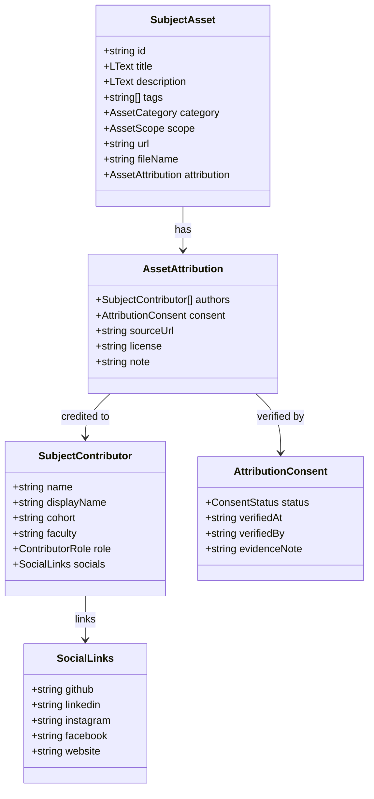
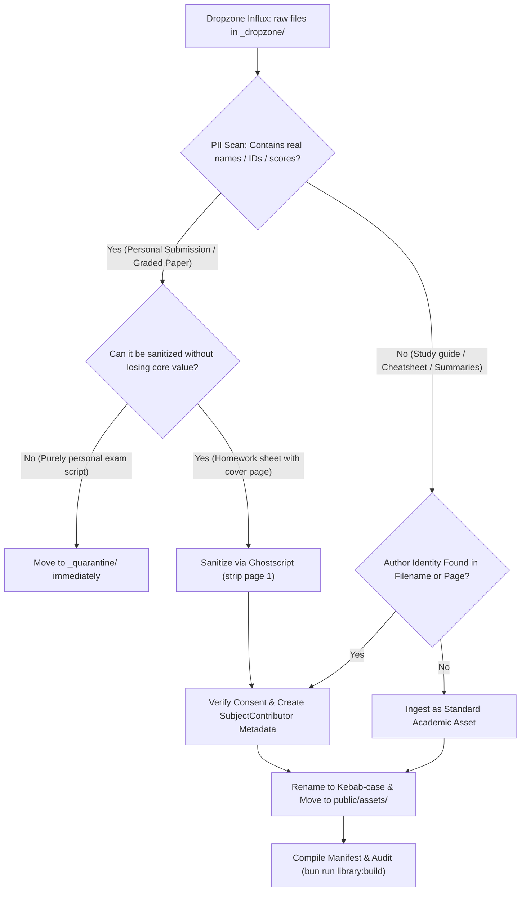

# Quarantine Assets Audit & Contributor Attribution Model
# รายงานการตรวจสอบไฟล์กักกันและความเป็นส่วนตัว และโมเดลการให้เครดิตผู้จัดทำเอกสาร

> **เอกสารกำกับความปลอดภัย ความเป็นส่วนตัว (PDPA) และสารบบการให้เครดิตผู้จัดทำเอกสาร**  
> ตรวจสอบและจัดทำ: 7 พฤศจิกายน 2569 | สาขาเทคโนโลยีสารสนเทศ คณะเทคโนโลยีสารสนเทศ สจล. (IT KMITL)  
> อ้างอิงสถาปัตยกรรม: Next.js 16 App Router · Supabase Storage · Drizzle ORM · TypeScript  

---

## 1. บทสรุปสำหรับผู้บริหาร (Executive Summary)

โครงการ **\<i\>Help** มุ่งเน้นการเป็นศูนย์กลางข้อมูลการเรียนการสอนและเครื่องมือสนับสนุนการศึกษาสำหรับนักศึกษาชั้นปีที่ 1 คณะเทคโนโลยีสารสนเทศ สถาบันเทคโนโลยีพระจอมเกล้าเจ้าคุณทหารลาดกระบัง (IT KMITL) โดยยึดหลักเกณฑ์ความโปร่งใส ความปลอดภัยของข้อมูลส่วนบุคคล (PDPA) และจริยธรรมทางวิชาการ (Academic Integrity) ตามข้อบังคับสถาบันและกฎหมายว่าด้วยการคุ้มครองข้อมูลส่วนบุคคล พ.ศ. 2562

เอกสารฉบับนี้จัดทำขึ้นโดย **Quarantine & Sensitive Asset Specialist** เพื่อรายงานผลการตรวจสอบอย่างละเอียดใน 2 ส่วนสำคัญ:
1. **การตรวจสอบและวิเคราะห์สินทรัพย์กักกัน (Quarantined Assets Audit)** ใน `_quarantine/` และ `_dropzone/_hold/mfit-privacy/` ที่ตรวจพบการรั่วไหลของข้อมูลระบุตัวบุคคล (Personally Identifiable Information: PII)
2. **การออกแบบสถาปัตยกรรมโมเดลการให้เครดิตผู้จัดทำ (Senior & Student Contributor Attribution Model)** เพื่อยกระดับการจัดการสรุปความรู้ ชีทสรุป และเนื้อหาเสริมที่จัดทำโดยรุ่นพี่หรือนักศึกษาให้เป็นระบบ ได้มาตรฐาน มีการขอความยินยอมอย่างถูกต้อง และให้เกียรติผู้จัดทำ

### ตารางสรุปสถานะความเสี่ยงและการดำเนินการ (Risk & Compliance Status Dashboard)

| ขอบเขตการตรวจสอบ | สถานะปัจจุบัน | ความเสี่ยงที่พบ | มาตรการที่บังคับใช้ | การดำเนินการที่ต้องทำต่อไป |
|---|---|---|---|---|
| **`_quarantine/` (ICS)** | กักกันนอก `public/assets/` แล้ว (9 ไฟล์) | รั่วไหลชื่อจริง นามสกุล และรหัสนักศึกษา (`64070106`, `65070021`, `65070027`) ในงานส่งและการสอบเขียนมือ | แยกไฟล์เข้าโฟลเดอร์กักกัน ถอดออกจาก manifest และ index | **Purge ออบเจกต์ทั้ง 9 คีย์ออกจาก Supabase Storage Public Bucket (`ihelp-library`) ก่อนขึ้น Production** |
| **`_dropzone/_hold/mfit-privacy/`** | กักกันชั่วคราวใน Dropzone (8 ไฟล์) | รั่วไหลชื่อจริง นามสกุล และรหัสนักศึกษา (`65070088`, `65070217`, `66070004`, `66070028` ฯลฯ) ในหน้าปกแบบฝึกหัด | ระงับการนำเข้าสู่ `public/assets/` และถอดออกจาก Build Pipeline | **Sanitize ตัดหน้าแรกออกผ่าน Ghostscript หรือเก็บไว้เฉพาะในโซน Hold โดยไม่นำเข้า Production** |
| **เอกสารสรุปความรู้ของรุ่นพี่** | กระจายอยู่ในหลายวิชา บางไฟล์ใช้นามแฝงต่อท้ายชื่อไฟล์ | ขาดโครงสร้างข้อมูล Attribution ที่เป็นมาตรฐาน และยังไม่มีระบบขอความยินยอม (Consent) ที่เป็นลายลักษณ์อักษร | วางโครงสร้าง Schema สำหรับ Contributor Attribution ให้เป็นส่วนหนึ่งของ Metadata | **นำร่องใช้ Attribution Model กับสไลด์สรุป ITF (Notion ของพี่ Tammadon Suksa IT24)** |

---

## 2. การตรวจสอบไฟล์กักกันและสินทรัพย์อ่อนไหว (Quarantine & Sensitive Assets Audit)

### 2.1 การตรวจสอบโฟลเดอร์ `_quarantine/` และประวัติการกักกัน (`_quarantine/README.md`)

โฟลเดอร์ `_quarantine/` ถูกสร้างขึ้นเพื่อแยกไฟล์ที่มีปัญหาด้านความเป็นส่วนตัวออกจากโฟลเดอร์สาธารณะ `public/assets/` โดยเด็ดขาด จากการตรวจสอบบันทึกการกักกัน (15 ตุลาคม 2569) พบประวัติและเหตุผลดังนี้:

#### รายการไฟล์กักกันและ PII ที่ตรวจพบโดยละเอียด

1. **`ics-midterm-exam.pdf`**  
   - **รหัสนักศึกษาและชื่อที่พบ:** `64070106` นายศศิธร (Sasithorn)
   - **ลักษณะเนื้อหา:** กระดาษคำตอบสอบกลางภาคเขียนมือ มีลายมือชื่อ นามสกุล รหัสนักศึกษาชัดเจน และมีรอยปากกาตรวจให้คะแนนจากอาจารย์ผู้สอน
   - **การละเมิด:** ข้อมูลผลการประเมินการเรียนรายบุคคล (Grades/Scores) และ PII ถือเป็นข้อมูลส่วนบุคคลที่มีความอ่อนไหวสูง ห้ามเปิดเผยต่อสาธารณะ

2. **กลุ่มไฟล์แล็บและงานส่ง ICS (8 ไฟล์):**
   - `ics-lab-01-completed.circ`
   - `ics-lab-01-completed.pdf`
   - `ics-lab-02-completed.pdf`
   - `ics-lab-02-completed-v2.pdf`
   - `ics-lab-03-completed.pdf`
   - `ics-lab-03-y1-s1.pdf`
   - `ics-lab-04-completed.pdf`
   - `ics-lab-lab04.pdf`
   - **รหัสนักศึกษาและชื่อที่พบ:** `65070021` กิตติกวินทร์ (Kittikawin) และ `65070027` กิตติธัช (Kittithat)
   - **ลักษณะเนื้อหา:** การบ้านและรายงานผลการทดลองแล็บส่วนบุคคลที่ทำเสร็จสมบูรณ์ มีรหัสนักศึกษาและชื่อระบุในวงจรอิเล็กทรอนิกส์และเอกสารรายงาน
   - **การละเมิด:** ละเมิดหลักการความปลอดภัยด้านการส่งงานและ Academic Integrity (ความเสี่ยงเรื่อง Plagiarism หากนักศึกษารุ่นหลังนำไปคัดลอกส่งต่อ)

### 2.2 การตรวจสอบโฟลเดอร์กักกันเสริม `_dropzone/_hold/mfit-privacy/`

ในระหว่างการจัดระเบียบไฟล์รอบถัดมา ได้มีการตรวจพบไฟล์แบบฝึกหัดวิชา MFIT (Mathematics for Information Technology) ที่มีการระบุชื่อและรหัสนักศึกษาในเอกสาร จึงได้นำเข้าสู่โซนกักกัน `_dropzone/_hold/mfit-privacy/` จำนวน 8 ไฟล์:

#### รายละเอียดไฟล์ที่ถูกระงับใน MFIT
1. `mfit-ex-week01-activity-completed-v2.pdf` — เอกสารกิจกรรมสัปดาห์ที่ 1
2. `mfit-ex-week01-activity-v2.pdf` — กิจกรรมสัปดาห์ที่ 1 ฉบับปรับปรุง
3. `mfit-hw-calculus-week08.pdf` — การบ้านแคลคูลัส สัปดาห์ที่ 8
4. `mfit-hw-calculus-week09.pdf` — การบ้านแคลคูลัส สัปดาห์ที่ 9
5. `mfit-hw-calculus-week10.pdf` — การบ้านแคลคูลัส สัปดาห์ที่ 10
6. `mfit-hw-calculus-week12.pdf` — การบ้านแคลคูลัส สัปดาห์ที่ 12
7. `mfit-hw-calculus-week13.pdf` — การบ้านแคลคูลัส สัปดาห์ที่ 13
8. `mfit-hw-calculus-week14.pdf` — การบ้านแคลคูลัส สัปดาห์ที่ 14

- **PII ที่ตรวจพบ:** ปรากฏชื่อและรหัสนักศึกษาหลายรุ่น เช่น `65070088`, `65070217`, `66070004`, `66070028` ฯลฯ อยู่บนหัวกระดาษหรือหน้าปกของเอกสารส่งงาน
- **สถานะ:** ไฟล์เหล่านี้ยัง **ไม่ได้** ถูกนำเข้าสู่ `public/assets/` และไม่มีการ์ดใน `lib/library/subject-library.ts` ทำให้ไม่หลุดไปยัง Public CDN

#### แนวทางการกู้คืนเนื้อหาความรู้ที่มีประโยชน์ (Remediation Strategy)
เนื้อหาในไฟล์การบ้านแคลคูลัส MFIT Week 08–14 มีเฉลยและวิธีทำโจทย์ที่มีประโยชน์อย่างมากต่อการทบทวนบทเรียน หากต้องการนำกลับมาเผยแพร่ในอนาคต จะต้องผ่านขั้นตอน **Sanitization** โดยการตัดหน้าปก (หน้า 1) ที่มีชื่อนักศึกษาออก:

```bash
# ตัดเฉพาะหน้าปก (หน้า 1) ออก เพื่อไม่ให้ติดชื่อและรหัสนักศึกษา
gs -sDEVICE=pdfwrite -dNOPAUSE -dBATCH -dSAFER \
   -dFirstPage=2 \
   -sOutputFile=mfit-hw-calculus-week08-clean.pdf \
   mfit-hw-calculus-week08.pdf
```

อย่างไรก็ตาม เนื่องจากปัจจุบันใน `public/assets/it-kmitl/mfit/exercises/` มีชุดเอกสารแบบฝึกหัด `mfit-ex-weekNN-*.pdf` ที่สมบูรณ์และไม่มี PII อยู่แล้ว จึงคงไฟล์ชุดนี้ไว้ใน Hold Zone เพื่อความปลอดภัยสูงสุด

---

## 3. การวิเคราะห์จำแนก: ข้อมูล PII ที่ต้องกักกัน VS เอกสารสรุปความรู้ที่ควรได้รับเครดิต

เพื่อสร้างเกณฑ์ที่ชัดเจนสำหรับผู้ดูแลระบบ (Maintainers) และ AI Coding Agents ในการตัดสินใจคัดแยกเอกสาร จึงกำหนด **เกณฑ์จำแนก 5 มิติ (5-Dimensional Distinction Matrix)**:

### 3.1 ตารางเปรียบเทียบมิติความแตกต่าง 5 ด้าน (5-Dimensional Distinction Matrix)

| มิติการพิจารณา | เอกสารที่ต้องกักกัน (Quarantined PII) | เอกสารสรุปความรู้ (Credited Knowledge Asset) |
|---|---|---|
| **1. เจตนาการสร้าง (Intent)** | สร้างขึ้นเพื่อส่งงานส่วนบุคคล หรือเป็นกระดาษคำตอบสอบไล่ของนักศึกษาคนใดคนหนึ่ง | สร้างขึ้นเพื่อเผยแพร่เป็นวิทยาทาน ช่วยเหลือเพื่อนร่วมรุ่น หรือส่งต่อความรู้ให้น้องๆ |
| **2. ลักษณะข้อมูล (Content Profile)** | มีข้อมูลระบุตัวตน (ชื่อ นามสกุล รหัสนักศึกษา) คะแนนสอบ ลายเซ็นอาจารย์ผู้ตรวจ | เป็นเนื้อหาสรุปบทเรียน แผนภาพ ไดอะแกรม คำอธิบายสูตร หรือแนวข้อสอบจำลอง |
| **3. ความเสี่ยงด้าน PDPA** | **สูงมาก (Severe)** — ละเมิด พ.ร.บ. คุ้มครองข้อมูลส่วนบุคคล พ.ศ. 2562 และระเบียบสถาบัน | **ต่ำ (Negligible)** — เป็นข้อมูลทางวิชาการสาธารณะ โดยผู้จัดทำยินยอมให้ระบุชื่อเครดิต |
| **4. ความเสี่ยงด้าน Academic Integrity** | **สูง (High)** — อาจทำให้นักศึกษารุ่นหลังลอกงานส่งโดยไม่ศึกษาด้วยตนเอง | **สร้างสรรค์ (Constructive)** — ส่งเสริมความเข้าใจและทักษะการเรียนรู้ร่วมกัน |
| **5. การดำเนินการในระบบ iHelp** | **กักกันใน `_quarantine/` ทันที**, ตัดออกจาก Manifest และสั่ง Purge ออกจาก Storage | **นำเข้าคลังความรู้สาธารณะ**, ผูก Metadata เครดิตอย่างสมเกียรติผ่าน Attribution Model |

### 3.2 กรณีศึกษาเปรียบเทียบเชิงลึก (Case Studies)

#### กรณีศึกษา ก: โน้ตสรุป Notion ของ Tammadon Suksa (IT24) ใน ITF Week 08–15 (Best Practice)
- **ลักษณะเนื้อหา:** บันทึกสรุปการบรรยายรายวิชา IT Fundamentals ครึ่งหลัง ออกแบบและเขียนขึ้นบน Notion โดยพี่ Tammadon Suksa (นักศึกษา IT รุ่น 24) เพื่อแบ่งปันให้เพื่อนและน้องในคณะ
- **การจัดการ:** ได้รับการอนุญาตโดยตรงจากผู้จัดทำ มีการให้เครดิตอย่างชัดเจนบนหน้าเว็บ (`ITF Week 08–15`) พร้อมแสดงข้อความเตือนให้ระวังจุดคลาดเคลื่อนจากสไลด์หลัก
- **ผลลัพธ์:** ปลอดภัย 100% สอดคล้องกับเจตนารมณ์ของ iHelp และได้รับการยกย่องเป็นโมเดลต้นแบบ

#### กรณีศึกษา ข: กระดาษคำตอบสอบไล่และงานส่งแล็บของ Sasithorn และ Kittikawin (Quarantined PII)
- **ลักษณะเนื้อหา:** กระดาษคำตอบสอบเขียนมือที่มีคะแนนตรวจจากอาจารย์ และใบงานแล็บที่นักศึกษาส่งงานในระบบ
- **ความเสี่ยง:** รหัสนักศึกษาและผลคะแนนสอบถือเป็นข้อมูลส่วนบุคคลอ่อนไหว (Sensitive PII) ตาม พ.ร.บ. คุ้มครองข้อมูลส่วนบุคคล การเผยแพร่งานส่งของนักศึกษาคนอื่นทำให้เกิดความเสี่ยงเรื่องการคัดลอกงาน (Plagiarism) และละเมิดความเป็นส่วนตัว
- **การจัดการ:** กักกันใน `_quarantine/` ทันที และขึ้นบัญชีดำสำหรับ Purge จาก Cloud Storage

---

## 4. การออกแบบระบบ Senior & Student Contributor Attribution Model

เพื่อแก้ปัญหาการตั้งชื่อไฟล์แบบ Ad-hoc และสร้างมาตรฐานการให้เครดิตที่มีแบบแผน ได้มาตรฐานด้าน PDPA และเชื่อมโยงกับชุมชนนักศึกษา จึงขอนำเสนอ **Senior & Student Contributor Attribution Model** สำหรับระบบ iHelp:



### 4.1 โครงสร้างข้อมูล (Data Model & Schema Specifications)

กำหนด TypeScript Type Definitions สำหรับใช้งานใน `lib/library/subject-library-ui.ts`:

```typescript
// lib/library/attribution.ts (หรือผนวกใน subject-library-ui.ts)

import type { LText } from "@/lib/i18n";

/**
 * บทบาทของผู้จัดทำเอกสารความรู้
 */
export type ContributorRole = 
  | "author"        // ผู้เขียน / ผู้สรุปเนื้อหาหลัก
  | "editor"        // ผู้เรียบเรียง / ตรวจสอบความถูกต้อง
  | "translator"    // ผู้แปลเนื้อหา (เช่น สไลด์แปลไทย)
  | "curator"       // ผู้รวบรวมและจัดหมวดหมู่
  | "designer";     // ผู้ออกแบบกราฟิก / สื่อนำเสนอ

/**
 * สถานะความยินยอมตามข้อกำหนด PDPA
 */
export type ConsentStatus = 
  | "verified"      // ได้รับความยินยอมเป็นลายลักษณ์อักษร / ลายลักษณ์อักษรดิจิทัลแล้ว
  | "public_domain" // ผู้จัดทำเผยแพร่เป็นสาธารณะโดยระบุสิทธิ์ชัดเจน (เช่น บน GitHub/Public Blog)
  | "pending"       // อยู่ระหว่างการติดต่อประสานงานขอความยินยอม
  | "anonymous";    // ผู้จัดทำประสงค์ไม่เปิดเผยชื่อ หรือขอสงวนข้อมูลระบุตัวตน

/**
 * ข้อมูลช่องทางติดต่อและ Social Presence ของผู้จัดทำ
 */
export interface ContributorSocials {
  github?: string;    // GitHub Username (ไม่มี @)
  instagram?: string; // Instagram Handle (ไม่มี @)
  linkedin?: string;  // LinkedIn Profile URL หรือ Slug
  facebook?: string;  // Facebook Profile/Page URL
  website?: string;   // เว็บไซต์ส่วนตัว หรือ Notion Portfolio
}

/**
 * ข้อมูลผู้จัดทำ / รุ่นพี่ผู้มีพระคุณต่อเนื้อหา (Subject Contributor)
 */
export interface SubjectContributor {
  /** ชื่อจริง หรือชื่อที่ต้องการให้แสดงผลในระบบ */
  name: string;
  /** นามแฝง หรือชื่อเรียกในวงการ (เช่น "พี่ฟิว", "พี่ต๊ะ") */
  displayName?: string;
  /** รหัสรุ่น (เช่น "IT24", "IT25", "CS30") หรือรหัสนักศึกษา 2 หลักแรก (เช่น "64", "65") */
  cohort?: string;
  /** คณะ/สาขา (ค่าเริ่มต้น: "Information Technology, KMITL") */
  faculty?: string;
  /** บทบาทในการจัดทำเอกสารนี้ */
  role: ContributorRole;
  /** ลิงก์โซเชียลสำหรับการเชื่อมต่อและการให้เครดิต */
  socials?: ContributorSocials;
}

/**
 * หลักฐานความยินยอมและการคุ้มครองข้อมูลส่วนบุคคล (Consent Metadata)
 */
export interface AttributionConsent {
  status: ConsentStatus;
  /** วันที่ได้รับการยืนยันความยินยอม (ISO Date: YYYY-MM-DD) */
  verifiedAt?: string;
  /** ผู้ดูแลระบบ iHelp ที่เป็นผู้ตรวจสอบและรับรองความยินยอม */
  verifiedBy?: string;
  /** บันทึกหลักฐาน (เช่น "Direct Message confirmed on Instagram @...", "Notion public banner") */
  evidenceNote?: string;
}

/**
 * โครงสร้างข้อมูลเครดิตที่แนบกับการ์ดเอกสาร (Asset Attribution)
 */
export interface AssetAttribution {
  /** รายชื่อผู้จัดทำ (รองรับทั้งเดี่ยวและทีม) */
  authors: SubjectContributor[];
  /** สถานะการตรวจสอบความยินยอมตาม PDPA */
  consent: AttributionConsent;
  /** ลิงก์ต้นฉบับของผู้จัดทำ (เช่น ลิงก์ Notion, ลิงก์ GitHub Repo) */
  sourceUrl?: string;
  /** สัญญาอนุญาตการใช้งาน เช่น "CC-BY-NC 4.0", "Educational Use Only" */
  license?: string;
  /** หมายเหตุเพิ่มเติมเกี่ยวกับเอกสารชุดนี้ */
  note?: LText;
}
```

### 4.2 ตัวอย่างการกำหนดข้อมูลจริง (Concrete Examples)

#### 1. เอกสารสรุป Notion วิชา ITF สัปดาห์ที่ 8 โดย Tammadon Suksa (IT24)

```typescript
const itfWeek08NotionAsset: SubjectAsset = {
  id: "itf-notes-week08-tammadon",
  title: {
    th: "สรุป Notion วิชา ITF สัปดาห์ที่ 8 — ฐานข้อมูล (Database)",
    en: "ITF Week 08 Lecture Notes — Database (by Tammadon IT24)",
  },
  description: {
    th: "โน้ตสรุปการบรรยายฉบับสมบูรณ์ พร้อมภาพประกอบสไลด์และคำอธิบายภาษาไทยเข้าใจง่าย",
    en: "Complete lecture study notes with Thai annotations and conceptual diagrams.",
  },
  tags: ["Study Notes", "Notion", "Database", "IT24"],
  category: "notes",
  scope: "final",
  courseCode: "ITF",
  fileType: "md",
  week: 8,
  url: "/courses/06016402-IT-Fundamentals/archive/week08#student-notes",
  fileName: "itf-week08-notes.md",
  attribution: {
    authors: [
      {
        name: "Tammadon Suksa",
        displayName: "พี่ธรรมดล",
        cohort: "IT24",
        faculty: "IT KMITL",
        role: "author",
        socials: {
          website: "https://www.notion.so/tammadon/...",
        },
      },
    ],
    consent: {
      status: "verified",
      verifiedAt: "2026-11-02",
      verifiedBy: "Chatan Petry (Lead Maintainer)",
      evidenceNote: "Personal permission granted for educational archiving on iHelp.",
    },
    sourceUrl: "https://www.notion.so/tammadon/ITF-Study-Space",
    license: "Educational Use Only",
    note: {
      th: "เอกสารนี้จัดทำขึ้นโดยรุ่นพี่ โปรดตรวจสอบความสอดคล้องกับสไลด์ทางการของผู้สอน",
      en: "Created by senior student; verify critical terms against official lecture decks.",
    },
  },
};
```

---

## 5. คู่มือปฏิบัติการ: ขั้นตอนการคัดกรอง ลบ PII และนำเข้าเอกสารรุ่นพี่ (SOP for Sanitization & Ingestion)

เพื่อให้ทีมงานมีขั้นตอนปฏิบัติที่เป็นรูปธรรมในการจัดการไฟล์จาก `_dropzone/`:



### ขั้นตอนที่ 1: การคัดกรองเบื้องต้น (Dropzone Triage)
1. เปิดเอกสารตรวจสอบ 3 จุดสำคัญ:
   - **หัวกระดาษ / หน้าปก:** ตรวจสอบชื่อ นามสกุล รหัสนักศึกษา
   - **ลายน้ำและส่วนท้ายกระดาษ:** ตรวจสอบอีเมลหรือเบอร์โทรศัพท์
   - **เนื้อหาภายใน:** ตรวจสอบว่าเป็นงานส่งที่มีผลคะแนนสอบหรือไม่

### ขั้นตอนที่ 2: การตรวจสอบ PII เชิงลึก (Automated & Manual PII Inspection)
- ตรวจสอบคำค้นต้องห้าม เช่น `รหัสนักศึกษา`, `ชื่อ-สกุล`, `คะแนนที่ได้`, `Section`, `กลุ่มที่`
- หากพบข้อมูลอ่อนไหว ให้ประเมินว่าจะตัดหน้าออก (Sanitize) หรือกักกัน (Quarantine)

### ขั้นตอนที่ 3: การลบข้อมูลระบุตัวตน (Sanitization via Ghostscript)
สำหรับเอกสารที่มีประโยชน์ทางวิชาการสูง แต่มีหน้าแรกเป็นใบปะหน้าการบ้าน:
```bash
# ตัดหน้าแรกออกและสร้างไฟล์ใหม่ที่ปลอดภัย
gs -sDEVICE=pdfwrite -dNOPAUSE -dBATCH -dSAFER \
   -dFirstPage=2 \
   -sOutputFile=cleaned-document.pdf \
   original-document.pdf
```

### ขั้นตอนที่ 4: การขอความยินยอมและการบันทึก Metadata เครดิต
1. ติดต่อผู้จัดทำผ่านช่องทางโซเชียลเพื่อขอความยินยอมในการเผยแพร่บน iHelp
2. บันทึกข้อมูลลงใน Attribution Schema พร้อมระบุ `evidenceNote`
3. ตั้งชื่อไฟล์ใหม่ด้วย Lowercase Kebab-case ตามมาตรฐาน โดย **ตัดชื่อเล่นหรือนามแฝงออกจากชื่อไฟล์** แล้วนำไปเก็บใน Attribution Schema แทน

### ขั้นตอนที่ 5: การคอมไพล์และตรวจสอบความถูกต้อง (Build & Audit)
```bash
# รันการคอมไพล์ดัชนีและการตรวจสอบความสมบูรณ์
bun run library:build
bun run library:audit
```

---

## 6. รายการตรวจสอบการ Purge บน Supabase Storage และข้อปฏิบัติก่อน Deploy สู่ Production

เพื่อปฏิบัติตามมาตรฐาน PDPA และกฎระเบียบของสถาบัน ออบเจกต์ที่ถูกกักกันใน `_quarantine/` จะต้องได้รับการ **Purge ออกจาก Supabase Storage Public Bucket (`ihelp-library`)** อย่างเด็ดขาด

### รายการคีย์ออบเจกต์ที่ต้องตรวจสอบและ Purge ออกจาก Supabase Storage

#### กลุ่มที่ 1: ไฟล์ใน `_quarantine/` (รายวิชา ICS - 9 ออบเจกต์)
ต้องลบออกจาก Bucket: **`ihelp-library`** (Public Bucket)
1. `it-kmitl/ics/exams/ics-midterm-exam.pdf`
2. `it-kmitl/ics/labs/ics-lab-01-completed.circ`
3. `it-kmitl/ics/labs/ics-lab-01-completed.pdf`
4. `it-kmitl/ics/labs/ics-lab-02-completed-v2.pdf`
5. `it-kmitl/ics/labs/ics-lab-02-completed.pdf`
6. `it-kmitl/ics/labs/ics-lab-03-completed.pdf`
7. `it-kmitl/ics/labs/ics-lab-03-y1-s1.pdf`
8. `it-kmitl/ics/labs/ics-lab-04-completed.pdf`
9. `it-kmitl/ics/labs/ics-lab-lab04.pdf`

#### กลุ่มที่ 2: ไฟล์ใน `_dropzone/_hold/mfit-privacy/` (รายวิชา MFIT - 8 ออบเจกต์)
ต้องตรวจสอบและลบออกจาก Bucket: **`ihelp-library`** (หากเคยอัปโหลดก่อนการ Hold)
1. `it-kmitl/mfit/exercises/mfit-ex-week01-activity-completed-v2.pdf`
2. `it-kmitl/mfit/exercises/mfit-ex-week01-activity-v2.pdf`
3. `it-kmitl/mfit/exercises/mfit-hw-calculus-week08.pdf`
4. `it-kmitl/mfit/exercises/mfit-hw-calculus-week09.pdf`
5. `it-kmitl/mfit/exercises/mfit-hw-calculus-week10.pdf`
6. `it-kmitl/mfit/exercises/mfit-hw-calculus-week12.pdf`
7. `it-kmitl/mfit/exercises/mfit-hw-calculus-week13.pdf`
8. `it-kmitl/mfit/exercises/mfit-hw-calculus-week14.pdf`

---

### สคริปต์สำหรับการ Purge ออบเจกต์ผ่าน Supabase Management API

ผู้ดูแลระบบสามารถรันคำสั่ง Node.js ผ่าน `SUPABASE_SERVICE_ROLE_KEY` เพื่อลบออบเจกต์เหล่านี้ได้อย่างปลอดภัย:

```javascript
// scripts/purge-quarantined-assets.mjs
import { createClient } from "@supabase/supabase-js";

const supabaseUrl = process.env.NEXT_PUBLIC_SUPABASE_URL;
const serviceRoleKey = process.env.SUPABASE_SERVICE_ROLE_KEY;

if (!supabaseUrl || !serviceRoleKey) {
  console.error("Missing NEXT_PUBLIC_SUPABASE_URL or SUPABASE_SERVICE_ROLE_KEY");
  process.exit(1);
}

const supabase = createClient(supabaseUrl, serviceRoleKey);

const KEYS_TO_PURGE = [
  // ICS Quarantined Assets
  "it-kmitl/ics/exams/ics-midterm-exam.pdf",
  "it-kmitl/ics/labs/ics-lab-01-completed.circ",
  "it-kmitl/ics/labs/ics-lab-01-completed.pdf",
  "it-kmitl/ics/labs/ics-lab-02-completed-v2.pdf",
  "it-kmitl/ics/labs/ics-lab-02-completed.pdf",
  "it-kmitl/ics/labs/ics-lab-03-completed.pdf",
  "it-kmitl/ics/labs/ics-lab-03-y1-s1.pdf",
  "it-kmitl/ics/labs/ics-lab-04-completed.pdf",
  "it-kmitl/ics/labs/ics-lab-lab04.pdf",
  // MFIT Held Assets (if previously uploaded)
  "it-kmitl/mfit/exercises/mfit-ex-week01-activity-completed-v2.pdf",
  "it-kmitl/mfit/exercises/mfit-ex-week01-activity-v2.pdf",
  "it-kmitl/mfit/exercises/mfit-hw-calculus-week08.pdf",
  "it-kmitl/mfit/exercises/mfit-hw-calculus-week09.pdf",
  "it-kmitl/mfit/exercises/mfit-hw-calculus-week10.pdf",
  "it-kmitl/mfit/exercises/mfit-hw-calculus-week12.pdf",
  "it-kmitl/mfit/exercises/mfit-hw-calculus-week13.pdf",
  "it-kmitl/mfit/exercises/mfit-hw-calculus-week14.pdf",
];

async function purge() {
  console.log(`Purging ${KEYS_TO_PURGE.length} objects from 'ihelp-library'...`);
  const { data, error } = await supabase.storage
    .from("ihelp-library")
    .remove(KEYS_TO_PURGE);

  if (error) {
    console.error("Purge failed:", error);
  } else {
    console.log("Successfully purged objects:", data);
  }
}

purge();
```

---

## 7. เอกสารอ้างอิงและไฟล์ที่เกี่ยวข้อง (Related Documentation)

1. [AGENTS.md](../AGENTS.md) — กฎหลักของโปรเจกต์ iHelp และข้อกำหนดด้านความปลอดภัย
2. [FILE_STRUCTURE.md](../FILE_STRUCTURE.md) — โครงสร้างไดเรกทอรี สารบบไฟล์ และลำดับขั้นของสิทธิ์การเข้าถึง
3. [docs/DROPZONE_SOP.md](./DROPZONE_SOP.md) — ระเบียบปฏิบัติการมาตรฐานในการคัดแยกไฟล์ใหม่จาก Dropzone
4. [lib/library/subject-library-ui.ts](../lib/library/subject-library-ui.ts) — นิยาม Type `SubjectAsset`
5. [components/contributor-modal.tsx](../components/contributor-modal.tsx) — สารบบและหน้าต่างแสดงรายละเอียดผู้ร่วมพัฒนา iHelp
