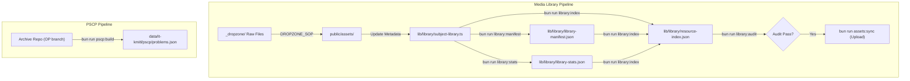

# \<i\>Help Developer Documentation Hub (Super Library)

> **ศูนย์กลางคลังข้อมูลวิศวกรรม สถาปัตยกรรมระบบ คู่มือการพัฒนา และสารบรรณเอกสารฉบับสมบูรณ์**  
> สถานะเอกสาร: แม่บทระบบ (Master Architecture Blueprint) · กิ่งพัฒนา: `staging`  
> ปรับปรุงล่าสุด: 23 พฤศจิกายน 2569 | คณะเทคโนโลยีสารสนเทศ สถาบันเทคโนโลยีพระจอมเกล้าเจ้าคุณทหารลาดกระบัง (IT KMITL)

ยินดีต้อนรับสู่ **\<i\>Help Developer Documentation Hub (Super Library)** ซึ่งเป็นศูนย์กลางความรู้ทางเทคนิค สถาปัตยกรรมซอฟต์แวร์ และคู่มือการพัฒนาระบบทั้งหมดของเว็บไซต์ \<i\>Help เอกสารนี้จัดทำขึ้นเพื่อให้ทั้งนักพัฒนา (Developers), ผู้ดูแลระบบ (Maintainers), ผู้ร่วมแบ่งปันเนื้อหา (Contributors) รวมถึง AI Agents สามารถทำความเข้าใจ ออกแบบ แก้ไข และขยายขีดความสามารถของระบบได้อย่างถูกต้อง รวดเร็ว และเป็นมาตรฐานเดียวกัน

---

## สารบัญหลัก (Table of Contents)

1. [สารบัญเอกสารในโฟลเดอร์ docs/ (Directory of Documentation)](#1-สารบัญเอกสารในโฟลเดอร์-docs-directory-of-documentation)
2. [ภาพรวมสถาปัตยกรรมทางเทคนิค (High-Level Architecture)](#2-ภาพรวมสถาปัตยกรรมทางเทคนิค-high-level-architecture)
3. [เจาะลึก 12 ระบบหลัก (Deep Dive: The 12 Core Subsystems)](#3-เจาะลึก-12-ระบบหลัก-deep-dive-the-12-core-subsystems)
   - [3.1 ศูนย์การเรียนรู้รายวิชาและสันแกน 11 โมดูล (Course Hubs & 11-Module Spine)](#31-ศูนย์การเรียนรู้รายวิชาและสันแกน-11-โมดูล-course-hubs--11-module-spine)
   - [3.2 คลังสื่อการเรียนรู้และระบบจัดเก็บ Supabase (Media Library & Storage Engine)](#32-คลังสื่อการเรียนรู้และระบบจัดเก็บ-supabase-media-library--storage-engine)
   - [3.3 ระบบคำนวณเกรดและจำลองคะแนนสอบ (Grade & Exam Score Calculator)](#33-ระบบคำนวณเกรดและจำลองคะแนนสอบ-grade--exam-score-calculator)
   - [3.4 ตารางสอบและผังที่นั่งสอบอัจฉริยะ (Exam Schedule & Interactive Seating Map)](#34-ตารางสอบและผังที่นั่งสอบอัจฉริยะ-exam-schedule--interactive-seating-map)
   - [3.5 ระบบจัดตารางเรียนจำลองหลายเทอม (Timetable & Schedule Planner)](#35-ระบบจัดตารางเรียนจำลองหลายเทอม-timetable--schedule-planner)
   - [3.6 พื้นที่เขียนโค้ดและรันโปรแกรม PSCP (PSCP Coding Workspace & IDE)](#36-พื้นที่เขียนโค้ดและรันโปรแกรม-pscp-pscp-coding-workspace--ide)
   - [3.7 ผู้ช่วยตอบคำถามอัตโนมัติและระบบป้องกันความปลอดภัย (Help Desk Chat & Security Guards)](#37-ผู้ช่วยตอบคำถามอัตโนมัติและระบบป้องกันความปลอดภัย-help-desk-chat--security-guards)
   - [3.8 พื้นที่อ่านหนังสือส่วนบุคคลและตัวนับถอยหลังสอบ (Study Space & Exam Countdown)](#38-พื้นที่อ่านหนังสือส่วนบุคคลและตัวนับถอยหลังสอบ-study-space--exam-countdown)
   - [3.9 หน้าแนะนำส่วนขยาย PG IJUDGE Pro (VS Code Extension Showcase)](#39-หน้าแนะนำส่วนขยาย-pg-ijudge-pro-vs-code-extension-showcase)
   - [3.10 ระบบเครดิตผู้ร่วมพัฒนาและการเลื่อนชั้นปีอัตโนมัติ (Contributor Attribution & Promotion)](#310-ระบบเครดิตผู้ร่วมพัฒนาและการเลื่อนชั้นปีอัตโนมัติ-contributor-attribution--promotion)
   - [3.11 ระบบการออกแบบ ธีมมืดชาร์โคล และฟอนต์ (Design System & Theming Discipline)](#311-ระบบการออกแบบ-ธีมมืดชาร์โคล-และฟอนต์-design-system--theming-discipline)
   - [3.12 สถาปัตยกรรมความปลอดภัยและการจำกัดการเข้าถึง (Auth, Security & Storage Isolation)](#312-สถาปัตยกรรมความปลอดภัยและการจำกัดการเข้าถึง-auth-security--storage-isolation)
4. [วงจรการไหลของข้อมูล (Data Pipelines & Generation Scripts)](#4-วงจรการไหลของข้อมูล-data-pipelines--generation-scripts)
5. [แนวทางปฏิบัติและกฎการพัฒนา (Development Workflow & Golden Rules)](#5-แนวทางปฏิบัติและกฎการพัฒนา-development-workflow--golden-rules)

---

## 1. สารบัญเอกสารในโฟลเดอร์ docs/ (Directory of Documentation)

เอกสารทั้งหมดใน `docs/` ถูกจัดกลุ่มตามวัตถุประสงค์การใช้งานดังนี้:

### กลุ่มที่ 1: ภาพรวมและสถาปัตยกรรมระบบ (Architecture & Blueprints)
- [`FULL_README.md`](file:///Users/chatan/Desktop/Keep/KMITL/IT-KMITL/ihelp/docs/FULL_README.md) — คู่มือแนะนำโครงการฉบับสมบูรณ์ พันธกิจ เป้าหมาย ฟีเจอร์ทั้งหมด และ Tech Stack
- [`INDEX_ARCHITECTURE.md`](file:///Users/chatan/Desktop/Keep/KMITL/IT-KMITL/ihelp/docs/INDEX_ARCHITECTURE.md) — สถาปัตยกรรมหน้า Index โฉมใหม่ (Academic Command Center), การจัดกลุ่มคอมโพเนนต์, สเตตรีแอกทีฟ และระบบนำทาง
- [`Current_Architecture_Report.md`](file:///Users/chatan/Desktop/Keep/KMITL/IT-KMITL/ihelp/docs/Current_Architecture_Report.md) — รายงานการตรวจสอบสถานะสถาปัตยกรรม ประเด็นทางเทคนิค และจุดที่ต้องระวัง
- [`LEARNING_BLUEPRINT.md`](file:///Users/chatan/Desktop/Keep/KMITL/IT-KMITL/ihelp/docs/LEARNING_BLUEPRINT.md) — พิมพ์เขียวการเรียนรู้ สัญญาโครงสร้าง 11 โมดูลที่ทุกรายวิชาต้องปฏิบัติตาม
- [`LIBRARY_ARCHITECTURE_AND_WORKFLOW.md`](file:///Users/chatan/Desktop/Keep/KMITL/IT-KMITL/ihelp/docs/LIBRARY_ARCHITECTURE_AND_WORKFLOW.md) — สถาปัตยกรรมคลังสื่อการเรียนรู้ ระบบ Manifest ดัชนีทรัพยากร และ Supabase Storage

### กลุ่มที่ 2: ระบบและข้อมูลเฉพาะทาง (Core Subsystems & Engines)
- [`SCHEDULE_DATA_GUIDE.md`](file:///Users/chatan/Desktop/Keep/KMITL/IT-KMITL/ihelp/docs/SCHEDULE_DATA_GUIDE.md) — คู่มือโครงสร้างข้อมูลตารางเรียน การบริหารจัดการหลายภาคการศึกษา และการส่งต่อระบบ
- [`STUDY_SPACE.md`](file:///Users/chatan/Desktop/Keep/KMITL/IT-KMITL/ihelp/docs/STUDY_SPACE.md) — ข้อกำหนดพื้นที่อ่านหนังสือส่วนบุคคล (`/profile/<id>/study`), แผนรายวัน, ตัวจับเวลา และโควตาสอบ
- [`CONTRIBUTOR_SYSTEM.md`](file:///Users/chatan/Desktop/Keep/KMITL/IT-KMITL/ihelp/docs/CONTRIBUTOR_SYSTEM.md) — สถาปัตยกรรมระบบเครดิตผู้ร่วมพัฒนา สกีมาโปรไฟล์นักศึกษา และตรรกะการเลื่อนชั้นปีอัตโนมัติ

### กลุ่มที่ 3: มาตรฐานการทำงานและขั้นตอนปฏิบัติ (Standards & SOPs)
- [`COURSE_OVERVIEW_STANDARD.md`](file:///Users/chatan/Desktop/Keep/KMITL/IT-KMITL/ihelp/docs/COURSE_OVERVIEW_STANDARD.md) — ข้อกำหนดมาตรฐานโครงสร้างไฟล์ `summary.md` และ `blueprint.md` ของทุกวิชา
- [`DROPZONE_SOP.md`](file:///Users/chatan/Desktop/Keep/KMITL/IT-KMITL/ihelp/docs/DROPZONE_SOP.md) — ขั้นตอนการคัดแยก ตั้งชื่อ (kebab-case) บีบอัด และนำเข้าไฟล์สื่อการสอนจาก `_dropzone/`
- [`FILE_STRUCTURE.md`](file:///Users/chatan/Desktop/Keep/KMITL/IT-KMITL/ihelp/docs/FILE_STRUCTURE.md) — แผนผังโครงสร้างโฟลเดอร์ การจัดเก็บไฟล์ การตั้งชื่อ และอนุกรมวิธานขอบเขตเนื้อหา (Scope Taxonomy)
- [`VERSION_CONTROL_GUIDE.md`](file:///Users/chatan/Desktop/Keep/KMITL/IT-KMITL/ihelp/docs/VERSION_CONTROL_GUIDE.md) — มาตรฐานการควบคุมเวอร์ชัน Semantic Versioning, บันทึก `CHANGELOG.md` และการเชื่อมต่อสองภาษา

### กลุ่มที่ 4: อัตลักษณ์ การออกแบบ และความปลอดภัย (Design, Security & Audits)
- [`BRANDING.md`](file:///Users/chatan/Desktop/Keep/KMITL/IT-KMITL/ihelp/docs/BRANDING.md) — คู่มืออัตลักษณ์แบรนด์ iHelp การสะกดเครื่องหมายคำ `<i\>Help` และโทนสี
- [`FONTS.md`](file:///Users/chatan/Desktop/Keep/KMITL/IT-KMITL/ihelp/docs/FONTS.md) — มาตรฐานการใช้งานฟอนต์ IBM Plex Sans Thai, น้ำหนักตัวอักษร และการจัด Typographic Hierarchy
- [`QUARANTINE_AUDIT.md`](file:///Users/chatan/Desktop/Keep/KMITL/IT-KMITL/ihelp/docs/QUARANTINE_AUDIT.md) — รายงานตรวจสอบความปลอดภัย สิทธิความเป็นส่วนตัว (PDPA) และสารบบไฟล์กักกัน
- [`FULL_CONTRIBUTING.md`](file:///Users/chatan/Desktop/Keep/KMITL/IT-KMITL/ihelp/docs/FULL_CONTRIBUTING.md) — คู่มือการร่วมพัฒนาสำหรับนักศึกษาและบุคคลภายนอก

---

## 2. ภาพรวมสถาปัตยกรรมทางเทคนิค (High-Level Architecture)

iHelp พัฒนาขึ้นด้วยเทคโนโลยีเว็บสมัยใหม่ โดยคำนึงถึงประสิทธิภาพ ความปลอดภัย และประสบการณ์ผู้ใช้สูงสุด:

```
[ Next.js 16 (App Router) + React 19 + TypeScript + Tailwind CSS 4 ]
                             │
       ┌─────────────────────┼─────────────────────┐
       ▼                     ▼                     ▼
[ Static Core ]       [ Dynamic Edge ]      [ Secure Vault ]
- Course Markdown     - Help Desk Chat      - Supabase Storage
  (summary / weeks)     (FAQ + Search)        (ihelp-library)
- 11-Module Spine     - Grade Calculator    - Supabase Auth
- Static Manifests    - Schedule Conflict     (@kmitl.ac.th RLS)
- Pyodide WASM IDE    - Room Seating Chart  - Private Study Plans
```

- **Runtime & Package Manager**: Next.js 16 App Router รันบน Node.js โดยใช้ **Bun** เป็น Package Manager และตัวรันสคริปต์หลัก (`bun run dev`, `bun run build`)
- **Rendering Strategy**: เน้น **Static Site Generation (SSG)** และ Server Components เพื่อความเร็วสูงสุดและ SEO ที่ยอดเยี่ยม โดยข้อมูลเนื้อหารายวิชาจะถูก Bundle ในขั้นตอนการ Build
- **Client Bundle Protection**: ข้อมูลที่มีความละเอียดอ่อนและคลังไฟล์ฉบับเต็ม (`subject-library.ts`, `resource-index.json`) จะถูกกักไว้บนเซิร์ฟเวอร์เท่านั้น ฝั่งเบราว์เซอร์จะได้รับเฉพาะ `subject-library-ui.ts` เพื่อป้องกัน Data Leak

---

## 3. เจาะลึก 12 ระบบหลัก (Deep Dive: The 12 Core Subsystems)

### 3.1 ศูนย์การเรียนรู้รายวิชาและสันแกน 11 โมดูล (Course Hubs & 11-Module Spine)
หน้ารายวิชา (`/courses/<dir>`) ทุกวิชาจะต้องยึดตามโครงสร้างสันแกน 11 โมดูลที่เท่าเทียมกัน (`lib/courses/spine.ts`):
1. **เข้าใจ (Understand)**:
   - `orientation` ("เข้าใจวิชานี้ใน 3 นาที"): ดึงข้อมูลจากส่วนที่ 1 และ 2 ของ `summary.md` (เป้าหมาย ขอบเขต เกณฑ์คะแนน)
   - `concept_map` ("แผนที่เนื้อหา"): โครงสร้างมโนทัศน์ของวิชา
   - `deep_summary` ("สรุปเนื้อหา"): สรุปแบบเจาะลึก
2. **ย่อ (Condensed)**:
   - `cheatsheet` ("สรุปเร่งด่วน 10 นาที"): สรุปสูตร คีย์ลัด และจุดเน้น
   - `flashcards` ("บัตรคำ"): สรุปนิยามและแนวคิดสำคัญ
3. **ฝึก (Practice)**:
   - `problem_bank` ("คลังโจทย์รายบท"): แบบฝึกหัดแยกตามหัวข้อ
   - `quiz` ("แบบทดสอบ 10 นาที"): แบบประเมินความรู้แบบทดสอบสั้น
   - `lab` ("ห้องปฏิบัติ"): โจทย์แล็บและใบงาน
4. **พิสูจน์ (Prove)**:
   - `mock_exam` ("ข้อสอบเสมือนจริง"): จำลองข้อสอบมิดเทอมและไฟนอล
   - `remedial` ("ห้องซ่อมจุดอ่อน"): คัดแยกเนื้อหาจุดที่มักผิดบ่อย
   - `resources` ("คลังทรัพยากร"): ลิงก์ตรงไปยังสื่อใน Media Library ของวิชานั้น

**Data Sources**:
- ข้อมูลอัตลักษณ์วิชา (รหัส, ชื่อไทย/อังกฤษ, หน่วยกิต): `lib/courses/catalog.ts`
- การผูกโมดูลของแต่ละวิชา: `lib/courses/course-bindings.ts`
- เอกสารเนื้อหา: `content/courses/<dir>/summary.md` และ `archive/weekNN.md`
- ตัวอ่านเนื้อหา Markdown: `components/md-view.tsx` และ `components/module-reader.tsx`

---

### 3.2 คลังสื่อการเรียนรู้และระบบจัดเก็บ Supabase (Media Library & Storage Engine)
ระบบจัดเก็บและแจกจ่ายไฟล์สื่อการสอน สไลด์ เอกสารสรุป และข้อสอบเก่า (`/library` และแท็บ Resources ของแต่ละวิชา):
- **Storage Provider**: Supabase Storage ภายใต้ Bucket ชื่อ `ihelp-library`
- **Access Control**:
  - `public`: ไฟล์สื่อสาธารณะที่เปิดให้ทุกคนเข้าถึงได้
  - `member` / `insider`: ไฟล์ที่สงวนไว้สำหรับนักศึกษาและบุคลากร IT KMITL เข้าถึงผ่านการลงชื่อเข้าใช้ด้วยอีเมล `@kmitl.ac.th`
- **Metadata Management**: ข้อมูลการ์ดสื่อทั้งหมดประกาศไว้ใน `lib/library/subject-library.ts` ระบุชื่อ, หมวดหมู่, สัปดาห์, ขอบเขต (midterm/final), ฉบับพิมพ์ (edition), จำนวนหน้า และขนาดไฟล์
- **Dropzone SOP**: กระบวนการนำเข้าไฟล์จาก `_dropzone/` ต้องผ่านการตรวจสอบชื่อเป็น kebab-case, บีบอัดขนาดไฟล์, รัน `bun run library:build`, ตรวจสอบด้วย `bun run library:audit` และซิงค์ขึ้น Storage ด้วย `bun run assets:sync`

---

### 3.3 ระบบคำนวณเกรดและจำลองคะแนนสอบ (Grade & Exam Score Calculator)
ระบบจำลองผลการเรียนและคำนวณคะแนนสอบปลายภาคที่ต้องการ (`/grade-calculator`):
- **Safe Math Evaluator**: รองรับการกรอกนิพจน์เลขคณิต เช่น `10+5+8.5` โดยมีตัววิเคราะห์ที่ปลอดภัย ป้องกัน Code Injection
- **Course Presets**: มี Preset สัดส่วนคะแนนมาตรฐานของวิชาปี 1 เทอม 1 และเทอม 2 ครบถ้วน
- **Grading Modes**: รองรับทั้งการตัดเกรดอิงเกณฑ์แบบ Letter Grade (A, B+, B, C+, C, D+, D, F) และแบบ Pass/Fail (S/U)
- **Target Final Projection**: เมื่อผู้ใช้ระบุเกรดเป้าหมายที่ต้องการ ระบบจะคำนวณคะแนนสอบปลายภาคขั้นต่ำที่ต้องทำได้แบบ Realtime
- **Data Import**: มีลิ้นชักกรอกคะแนนย่อย (Subscore Drawers) และรองรับการคัดลอกจาก Excel/Google Sheets/TSV วางลงในระบบได้ทันที

---

### 3.4 ตารางสอบและผังที่นั่งสอบอัจฉริยะ (Exam Schedule & Interactive Seating Map)
ระบบตรวจสอบตารางสอบและค้นหาห้องสอบ/ที่นั่งสอบเฉพาะบุคคล (`/exam-schedule`):
- **Student ID Search**: ป้อนรหัสประจำตัวนักศึกษา 8 หลัก เพื่อกรองวิชาที่ต้องสอบ วัน เวลา และเลขที่นั่งสอบ
- **Interactive Seating Chart**: แผนผังห้องสอบแบบเสมือนจริง (`components/exams/room-seating-chart.tsx`) จำลองตำแหน่งโต๊ะ แถว ทางเดิน และไฮไลต์ตำแหน่งที่นั่งของนักศึกษาอย่างชัดเจน
- **Calendar Export**: ปุ่มส่งออกกำหนดการสอบเข้าสู่ปฏิทินส่วนบุคคลในรูปแบบไฟล์มาตรฐาน `.ics`
- **Alert Sound**: ระบบนับถอยหลังสู่วันสอบและวันสุดท้ายของการถอนรายวิชา (Resign) พร้อมเสียงเตือนสร้างความตระหนักรู้

---

### 3.5 ระบบจัดตารางเรียนจำลองหลายเทอม (Timetable & Schedule Planner)
ระบบจำลองตารางเรียนเพื่อจัดเซกชันและวางแผนก่อนลงทะเบียนเรียนจริง (`/schedule`):
- **Multi-Term Registry**: รองรับข้อมูลหลายภาคการศึกษาผ่าน `lib/schedule/registry.ts` เช่น ภาคการศึกษา 1/2569, 2/2569 และพร้อมขยายสำหรับปีต่อๆ ไป
- **Overlap & Conflict Engine**: ตรวจสอบเวลาเรียนและเวลาสอบที่ทับซ้อนกัน แจ้งเตือนเมื่อมีการชนกันของเซกชัน
- **Calendar Matrix**: เรนเดอร์ตารางเรียนในรูปแบบกริด 7 วัน x 24 ชั่วโมง พร้อมรหัสสีประจำวิชาและรายละเอียดอาจารย์ผู้สอน
- **Export & Share**: บันทึกภาพตารางเรียน ส่งออกปฏิทินไฟล์ `.ics` (iCalendar RFC 5545) พร้อมคำนวณวันหยุดราชการไทยและสัปดาห์สอบกลางภาค และหน้าต่าง Modal แสดงตารางวัน-เวลาเรียนจริง 15 สัปดาห์

---

### 3.6 พื้นที่เขียนโค้ดและรันโปรแกรม PSCP (PSCP Coding Workspace & IDE)
ระบบสนับสนุนการเรียนและฝึกแก้โจทย์รายวิชาการแก้ปัญหาและการโปรแกรมคอมพิวเตอร์ (`/pscp` และ `/pscp/[slug]`):
- **PSCP Course Hub Portal**: พอร์ทัลเฉพาะทางด้านบนสุดของหน้ารายวิชา PSCP (`components/pscp/pscp-portal-section.tsx`) เชื่อมต่อทางลัดสู่คลังโจทย์ 100+ ข้อ, 14 โจทย์เตรียมสอบแนะนำ, และหน้าต่าง Modal ข้อมูลส่วนขยาย PG IJUDGE Pro สำหรับ VS Code
- **Problem Registry**: สารบบโจทย์สร้างขึ้นโดยอัตโนมัติจาก Archive ผ่าน `scripts/build_pscp_registry.py` รวบรวมคำอธิบาย, ข้อจำกัดเวลา/หน่วยความจำ, Input/Output Specification และ Sample Cases
- **Embedded Editor**: บูรณาการ CodeMirror 6 Python Editor ที่ปรับแต่งธีมให้เข้ากับ Figma Charcoal Dark มี Line Numbers และ Auto-completion
- **Pyodide WASM Runtime**: รันโค้ด Python 3 ในเบราว์เซอร์ของนักศึกษาโดยตรงผ่าน WebAssembly สามารถส่ง Input และตรวจสอบผลลัพธ์กับ Testcases ได้ทันที
- **Learning Log Wizard**: ตัวช่วยจัดรูปแบบรายงานการเรียนรู้ `submission.md` และ `ai_reflection.md` โดยมีหลัก Academic Integrity ที่เข้มงวด คือช่วยเฉพาะการจัด Format จากสิ่งที่นักศึกษาเขียนเอง ห้ามเขียนคำตอบให้เด็ดขาด

---

### 3.7 ผู้ช่วยตอบคำถามอัตโนมัติและระบบป้องกันความปลอดภัย (Help Desk Chat & Security Guards)
วิดเจ็ตแชตช่วยเหลืออัจฉริยะที่ปรากฏอยู่ทุกหน้า (`components/chat-widget.tsx`, `app/api/chat/route.ts`):
- **Catalog-backed Answers**: ดึงคำตอบสำเร็จรูปที่ผ่านการตรวจสอบแล้วจาก `lib/chat/faq.ts` ตอบสนองทันทีโดยไม่ต้องเรียก LLM ในคำถามทั่วไป
- **Resource Search**: ดึงรายการไฟล์สื่อการสอนด้วยระบบค้นหา `lib/chat/file-search.ts` แสดงปุ่มเปิดไฟล์และรายละเอียดการดาวน์โหลด
- **Prompt Injection Guards**: ระบบคัดกรองคำสั่งผ่าน `lib/chat/guard.ts` ตรวจจับคำสั่งพยายามเจาะระบบหรือลักลอบนำข้อมูลออกมา
- **Asset Masking**: ปิดกั้นไฟล์ที่ระบุว่าเป็น `isRestrictedAsset()` ไม่ให้ Chatbot ค้นพบหรือเปิดเผยแก่ผู้ใช้ที่ไม่มีสิทธิ์

---

### 3.8 พื้นที่อ่านหนังสือส่วนบุคคลและตัวนับถอยหลังสอบ (Study Space & Exam Countdown)
หน้าจอวางแผนอ่านหนังสือเตรียมสอบส่วนบุคคล (`/profile/<id>/study`):
- **Identity Gated**: รันเฉพาะฝั่ง Server-only ตรวจสอบว่า Session ของผู้ใช้ตรงกับรหัสประจำตัวนักศึกษาใน URL จึงจะแสดงผลได้
- **Personal Plans**: แผนการอ่านหนังสือรายวันถูกนิยามใน `lib/study-space/plans/`
- **Exam Quota Tracker**: แถบความคืบหน้าการอ่านหนังสือในโควตาช่วงโค้งสุดท้าย 22 วันก่อนสอบ
- **Study Timers**: ตัวจับเวลาอ่านหนังสือสไตล์ Pomodoro พร้อม Preset สำหรับวิชาท่องจำและวิชาคำนวณ

---

### 3.9 หน้าแนะนำส่วนขยาย PG IJUDGE Pro (VS Code Extension Showcase)
หน้า Landing Page สำหรับแนะนำส่วนขยาย Visual Studio Code สำหรับระบบตรวจข้อสอบ iJudge (`/pro`):
- **Bilingual Presentation**: นำเสนอข้อมูลสองภาษา (ไทยและอังกฤษ) อย่างครบถ้วน
- **Feature Showcase**: อธิบายฟังก์ชันการทำงาน เช่น การซิงค์โจทย์, การรัน Testcases ใน VS Code, การส่งงานอัตโนมัติ และคีย์ลัด
- **Direct Marketplace Links**: ปุ่มสำหรับติดตั้งส่วนขยายจาก Visual Studio Marketplace ได้ในคลิกเดียว

---

### 3.10 ระบบเครดิตผู้ร่วมพัฒนาและการเลื่อนชั้นปีอัตโนมัติ (Contributor Attribution & Promotion)
ระบบบันทึกเกียรติประวัติและให้เครดิตผู้ร่วมจัดทำเนื้อหาและซอฟต์แวร์ (`docs/CONTRIBUTOR_SYSTEM.md`):
- **Contributor Schema**: โครงสร้างข้อมูลระบุชื่อ, GitHub Username, รหัสนักศึกษา, บทบาทหน้าที่ และวิชาที่ร่วมแบ่งปัน
- **Modal Attribution**: หน้าต่างแสดงโปรไฟล์ผู้ร่วมพัฒนา (`components/contributor-modal.tsx`) แสดงป้ายบทบาท ลิงก์ GitHub และประวัติผลงาน
- **Auto Academic Year Promotion**: ตรรกะการคำนวณชั้นปีปัจจุบันโดยอัตโนมัติจากรุ่นการศึกษา (เช่น IT24 จะแสดงผลเป็นปี 1 ในปีการศึกษา 2569 และเปลี่ยนเป็นปี 2 อัตโนมัติเมื่อเข้าสู่ปีการศึกษา 2570)

---

### 3.11 ระบบการออกแบบ ธีมมืดชาร์โคล และฟอนต์ (Design System & Theming Discipline)
มาตรฐานการออกแบบที่ประณีต เรียบหรู และสบายตาตามแบบฉบับ Modern Engineering Tools:
- **Charcoal Dark Theme**: สีพื้นหลังเป็นโทนชาร์โคลไม่สะท้อนแสงสีน้ำเงิน (`--background: #141416`, `--card: #1c1c1f`, `--popover: #222226`) ใน `app/globals.css`
- **Border Treatment**: เส้นขอบใช้สีขาวที่มีค่าความโปร่งใสบางเบา (`oklch(1 0 0 / 8.5%)`) เพื่อมิติที่ลึกซึ้งแต่ไม่แย่งสายตา
- **Typography**: กำหนดให้ใช้ฟอนต์ **IBM Plex Sans Thai** สำหรับภาษาไทยและภาษาอังกฤษ เพื่อความชัดเจน อ่านง่าย และถูกต้องตามหลัก Typographic Hierarchy
- **Bilingual Interface**: ข้อความ UI ทุกจุดต้องระบุผ่านอ็อบเจกต์ `LText` (`{ th: string, en: string }`) ห้ามฮาร์ดโค้ดภาษาใดภาษาหนึ่ง

---

### 3.12 สถาปัตยกรรมความปลอดภัยและการจำกัดการเข้าถึง (Auth, Security & Storage Isolation)
หลักการความปลอดภัยที่เข้มงวดเพื่อปกป้องข้อมูลนักศึกษาและลิขสิทธิ์สื่อการสอน:
- **Server Gating**: การจำกัดสิทธิ์จะทำที่ Server Component หรือ API Route เสมอ ห้ามใช้วิธีซ่อน UI บนหน้าจอ เพราะข้อมูลจะยังคงติดอยู่ใน Payload
- **Supabase Authentication**: ยืนยันตัวตนผ่าน Google OAuth โดยบังคับใช้อีเมลโดเมนมหาวิทยาลัย `@kmitl.ac.th`
- **Bundle Isolation**: ไฟล์ `lib/library/subject-library.ts` และ `resource-index.json` จะต้องไม่ถูก Import เข้าสู่ Client Components เด็ดขาด

---

## 4. วงจรการไหลของข้อมูล (Data Pipelines & Generation Scripts)

ไฟล์ข้อมูลหลักหลายไฟล์ถูกสร้างขึ้นด้วยสคริปต์อัตโนมัติ (Generated Files) **ห้ามแก้ไขด้วยมือโดยตรง** หากต้องการแก้ไข ให้แก้ไขที่ไฟล์ต้นทางแล้วสั่งรันคำสั่งตามตารางนี้:



| ไฟล์ที่ถูกสร้างขึ้น (Generated File) | ไฟล์ต้นทาง (Source of Truth) | คำสั่งสร้างใหม่ (Regenerate Command) |
|---|---|---|
| `lib/library/library-manifest.json` | `lib/library/subject-library.ts` | `bun run library:manifest` |
| `lib/library/library-stats.json` | `public/assets/` & storage | `bun run library:stats` |
| `lib/library/resource-index.json` | Catalog + Bindings + Weeks + Docs + Assets | `bun run library:index` |
| สร้างคลังสื่อครบทุกขั้นตอน | ข้อมูลและไฟล์ทั้งหมด | `bun run library:build` |
| `data/it-kmitl/pscp/problems.json` | Archive repository `OP` worktree | `bun run pscp:build` |
| `data/en-kmitl/compro/labs.json` | Data source ของวิชา ComPro | `bun run compro:labs` |

---

## 5. แนวทางปฏิบัติและกฎการพัฒนา (Development Workflow & Golden Rules)

เพื่อรักษาคุณภาพและความต่อเนื่องของระบบ ขอให้นักศึกษาและ AI Agents ปฏิบัติตามกฎเหล็กเหล่านี้อย่างเคร่งครัด:

1. **กิ่งพัฒนาหลักคือ `staging`**: งานฟีเจอร์ งานแก้บั๊ก และ PR ทั้งหมดต้องแตกกิ่งออกจากและผสานกลับเข้าสู่กิ่ง `staging` เท่านั้น ห้าม Push เข้าสู่ `main` โดยตรง
2. **ห้ามแก้ไขไฟล์ที่ถูก Generate ด้วยมือ**: ตรวจสอบตารางในหัวข้อ 4 เสมอ
3. **ห้ามดึงข้อมูลคลังเข้าสู่ Client Bundle**: Client Components ต้องเรียกใช้ผ่าน `lib/library/subject-library-ui.ts` เท่านั้น
4. **รักษาความปลอดภัยและความเป็นส่วนตัว (PDPA)**: ห้ามอัปโหลดข้อมูลส่วนบุคคลของผู้อื่น ไฟล์การบ้านที่ส่ง หรือคะแนนส่วนบุคคลขึ้นสู่คลังสาธารณะ
5. **รักษามาตรฐานความซื่อสัตย์ทางวิชาการ (Academic Integrity)**: ห้ามเขียนโค้ดเฉลยแบบฝึกหัด iJudge ลงในระบบ หรือเขียนรายงาน `submission.md` แทนนักศึกษา
6. **กฎเหล็กการอัปเดตเอกสาร Developer Documentation Hub**:
   > **ข้อบังคับสำคัญ:** ทุกครั้งที่มีการเพิ่มฟีเจอร์ใหม่, ปรับเปลี่ยนกระบวนการทำงาน (Workflow), ปรับแก้สถาปัตยกรรม หรือเพิ่มโมดูลระบบ **จะต้องทำการอัปเดตเอกสารใน `docs/` และสรุปใน `docs/README.md` นี้ให้ตรงกับความเป็นจริงเสมอ** ก่อนที่จะทำการ Commit Change หรือ Push งานขึ้นสู่ Repository
7. **ขั้นตอนการตรวจสอบคุณภาพก่อนส่งงาน (Verification Protocol)**:
   ```bash
   npx tsc --noEmit -p .      # ตรวจสอบ Type Safety ทั้งหมด
   bun run lint              # ตรวจสอบ Coding Standards
   bun run content:check     # ตรวจสอบสัญญาเนื้อหารายวิชา (Content Contract)
   bun run library:audit     # ตรวจสอบความถูกต้องของคลังสื่อ
   ```
8. **รูปแบบ Commit Message**: ใช้ Conventional Commits เช่น `feat(docs): ...`, `fix(reader): ...`, `docs: ...` พร้อมบันทึกประวัติการเปลี่ยนแปลงลงใน `CHANGELOG.md` ใต้หัวข้อ `## [Unreleased]`

---
*เอกสารนี้ได้รับการรับรองและบังคับใช้เป็นส่วนหนึ่งของระบบพัฒนาซอฟต์แวร์ \<i\>Help โดยทีมงานแกนนำและที่ปรึกษาโครงการ*
