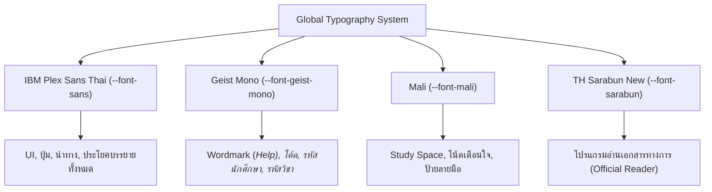

# iHelp Brand Identity, Design System & Style Guide (คู่มือมาตรฐานแบรนด์และดีไซน์ซิสเต็ม iHelp)

คู่มือนี้กำหนดมาตรฐานอย่างเป็นทางการสำหรับการใช้งานชื่อ, เครื่องหมายคำสัญลักษณ์ (Wordmark), โทนสี (Color Palette), แบบอักษร (Typography), เมทาดาทา (Metadata) และคอมโพเนนต์หลักทั้งหมดของ **iHelp** เพื่อให้ประสบการณ์การใช้งาน โค้ด และสื่อประชาสัมพันธ์ทั้งหมดเป็นมาตรฐานเดียวกันทั่วทั้งโปรเจกต์

---

## สารบัญ (Table of Contents)

1. [แนวคิดและปรัชญาของแบรนด์ (Brand Concept & Metaphor)](#1-แนวคิดและปรัชญาของแบรนด์-brand-concept--metaphor)
2. [กฎ 4 ข้อของการเขียนชื่อแบรนด์ (The 4 Naming Rules)](#2-กฎ-4-ข้อของการเขียนชื่อแบรนด์-the-4-naming-rules)
3. [เครื่องหมายเปิด-ปิด `< >` กับตัว `i` (The Angle Bracket Metaphor)](#3-เครื่องหมายเปิด-ปิด---กับตัว-i-the-angle-bracket-metaphor)
4. [ระบบสีประจำแบรนด์ (Brand Color Palette & Tokens)](#4-ระบบสีประจำแบรนด์-brand-color-palette--tokens)
5. [ระบบฟอนต์และตัวอักษร (Typography System)](#5-ระบบฟอนต์และตัวอักษร-typography-system)
6. [คอมโพเนนต์มาตรฐานประจำแบรนด์ (Brand Components Catalog)](#6-คอมโพเนนต์มาตรฐานประจำแบรนด์-brand-components-catalog)
7. [มาตรฐาน Page Titles & Metadata (SEO & Tab Display)](#7-มาตรฐาน-page-titles--metadata-seo--tab-display)
8. [ข้อควรระวังและสิ่งที่ไม่ควรทำ (Do's and Don'ts Checklist)](#8-ข้อควรระวังและสิ่งที่ไม่ควรทำ-dos-and-donts-checklist)

---

## 1. แนวคิดและปรัชญาของแบรนด์ (Brand Concept & Metaphor)

**iHelp** ก่อตั้งขึ้นเพื่อเป็นศูนย์รวมการเรียนรู้ (Learning Hub) สำหรับนักศึกษาคณะเทคโนโลยีสารสนเทศ สถาบันเทคโนโลยีพระจอมเกล้าเจ้าคุณทหารลาดกระบัง (IT KMITL)

- **`<i>`**: มาจากไวยากรณ์แท็ก HTML `<i>` (Italic tag) ซึ่งผสานความหมายของ **Information Technology (IT)**, **Information** และทักษะการเขียนโค้ด (Coding Syntax)
- **`Help`**: สื่อถึงความร่วมมือ การแบ่งปันชีตสรุป สไลด์ ข้อสอบเก่า และการช่วยเหลือกันระหว่างเพื่อนพี่น้องนักศึกษา

การผสานสองคำนี้สะท้อนตัวตนของระบบการศึกษาที่ทันสมัย เข้าถึงง่าย มีชีวิตชีวา และขับเคลื่อนด้วยพลังของชุมชนนักศึกษาไอที

---

## 2. กฎ 4 ข้อของการเขียนชื่อแบรนด์ (The 4 Naming Rules)

การเขียนชื่อแบรนด์แบ่งออกเป็น 4 รูปแบบอย่างเคร่งครัดตามบริบทการใช้งาน:

| รูปแบบ | ตัวอย่าง | บริบทการใช้งาน | ข้อควรระวัง |
|---|---|---|---|
| **`<i>Help`** (Brand Wordmark & Display) | `<Wordmark />`, แท็บเบราว์เซอร์ (`%s · <i>Help`), หน้า Splash, แบนเนอร์หัวเรื่อง | โลโก้แสดงผลใน UI, ส่วนหัวของหน้าเว็บ, ชื่อระบบในหัวเรื่องทางการ | ไม่ใส่ในประโยคเนื้อหาบทความทั่วไป เพื่อป้องกันการสับสนกับ HTML tag |
| **`iHelp`** (Canonical Prose Name) | "ยินดีต้อนรับสู่ iHelp", "ผู้ช่วย iHelp", "ร่วมแชร์เข้าคลัง iHelp", ปุ่ม "ทำโจทย์ใน iHelp" | **ประโยคทั่วไปทุกที่**: เนื้อหาบรรยาย, เอกสาร, FAQ, ข้อความแจ้งเตือน (Toasts/Alerts), ปุ่มกด, บทสนทนาของ Chatbot | **ห้าม** เขียน `IHelp`, `Ihelp`, หรือใส่เครื่องหมาย `< >` ในประโยคภาษาไทย/อังกฤษ |
| **`ihelp`** (Technical Identifier) | `ihelp.chatan.in.th`, `Jesselpetry/ihelp`, `ihelp.users`, LocalStorage `ihelp-*`, CSS `.bg-ihelp-gradient` | โดเมน, URL path, ชื่อ Repository, Schema ฐานข้อมูล, Storage bucket (`ihelp-library`), LocalStorage keys | ใช้ตัวพิมพ์เล็กทั้งหมด ไม่มีวรรคหรือสัญลักษณ์พิเศษ |
| **`%s · <i>Help`** (Metadata Standard) | `<title>ผลการเรียนและคะแนนสะสม Y1·S1 · <i>Help</title>` | Page Title ในแท็บเบราว์เซอร์ และ OpenGraph Title | ให้ Root layout จัดการ template โดยอัตโนมัติ ห้ามเขียนต่อท้ายซ้ำซ้อนในหน้ารายวิชา |

---

## 3. เครื่องหมายเปิด-ปิด `< >` กับตัว `i` (The Angle Bracket Metaphor)

หนึ่งในเอกลักษณ์สำคัญที่สุดของ iHelp คือการใช้เครื่องหมาย Code Tag:

> [!IMPORTANT]
> **เครื่องหมาย `<` และ `>` ต้องอยู่ภายใต้ตัว `i` เท่านั้น (`<i>`)**
> - ส่วนเปิด: `<`
> - ตัวอักษรแท็ก: `i`
> - ส่วนปิด: `>`
> - ตามด้วยคำว่า: `Help` (ตัว H พิมพ์ใหญ่)
>
> ❌ **ผิด**: `<ihelp>` (การเอาเครื่องหมายปิดไปไว้ท้ายสุดของคำว่า help เป็นรูปแบบที่ผิด)
> ❌ **ผิด**: `<i>help` (คำว่า help ต้องขึ้นต้นด้วยตัวพิมพ์ใหญ่เสมอ)
> ❌ **ผิด**: `<i/help>` หรือ `<i>Help</i>` (ไม่ใช้ไวยากรณ์แท็กปิด)
> ✅ **ถูกต้อง**: **`<i>Help`** (ใน Wordmark เรนเดอร์ `<` และ `>` ครอบเฉพาะตัว `i`)

### การเรนเดอร์ในคอมโพเนนต์ `<Wordmark />`:
- เครื่องหมาย `<` และ `>` รวมถึงตัว `i` (`<i>`) แสดงผลด้วยสี **iHelp Primary Blue** (`text-primary` หรือ `#2357A5`)
- คำว่า `Help` แสดงผลด้วยสีตัวอักษรปกติ (`text-foreground`)
- ทั้งหมดเรนเดอร์ด้วยฟอนต์แบบความกว้างคงที่ (`font-mono`) และน้ำหนักตัวหนา (`font-bold`)
- ความยาวรวมเท่ากับ **7 อักขระ** (`<`, `i`, `>`, `H`, `e`, `l`, `p`) ซึ่งสอดคล้องกับแอนิเมชันพิมพ์ตัวอักษร 7 ก้าว (`steps(7, end)`) ในหน้า Splash Screen อย่างสมบูรณ์

---

## 4. ระบบสีประจำแบรนด์ (Brand Color Palette & Tokens)

### 4.1 สีเอกลักษณ์หลัก (iHelp Signature Royal Blue Gradient)
พื้นผิวแบนเนอร์ การ์ดหลัก และตราสัญลักษณ์ของ iHelp ใช้การไล่เฉดสีฟ้าเข้ม 3 ระดับ (Tri-Stop Diagonal Gradient) ที่ทำมุม 135 องศา:

```
#3a72c8 (Cerulean Sky Blue)
       ↘
        #2357A5 (KMITL Sapphire Blue - Brand Base)
               ↘
                #163980 (Deep Prussian Navy)
```

- **CSS Property**: `linear-gradient(135deg, #3a72c8, #2357A5, #163980)`
- **Tailwind Class**: `.bg-ihelp-gradient` (นิยามใน `app/globals.css`)
- **TypeScript Constant**: `IHELP_GRADIENT_CSS` (จาก `@/lib/courses/course-theme`)

### 4.2 พื้นผิวธีมมืดสไตล์ Figma (Dark Charcoal Palette)
ตามข้อกำหนดใน `AGENTS.md` และ `app/globals.css` เว็บไซต์ใช้โทนเทาชาร์โคลเป็นกลาง ไม่ใช้สีน้ำเงินอมฟ้าอิ่มตัวจัด:
- **Canvas / Background**: `#141416` (`--background`)
- **Card Surface**: `#1c1c1f` (`--card`)
- **Popover / Dialog / Dropdown**: `#222226` (`--popover`)
- **Hairline Border**: `oklch(1 0 0 / 8.5%)` หรือ `border-white/10`
- **Text Color**: `#ffffff` (`text-foreground`) และ `text-muted-foreground` (`oklch(0.708 0 0)`)

### 4.3 การแยกแยะสีประจำวิชาออกจากสีแบรนด์กลาง (Subject Sub-Themes)
> [!WARNING]
> สีชมพู **PSCP Pink** (`#db2777` / `#ec4899`) เป็นสีธีมเฉพาะรายวิชา PSCP เท่านั้น **ไม่ใช่** สีประจำแบรนด์ iHelp!
> แบนเนอร์หลัก, แถบนำทาง (Navbar), โลโก้ และองค์ประกอบกลางของระบบจะต้องคงความเป็น **iHelp Signature Royal Blue** เสมอ

| วิชา / หมวด | โทนสี | การใช้งาน |
|---|---|---|
| **iHelp Global** | **Royal Blue Gradient** (`#3a72c8` → `#2357A5` → `#163980`) | Navbar, แบนเนอร์ภาพรวม, เกรด, ตารางเรียน, โลโก้ |
| **PSCP** | PSCP Pink (`#db2777` / `#ec4899`) | ไฮไลต์โค้ด Python, หน้าคลังโจทย์ PSCP |
| **ITF** | Amber / Gold (`#d97706` / `#f59e0b`) | ป้ายสัญลักษณ์ ITF และการบรรยายพื้นฐานไอที |
| **ICS** | Indigo / Violet (`#4f46e5` / `#6366f1`) | ป้ายสัญลักษณ์วิชาคอมพิวเตอร์และระบบตรรกะ |
| **MFIT** | Cyan / Sky Blue (`#0284c7` / `#0ea5e9`) | ป้ายสัญลักษณ์คณิตศาสตร์สำหรับไอที |
| **GE (ศึกษาทั่วไป)** | Emerald Green / Teal | CHARM, FE, DC, FE2 |

---

## 5. ระบบฟอนต์และตัวอักษร (Typography System)

อ้างอิงจาก `docs/FONTS.md` และ `app/layout.tsx` ระบบลงทะเบียน 4 ฟอนต์หลักผ่าน `next/font`:



1. **`IBM Plex Sans Thai` (`--font-sans`)**:
   - ฟอนต์หลักของทั้งเว็บไซต์ รองรับน้ำหนัก `300`, `400`, `500`, `600`, `700`
2. **`Geist Mono` (`--font-geist-mono`, `font-mono`)**:
   - ใช้สำหรับ **Wordmark `<Wordmark />`**, บล็อกโค้ด Python, รหัสนักศึกษา 8 หลัก และรหัสวิชา
3. **`Mali` (`--font-mali`)**:
   - ฟอนต์ลายมือภาษาไทย สำหรับสร้างบรรยากาศเป็นกันเองใน Study Space
4. **`TH Sarabun New` (`--font-sarabun`)**:
   - ฟอนต์มาตรฐานราชการ สำหรับแสดงผลเอกสาร PDF/Markdown สรุปเนื้อหา มีเฉพาะน้ำหนัก 400 และ 700

---

## 6. คอมโพเนนต์มาตรฐานประจำแบรนด์ (Brand Components Catalog)

คอมโพเนนต์ที่เกี่ยวข้องกับแบรนด์ทั้งหมดถูกจัดสรรไว้ใน `@/components/brand`:

### 6.1 `<Wordmark />` (`components/brand/wordmark.tsx`)
คอมโพเนนต์แสดงผลเครื่องหมายคำ iHelp:
```tsx
import { Wordmark } from "@/components/brand/wordmark";

// แสดงผลแบบเต็มพร้อมสี: <i (ฟ้า) Help (ขาว/ดำ)
<Wordmark />

// แสดงผลแบบข้อความล้วนสำหรับ Page Heading: <i>Help
<Wordmark plain />

// แสดงผลสำหรับข้อความบรรยาย: iHelp
<Wordmark asProse />
```

### 6.2 `<BrandBanner />` (`components/brand/brand-banner.tsx`)
แบนเนอร์มาตรฐานของ iHelp ที่รวมการไล่เฉดสีฟ้า ลายน้ำโปร่งใส และการจัดวางหัวเรื่อง:
```tsx
import { BrandBanner } from "@/components/brand/brand-banner";

<BrandBanner
  watermarkCode="IT"
  title="ผลการเรียนและคะแนนสะสม"
  subtitle="ศูนย์รวมผลการเรียนและคำนวณ GPA รายบุคคล"
  action={<IdentityPill />}
/>
```

### 6.3 `<BrandBadge />` (`components/brand/brand-badge.tsx`)
ป้ายกำกับรหัสวิชาหรือสถานะ:
```tsx
import { BrandBadge } from "@/components/brand/brand-badge";

<BrandBadge variant="gradient">ITF</BrandBadge>
<BrandBadge variant="glass">Semester 2 / 2026</BrandBadge>
```

### 6.4 `<CourseWatermark />` (`components/course-watermark.tsx`)
ตราสัญลักษณ์คณะ IT KMITL หรือสัญลักษณ์ประจำวิชาแบบลายน้ำ:
- กำหนดสีเป็น **Monochrome White** (`monochrome="currentColor"` ร่วมกับ `text-white`)
- ค่าความโปร่งแสงอยู่ที่ **25% (`opacity-25`)**
- ไม่ใส่ drop-shadow เพื่อให้สบายตา

---

## 7. มาตรฐาน Page Titles & Metadata (SEO & Tab Display)

เพื่อป้องกันปัญหาชื่อแบรนด์ซ้ำซ้อนในแท็บเบราว์เซอร์ (เช่น `ตารางเรียน · iHelp · <i>Help`):

### กฎการตั้งค่า Metadata:
1. **Root Layout (`app/layout.tsx`)** เป็นผู้กำหนด Template หลัก:
   ```ts
   title: {
     default: `${SITE.name} · ${SITE.tagline.th}`, // <i>Help · คลังเรียนรู้ IT KMITL
     template: `%s · ${SITE.name}`,                // %s · <i>Help
   }
   ```
2. **หน้าย่อย (Child Pages)** ให้ประกาศเฉพาะชื่อของหน้านั้น ๆ **โดยไม่ต้องเขียน `· iHelp` หรือ `· ${SITE.name}` ต่อท้าย**:
   ```ts
   // ✅ ถูกต้อง:
   export const metadata: Metadata = {
     title: "ผลการเรียนและคะแนนสะสม Y1·S1",
   };
   // Next.js จะเรนเดอร์ในแท็บเบราว์เซอร์เป็น:
   // "ผลการเรียนและคะแนนสะสม Y1·S1 · <i>Help"
   
   // ❌ ผิด:
   export const metadata: Metadata = {
     title: `ผลการเรียนและคะแนนสะสม Y1·S1 · ${SITE.shortName}`,
   };
   // จะทำให้เกิดชื่อซ้ำ: "ผลการเรียนและคะแนนสะสม Y1·S1 · iHelp · <i>Help"
   ```
3. **OpenGraph & Twitter Title**:
   ใช้ `${TITLE} · ${SITE.name}` เพื่อให้พรีวิวบนโซเชียลมีเดียแสดงชื่อแบรนด์อย่างเป็นทางการ

---

## 8. ข้อควรระวังและสิ่งที่ไม่ควรทำ (Do's and Don'ts Checklist)

```
┌──────────────────────────────────────┬──────────────────────────────────────┐
│ ✅ DO (สิ่งที่ควรทำ)                   │ ❌ DON'T (สิ่งที่ห้ามทำ)              │
├──────────────────────────────────────┼──────────────────────────────────────┤
│ <i>Help ในโลโก้และแท็บเบราว์เซอร์     │ <ihelp> หรือ <i>help                 │
│ iHelp ในประโยคบรรยายและคำชี้แจง      │ IHelp หรือ Ihelp                     │
│ ใช้ <Wordmark /> ในส่วนหัวของหน้า     │ พิมพ์โค้ดสีและสแปนแยกเองแบบไม่สม่ำเสมอ │
│ โทนฟ้า iHelp Blue Gradient ในแบนเนอร์ │ นำสีชมพู PSCP ไปใช้เป็นแบนเนอร์ส่วนกลาง│
│ ฟอนต์ monospace กับ Wordmark เสมอ     │ ใช้ฟอนต์ sans-serif กับ Wordmark     │
│ ลายน้ำขาวโปร่งแสง 25% ไม่ใส่เงา       │ ลายน้ำสีสดหรือติด drop-shadow หนา    │
│ ปล่อยให้ Root Template จัดการต่อท้าย  │ ใส่ · iHelp ต่อท้าย title หน้าลูกซ้ำ  │
└──────────────────────────────────────┴──────────────────────────────────────┘
```
